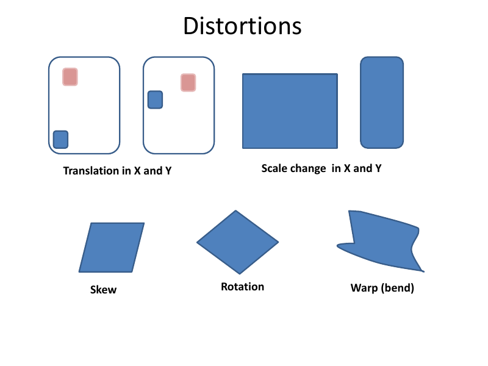
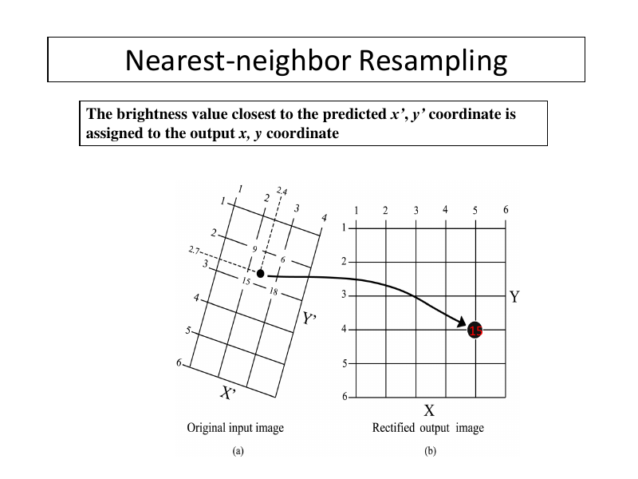
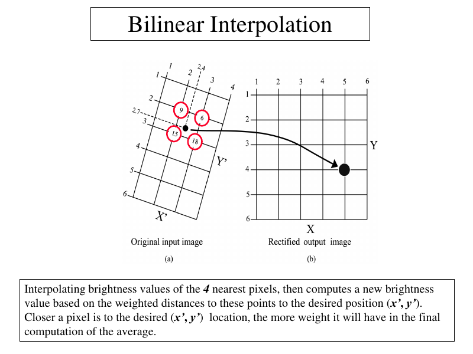
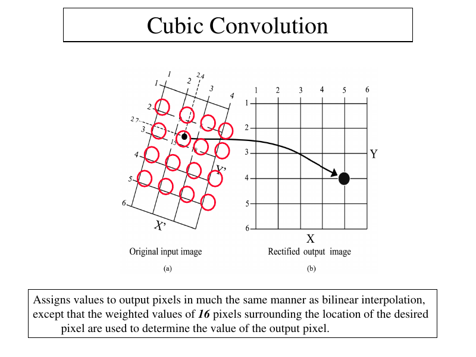
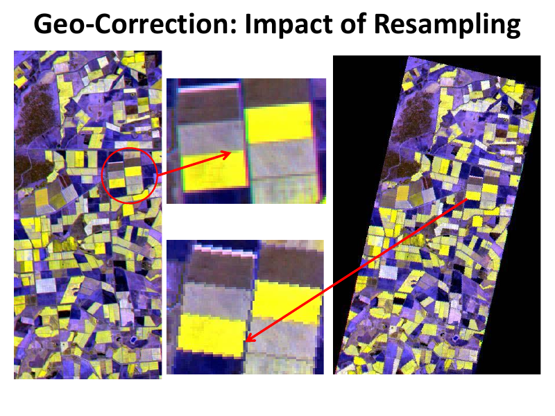
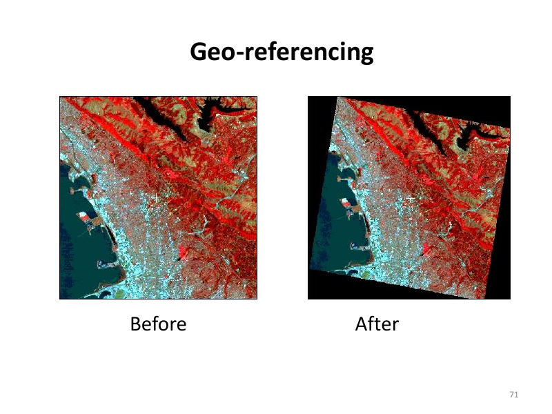

# Lecture 1 — Geometric Corrections (Part I)

> **Big idea in one line:** Satellite/aerial images come out "bent and shifted." Geometric correction puts every pixel back in its true map location (its correct x, y position) so we can measure distance, area and direction correctly.

---

## 1. What is Geometric Correction?

When a sensor captures an image, the pixels are **not** sitting at their correct map positions. They are distorted (stretched, skewed, shifted). Geometric correction is the **pre-processing** step that removes this distortion.

**Why we need it:**
- So each pixel sits at its proper **planimetric (x, y)** map location.
  - *Planimetric* = position on a flat 2D plane (ignores height/elevation).
- So the image can be combined with other data in a **GIS** (Geographic Information System) or **SDSS** (Spatial Decision Support System).
- So we can extract **accurate distance, area (polygon), and direction (bearing)**.

**When it is required (4 main uses):**
1. To transform an image to match a **map projection**.
2. To locate **points of interest** on both map and image.
3. To **overlay images taken at different times** (or by different sensors) of the same area.
4. To **overlay images and maps** together for combined GIS analysis.

---

## 2. Geometric Errors — the two families

Images can have two kinds of geometric error. The key skill is recognising the **source** of the error and whether it is **systematic (predictable)** or **non-systematic (random)**.

| Type | Other name | Caused by | Predictable? | Easy to fix? |
|------|-----------|-----------|--------------|--------------|
| **Internal** | Systematic | The sensor system itself + Earth rotation/curvature | Yes (predictable) | Easier |
| **External** | Un-systematic / Random | Random platform movement during capture (altitude/attitude) | No (random) | Harder |

> **Memory tip — "Internal = Systematic, External = Random"** → **"I-S, E-R"** (say it as "Is-Err").

### Sources of Systematic (predictable) errors — "SPER C"
- **S**kew — from **Earth's rotation** (skews/slants the image).
- **P**anoramic distortion — scale grows away from **nadir** (the point directly below the sensor), because the sensor views a larger ground area at the edges.
- **R**elief distortion — caused by terrain height differences.
- **E**arth **C**urvature — the curve of the Earth.

> **Acronym to remember systematic sources → "SPREC"** = **S**kew, **P**anoramic, **R**elief, **E**arth **C**urvature.

### Sources of Un-systematic (random) errors — "Two A's"
- **Attitude** of sensor → **Roll, Pitch, Yaw** (the platform rotating about its 3 axes).
- **Altitude** of sensor → variations in flying height.

> **Memory tip:** The two random sources both start with **"Alt-"** and **"Att-"** → **Altitude & Attitude**. For attitude rotations remember **"RPY"** = **R**oll, **P**itch, **Y**aw.

*Note: all error sources contribute unequally to the total distortion.*

---

## 3. Correcting the two error types

**Systematic error correction:**
- Corrected using **platform ephemeris** data + knowledge of internal sensor distortions.
  - *Ephemeris* = the calculated positions, velocities, etc. of a celestial object (here the satellite) at regular intervals.
- Usually **already removed by the satellite data provider** after acquisition.
- Easily fixed with **formulas/models**.

**Un-systematic (random) error correction:**
- **Cannot** be corrected accurately without enough **GCPs** (Ground Control Points).
- If left uncorrected, the image stays **non-planimetric** (pixels not in proper x, y).

---

## 4. Types of Distortion (visual)

Common geometric distortions you should recognise:

- **Translation** in X and Y (whole image shifted)
- **Scale change** in X and Y (stretched/shrunk)
- **Skew** (slanted into a parallelogram)
- **Rotation** (turned)
- **Warp / bend** (curved distortion)

- **Acronym:** BTSSR (bend , translation , scale change , skew , rotation , bend)



---

## 5. Ground Control Points (GCPs)

A **GCP** is a feature on the Earth's surface (like a road intersection) that you can clearly identify **both on the image and on a map**, and locate accurately.

A GCP gives you **two sets of coordinates for the same point**:
- **Image coordinates** → row *i* and column *j* (also written x, y).
- **Map coordinates** → X, Y (latitude/longitude in degrees, feet in State Plane, or meters in UTM — Universal Transverse Mercator).

> **Memory tip:** GCP = "a point I can pin on the **picture** AND on the **map**." Lowercase **(i, j)** = image; uppercase **(X, Y)** = map.

These paired coordinates (i, j ↔ X, Y) from many GCPs are used to calculate **transformation coefficients** that rectify the image to a standard datum and map projection.

**Sources to get accurate GCPs:**
- Hard-copy planimetric maps
- Digital planimetric maps
- **GPS** (Global Positioning System) instruments
- Field surveys
- **DOQs** (Digital Orthophotoquads) — already rectified for tilt and relief using **"Differential Rectification"** (e.g., USGS DOQQs — Digital Orthophoto Quarter Quadrangles).
  - *Differential Rectification* = same as standard rectification but applied to **small patches** to keep a common scale.

---

## 6. Rectification vs Registration (don't confuse these!)

Both align an image to a reference. The difference is **what the reference is**.

| Term | Reference is... | Also called |
|------|-----------------|-------------|
| **Rectification** | a **map** projection | Image-to-**map** rectification |
| **Registration** | another **image** of the same area | Image-to-**image** registration |

> **Memory tip:** **"Rectification → map (R & M); Registration → image (R & I... another image)."** Both rely on **human interaction** and use the **same principles**.

**Image-to-Map Rectification:**
- Makes the image geometry **planimetric** (proper x, y).
- Used to measure accurate **area, direction, distance**.
- May **not** remove all distortion (e.g., topographic relief stays).
- Uses GCPs to fit image to map geometry.

**Image-to-Image Registration:**
- Two images of **like geometry** and **same area** placed coincident with each other.
- Used when you **don't** need unique x, y for every pixel.
- Common use: **compare two images from different times** (change detection).

---

## 7. Levels of Geometric Rectification

> **Memory tip — levels go up with effort: "Systematic → 2D GCPs → 3D GCPs."**

- **Level 1** (zero/first level): mostly **systematic errors** corrected (original rectification).
- **Level 2**: uses **GCPs (X, Y)** + transformation → *geometric rectification*. Good when the area is **small and flat**.
- **Level 3**: uses **3D GCPs + DEM** (Digital Elevation Model) + transformation → **ortho-rectification** (removes relief too).

---

## 8. The Geometric Correction Process — 2 steps

The full process has two interpolations:

1. **Spatial Interpolation** — figures out the geometric relationship between **image pixel coordinates (x, y)** and **map coordinates (X, Y)**. GCP pairs establish this relationship.
2. **Intensity Interpolation** (a.k.a. spectral interpolation / resampling) — decides the **brightness value (BV)** to assign to each output pixel, because a rectified output pixel usually does **not** land exactly on an input row/column.

> **Memory tip — "Where + What":** Spatial = figure out **WHERE** the pixel goes; Intensity = figure out **WHAT** value (brightness) it gets.

---

## 9. Spatial Interpolation using GCPs (the math)

We compute transformation functions that relate distorted-image coordinates to correct map coordinates:

```
x = f1(X, Y)
y = f2(X, Y)
```
- (x, y) = distorted image coordinates (column, row)
- (X, Y) = correct map coordinates
- (f1, f2) = transformation functions built from GCPs

Usually **low-order polynomials** are used.

### Polynomial (Affine) Model — 1st order

Two equations per GCP:
```
x = a0 + a1X + a2Y
y = b0 + b1X + b2Y
```
This accounts for **6 parameters** (6 unknowns):

> **The 6 things a 1st-order affine transform fixes → "STARS-2"... easier: Translation(x,y) + Scale(x,y) + Skew + Rotation.**
- Shift / **Translation** in x and y
- **Scale** in x and y
- **Shear** (skew)
- **Rotation**

**Minimum GCPs needed = 3** (3 GCPs → 6 equations → solve 6 unknowns).

### General formula for minimum number of GCPs:
```
No. of GCPs = ((T + 1) × (T + 2)) / 2
```
where **T = order of the transformation (polynomial)**.

*(For T = 1: (2 × 3)/2 = 3 GCPs.)*

- Small area + moderate distortion → simple transform is fine.
- Large area + more distortion → complex (higher-order) transforms needed.

### Important notes on choosing GCPs
- Use **many more than the minimum** — more is better.
- Be cautious if you used only a few GCPs.
- **Spatial distribution matters** — spread them out to avoid a biased fit. (Hard in sea/water/featureless deserts.)
- Avoid GCPs from **old maps** not revised for a long time.

---

## 10. Intensity Interpolation / Resampling (the 3 methods)

When the output pixel doesn't fall exactly on an input pixel, we **resample** to assign a brightness value. Three methods:

> **Order of increasing complexity & smoothness → "NN → BL → CC"** (Nearest Neighbor → Bilinear → Cubic Convolution) = **0th → 1st → 2nd order**.

### a) Nearest Neighbor (zero-order)
- Assigns the value of the **nearest** uncorrected pixel.
- **Keeps actual (real) pixel values** — but edges look **jagged/blocky** (not smooth).
- ✅ **Recommended if data will be classified afterwards** (real values preserved).



### b) Bilinear interpolation (1st-order)
- Value = **weighted average of the 4 nearest** input pixels (closer pixel = more weight).
- Result = **interpolated (altered) values**; image looks **smoother / more natural**.
- ❌ **Not used before classification** — better for **after** classification.



### c) Cubic Convolution (bicubic / 2nd-order)
- Uses **cubic polynomials** and the **16 surrounding** pixels.
- Values are **altered the most**, but image looks **smoothest and most attractive**.
- **Computationally the most intensive** (heaviest to calculate).



> No single resampling method is best for everything — it depends on the data, the application, and each method's pros/cons.

**Quick comparison table:**

| Method | Pixels used | Values | Look | Best for |
|--------|-------------|--------|------|----------|
| Nearest Neighbor | 1 (nearest) | Real (unchanged) | Jagged | Before classification |
| Bilinear | 4 | Altered | Smooth | After classification |
| Cubic Convolution | 16 | Altered most | Smoothest | Visual quality |



---

## 11. Error & Accuracy — RMS Error

After transformation, leftover errors are called **residual errors**. Their size shows the **quality** of the transformation.

Overall accuracy is given by the **RMS Error (Root Mean Square Error)** — a mean value built from the individual residuals.

### RMS Error formula
```
RMS error = √[ (xr − xi)² + (yr − yi)² ]
```
- **xi, yi** = source (reference) coordinates in the reference image/map
- **xr, yr** = transformed coordinates

> **Memory tip:** RMS = the distance between where a GCP *should* be and where the transform *actually put it*. (It's just the Pythagorean/straight-line distance.)

### How RMS is used (iterative cleanup loop)
1. Find which GCP contributes the **most error**.
2. Compute the **overall RMS error**.
3. If it's above your **threshold (tolerance)**:
   - **Delete** the worst GCP.
   - **Re-compute** transformation parameters.
   - **Re-compute** the error.
   - Repeat.

### RMS Error Tolerance
- Sets a **window of pixels** that counts as "correct."
- Example: tolerance = **1.0** → the output is "correct" if it lands within **1 pixel** of the source (can be off by one pixel in x or y).

---

## 12. End results (geo-referencing in action)
- **Image-to-image geo-referencing** aligns an unrectified image to a rectified/reference image.
- After geo-referencing, images **overlay** correctly with maps and other layers.
- **Orthorectification** goes further and removes relief displacement using a DEM (covered more in Lecture 2).



---

## ⭐ Quick Revision Cheat-Sheet (Lecture 1)

- **Goal of geometric correction:** put pixels in true (x, y) map position → planimetric.
- **Internal = Systematic (predictable)**; **External = Random (attitude/altitude).** → *"I-S, E-R."*
- **Systematic sources → "SPREC":** Skew, Panoramic, Relief, Earth Curvature.
- **Random sources:** Altitude + Attitude (**Roll, Pitch, Yaw = "RPY"**).
- **GCP:** point identifiable on **both** image (i, j) and map (X, Y).
- **Rectification → map; Registration → another image.**
- **Levels 1/2/3:** systematic only / 2D GCPs (flat area) / 3D GCPs + DEM (ortho).
- **Process = Spatial (WHERE) + Intensity (WHAT) interpolation.**
- **1st-order affine = 6 params, min 3 GCPs.** GCP formula: `((T+1)(T+2))/2`.
- **Resampling NN → BL → CC:** NN keeps real values (use before classification), CC is smoothest (16 pixels).
- **Accuracy = RMS error** = straight-line distance between expected and transformed point; drop worst GCP and recompute if above tolerance.
