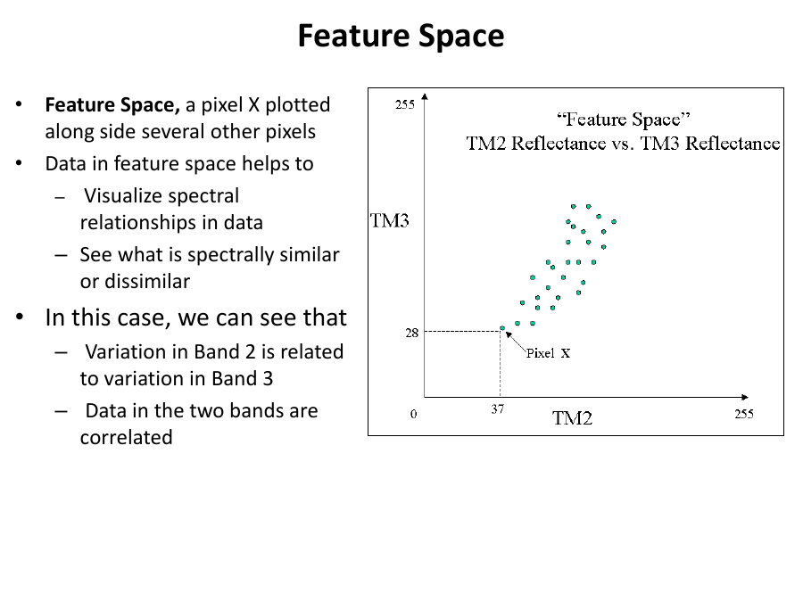
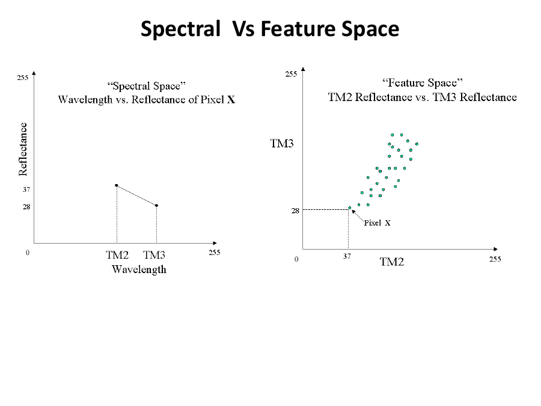
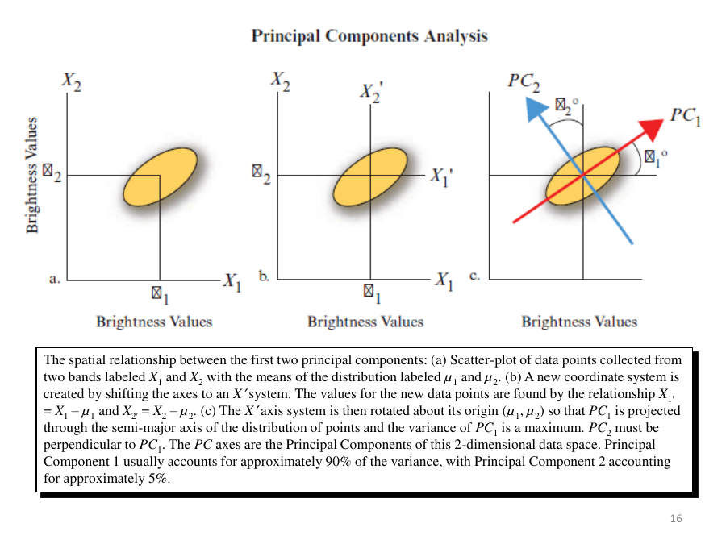
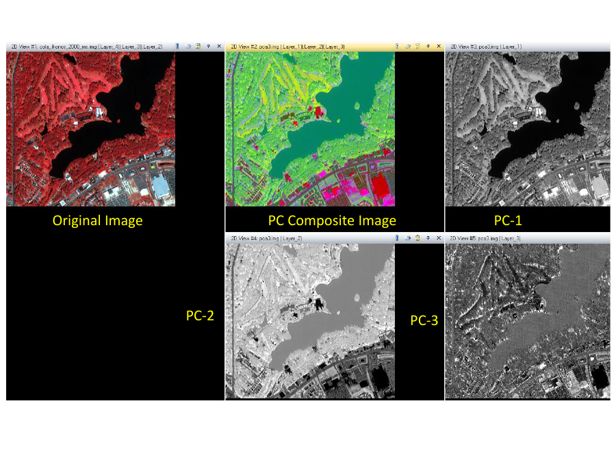
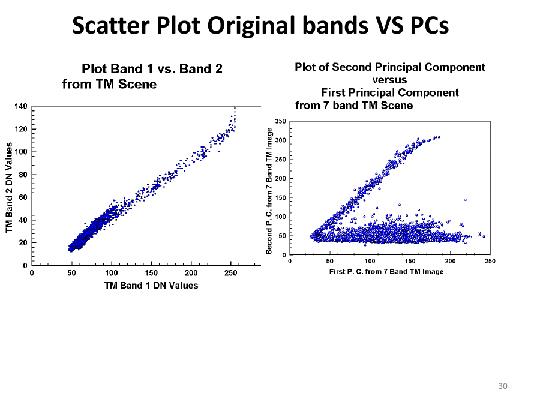

# Lecture 10 — Principal Component Analysis (PCA)

> **Big idea in one line:** Neighbouring image bands are often highly correlated (they repeat the same information). PCA rotates the data onto new axes so that the **first few "principal components" carry almost all the information**, letting us reduce many bands down to a few without losing much.

---

## 1. Image, Spectral & Feature Space (the foundations)

To understand PCA you first need three ways of looking at remote sensing data:

- **Image Space** = the normal picture: **Spatial + Spectral** (where things are + their brightness).
- **Spectral Space** = describes **one pixel at a time** by its **spectrum** (its reflectance across multiple wavelengths/bands). Describing an object using multiple wavelengths = a spectral space.
- **Feature Space** = a plot of **reflectance in one band vs reflectance in another band**, with many pixels shown together.

**Why Feature Space is useful:**
- Lets us **visualize spectral relationships** in the data.
- Shows what is **spectrally similar or dissimilar**.
- Reveals **correlation** — e.g., variation in Band 2 relates to variation in Band 3 → the two bands are **correlated**.

> **Memory tip:** **Image space = the photo; Spectral space = one pixel's fingerprint across bands; Feature space = scatter plot of band-vs-band.**

---

## 2. Spectral Redundancy (the problem PCA solves)

**Spectral redundancy** = the tendency of multiband images to have **high correlation between bands** (bands repeat each other's information).

**Causes of redundancy → "MTS":**
- **M**aterial spectral correlation
- **T**opographic shading
- **S**ensor bands overlap (adjacent bands)

> **Memory tip:** Redundancy = "the bands keep telling the same story." PCA's job is to **remove the repetition**.

---

## 3. What PCA / PCT Does

**The motivation:**
- Images may have **3, 4, 7 bands… or 200+** (hyperspectral).
- So much data → **processing takes a lot of time**.
- **Variance-covariance and correlation matrices** show how pairs of bands relate. Some pairs are **strongly correlated**, some not.
- **Band selection** tries to **identify and remove duplication** → keep **maximum information in the minimum number of bands**.

**Principal Component Transformation (PCT):**
- A method to **compress lots of data** into something that captures the **essence** of the actual data.
- A **feature-space transformation** designed to **remove spectral redundancy**.
- **De-correlates** the data by transforming DN distributions around **new multi-spaced axes**.
- Condenses information from inter-correlated bands into a few variables = **Principal Components (PCs)**.
- ⚠️ **PCA is scene-specific** (depends on the particular image — contrast with TCT, which is fixed).

> **Memory tip:** **PCA = scene-specific; TCT = fixed coefficients.** (The classic exam comparison from Lecture 9.)

**Objective:** **reduce dimensionality** (fewer bands) while **keeping as much information as possible** — reducing original variables into a lower number.

### PCA purposes (summary)
- Find **patterns** and **reduce dimensions** with **minimal information loss**.
- **Reduce computational cost** by extracting the subspace that **best describes** the data.
- Highlight **similarities and differences**.
- Produce **new PC images** that may be **more interpretable** than the originals.

---

## 4. How PCA Works (the rotation)

PCA **rotates the axes of feature space** to take maximum advantage of the data's variation:

1. **PC1 (first axis)** → placed in the direction of **maximum variation**.
2. **PC2 (second axis)** → placed **perpendicular to PC1**, in the direction of the **maximum remaining variation**.
3. Components are **ordered by the amount of variance** they explain.
4. The **first 2–3 components carry most of the real information**; later components only describe **minor variations** (mostly noise).

### The geometric steps (from the diagram)
- **(a)** Start with a scatter-plot of two bands X1, X2 with means µ1, µ2.
- **(b)** **Shift** the axes to the means: X1' = X1 − µ1, X2' = X2 − µ2.
- **(c)** **Rotate** the axes about the origin (µ1, µ2) so **PC1 runs along the long (semi-major) axis** of the data cloud (maximum variance). **PC2 is perpendicular to PC1.**

Typically: **PC1 ≈ 90% of the variance**, **PC2 ≈ 5%**.

> **Memory tip — PCA in 3 moves: "Centre → Rotate → Rank."** Centre on the mean, rotate to the longest spread (PC1), and rank components by variance.

---

## 5. Interpreting PCA Images

- Information in PCA images is revealed better by combining them as **registered overlays**.
- Any **three PC images** can be made into a **colour composite** by assigning them to the **Blue, Green, Red** guns of the monitor → better visualization.

### Scatter plots — before vs after PCA
- **Original Band 1 vs Band 2:** data form a **narrow, almost straight line** → the bands are **correlated** (either could replace the other = redundancy).
- **PC1 vs PC2:** the plotted values are **spread apart** (the data becomes **bimodal**), showing **definite dissimilarities** → the redundancy has been removed and structure revealed.

> **Memory tip:** **Before PCA = thin diagonal line (correlated). After PCA = spread-out cloud (de-correlated).** That spreading is the whole point.

This concept works in 2D but **extends to as many dimensions as there are spectral bands**.

---

## ⭐ Quick Revision Cheat-Sheet (Lecture 10)

- **Three spaces:** Image (spatial+spectral), Spectral (one pixel's spectrum), Feature (band-vs-band scatter).
- **Spectral redundancy** = bands too correlated; causes **"MTS"**: Material correlation, Topographic shading, Sensor band overlap.
- **PCA/PCT** = de-correlates data, compresses many bands into a few **Principal Components**; **reduces dimensionality** with minimal info loss.
- **PCA is scene-specific** (TCT is fixed — key contrast).
- **PC1 = max variance (~90%), PC2 = perpendicular, next-most variance (~5%);** later PCs = minor/noise.
- **Steps: Centre → Rotate → Rank** (shift to mean, rotate PC1 onto longest spread, order by variance).
- **Visualize:** assign 3 PCs to R/G/B for a composite.
- **Scatter:** original bands = thin correlated line → PCs = spread-out (de-correlated) cloud.
