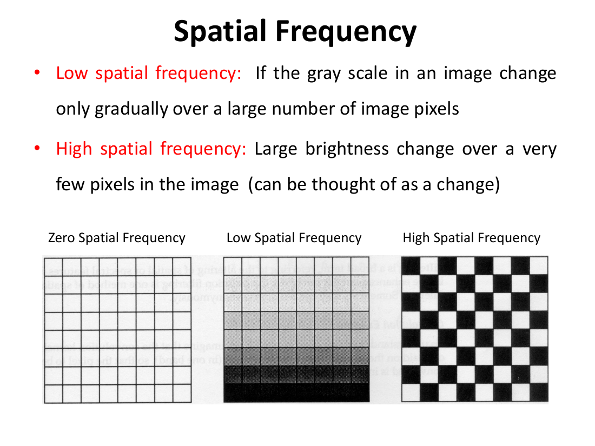
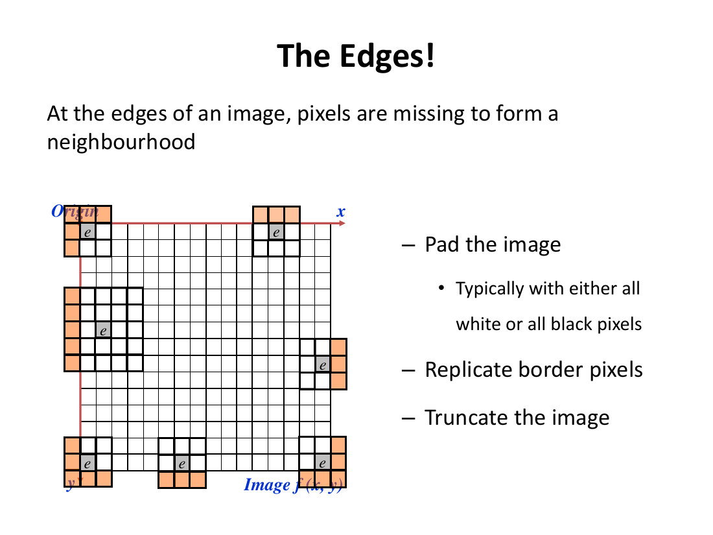
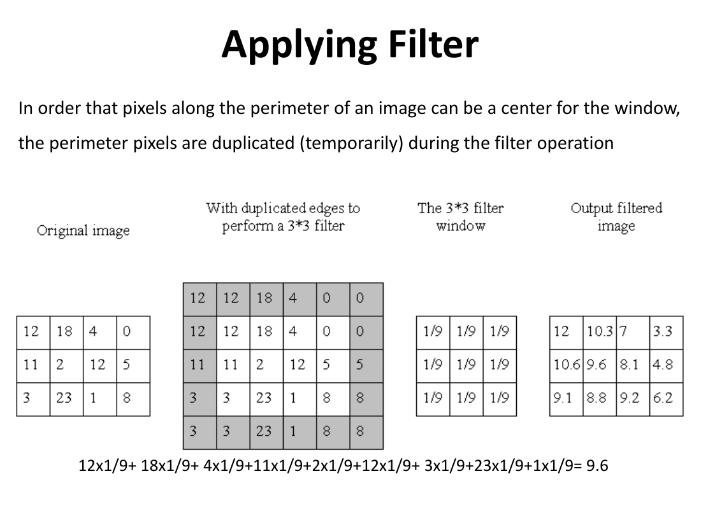
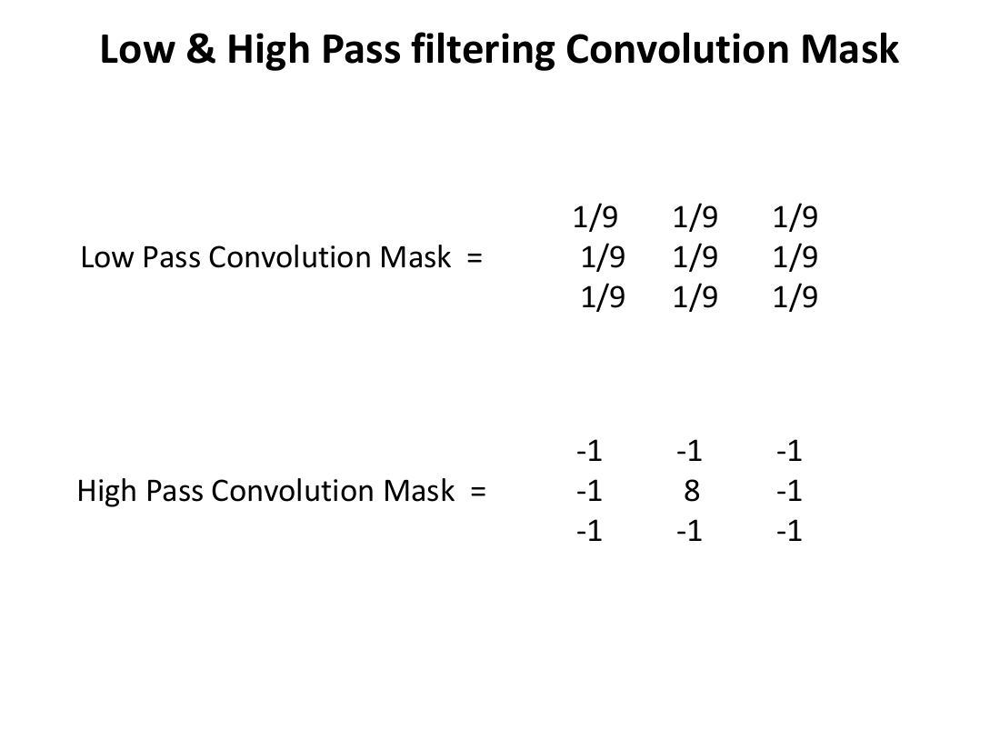
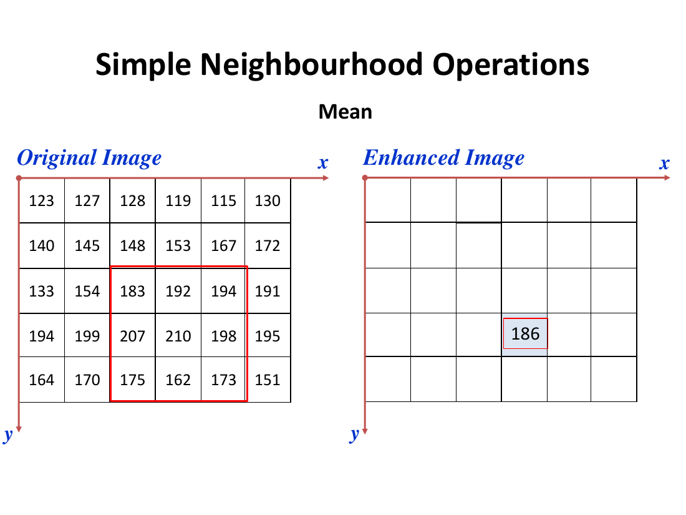
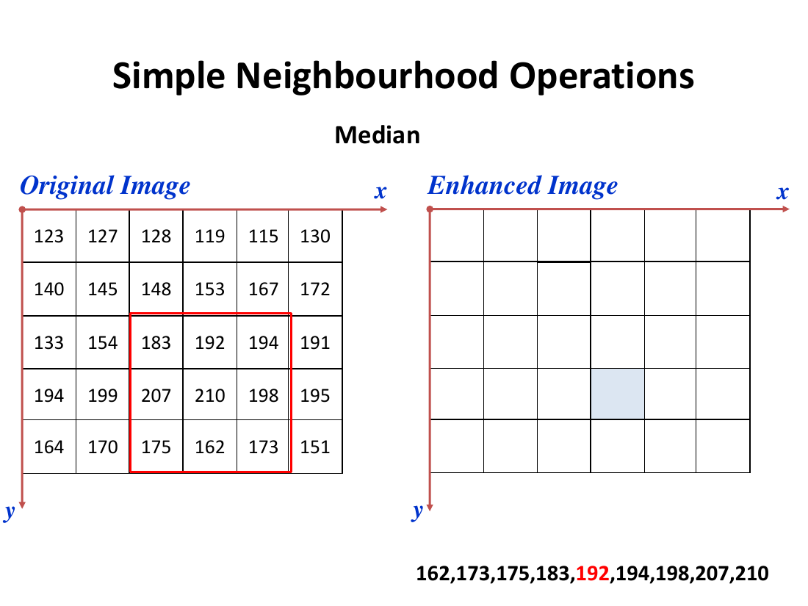

# Lecture 11 — Spatial Convolution Filtering & Spatial Transforms

> **Big idea in one line:** Instead of changing a pixel based on its own brightness, **spatial filtering** changes a pixel based on the **brightness of its neighbours**. By sliding a small grid of weights (a "kernel") over the image, we can **smooth out noise** (low-pass) or **sharpen edges** (high-pass).

---

## 1. Spatial Enhancement & Spatial Frequency

**Spatial enhancement** modifies a pixel's value based on the **values of the surrounding pixels** (its neighbourhood). It deals mostly with **spatial frequency**.

**Spatial frequency** = the **"roughness" of the tonal variations** in an image — the **number of changes in brightness value per unit distance** in any part of the image.

Any image can be split into two basic components of information:
- a **high spatial frequency** component, and
- a **low spatial frequency** component.
- Their **sum** makes up the **original image**.

| Frequency | What it looks like | Where it occurs |
|-----------|--------------------|-----------------|
| **Low spatial frequency** | Gray scale changes **gradually** over **many pixels** | Water bodies, agricultural fields, natural vegetation |
| **High spatial frequency** | **Large brightness change over very few pixels** (a sudden change) | Linear features: rivers, roads, pipelines, borders of fields, buildings |



> **Memory tip:** **Low = smooth & gradual; High = sharp & sudden.** Edges, roads and borders are *high frequency*; lakes and fields are *low frequency*.

A human interpreter quickly spots things with **high spatial frequency and high contrast**. So spatial enhancement aims to **emphasize the high-frequency areas** (the edges) to make them easier for the eye to pick up. These techniques are often called **"edge enhancement"** or **"edge detection."**

---

## 2. Spatial Filtering (the method)

**Filtering** = an operation that **changes the value of a pixel according to the gray values of its surrounding pixels**.

- This process of creating output values that are a **function of an input neighbourhood** is called **convolution filtering**.
- Filters operate in the **row–column space** = the **spatial domain**.

### Two broad filter types
- **Spectral filters** → block or pass energy over various **spectral ranges**.
- **Spatial filters** → emphasize or de-emphasize image data of various **spatial frequencies**. These include:
  - **High-pass filter**
  - **Low-pass filter**
  - **Edge detectors**

> **Memory tip:** **Spectral filter = which colours/wavelengths pass. Spatial filter = which frequencies (smooth vs sharp) pass.**

---

## 3. The Convolution Kernel (how a filter is built)

Although there are many kinds of filters, the basic principle is the same:

- Define a **window size** (the **kernel**), usually with an **odd number of rows and columns** (rows = columns, e.g. 3×3).
- Assign a **weight** to each pixel in the window.
- The numbers in the matrix are called **coefficients (ci)** because they are used as such in the maths.

A 3×3 mask template multiplies each coefficient by the brightness value (BV) under it:

```
Mask = c1×BV1  c2×BV2  c3×BV3
       c4×BV4  c5×BV5  c6×BV6
       c7×BV7  c8×BV8  c9×BV9
```

- The **central pixel BV5** is the one **under investigation** — its value is the one **changed** in the output image.
- **Mask size** determines the **degree of smoothing** and the **loss of detail** (bigger mask = more smoothing).

### How the filter moves (the 3 actions)
Move the window over the whole image, **pixel by pixel**. The output at each pixel = the **sum of the products** of each coefficient with its corresponding pixel value.

> **Memory tip — a filter is just "SHIFT → MULTIPLY → ADD":** shift the window one pixel, multiply each cell by its coefficient, add the results.

### What the coefficients do
| Coefficients | Effect |
|--------------|--------|
| **All positive** | **Blurs** the image |
| **Alternating positive & negative** | **Sharpens** the image |
| **Sum to 1** | **Brightness retained** |
| **Sum to zero** | **Dark image** |

> **Memory tip:** **Sum = 1 → keep brightness; Sum = 0 → goes dark.** All-positive blurs, mixed-sign sharpens.

---

## 4. The Edge Problem

At the **edges of an image**, pixels are **missing** to form a complete neighbourhood (the window hangs off the image). Three ways to handle it:

- **Pad the image** — typically with all **white** or all **black** pixels.
- **Replicate border pixels** — duplicate the perimeter pixels (temporarily) during the filter operation so edge pixels can also be a window centre.
- **Truncate the image** — drop the border.



### Worked example (3×3 mean filter)
With perimeter pixels duplicated, the centre pixel becomes the average of all 9:

```
12×1/9 + 18×1/9 + 4×1/9 + 11×1/9 + 2×1/9 + 12×1/9 + 3×1/9 + 23×1/9 + 1×1/9 = 9.6
```



---

## 5. Low-Pass vs High-Pass Filters

### Low-pass filters
- **Emphasize low spatial frequencies** to **reduce/eliminate noise**.
- Produce an image that looks **smooth or blurred** compared with the original.
- Useful for **increasing homogeneity** (too many speckles), smoothing "stair steps", and **removing "salt and pepper" noise**.

### High-pass filters
- **Emphasize high spatial frequencies** (borders/edges and changes at them).
- **Enhance contrast differences at edges**, thus **sharpening linear features**.
- Example: a road with a clear contrast to its surroundings is made **more distinct** by an edge-enhancement filter.

### The two classic masks
```
                       1/9  1/9  1/9
Low-Pass Mask   =      1/9  1/9  1/9        (all positive, sums to 1 → smooths)
                       1/9  1/9  1/9

                       -1   -1   -1
High-Pass Mask  =      -1    8   -1         (mixed sign, sums to 0 → sharpens)
                       -1   -1   -1
```



> **Memory tip:** **Low-pass = blur (kill noise); High-pass = sharpen (boost edges).** The all-1/9 mask smooths; the centre-8, minus-1 mask detects edges.

### Two kinds of low-pass smoothing
- **MEAN filter** → all pixels have **equal weight**.
- **GAUSSIAN filter** → **distance-weighted**: the **farther a pixel is** from the centre, the **smaller its weight** (closest pixels influence the output most).

---

## 6. Simple Neighbourhood Operations

These are easy filters defined by what they do to the neighbourhood:

| Operation | What it does | Use |
|-----------|--------------|-----|
| **Mean** | Replaces pixel with the **average** of its neighbourhood | **Smooth** an image |
| **Min** | Sets the pixel to the **minimum** value in the neighbourhood | Visual analysis |
| **Max** | Sets the pixel to the **maximum** value in the neighbourhood | Visual analysis only |
| **Median** | Sets the pixel to the **midpoint value** of the sorted set | **Minimize random noise** |

**Median example:** from the set `[1, 7, 15, 18, 24]`, the median is **15** (the middle value).

The **mean** filter assumes pixels are **like their neighbours** and averages them to smooth.





> **Memory tip:** **Mean = average (smooths but blurs edges); Median = middle of sorted values (kills speckle while keeping edges).** Min/Max just grab the darkest/brightest neighbour.

---

## ⭐ Quick Revision Cheat-Sheet (Lecture 11)

- **Spatial enhancement** changes a pixel using its **neighbours**; it works on **spatial frequency** (brightness changes per unit distance).
- **Low frequency** = gradual change (water, fields). **High frequency** = sudden change (roads, edges, buildings).
- **Convolution filtering** = slide an **odd-sized kernel** of **coefficients** over the image. Centre pixel (BV5) is the one changed.
- A filter is **SHIFT → MULTIPLY → ADD**. Mask size sets smoothing + detail loss.
- **Coefficients:** all-positive → blur; alternating ± → sharpen; **sum = 1** → keep brightness; **sum = 0** → dark.
- **Edge handling:** pad (white/black), replicate border, or truncate.
- **Low-pass** = smooth/blur, removes salt-and-pepper noise (MEAN = equal weight, GAUSSIAN = distance-weighted).
- **High-pass** = sharpen edges/linear features. Masks: all-1/9 (low) vs centre-8/−1 (high).
- **Simple ops:** Mean (smooth), Min, Max, **Median (best for random noise, preserves edges)**.
