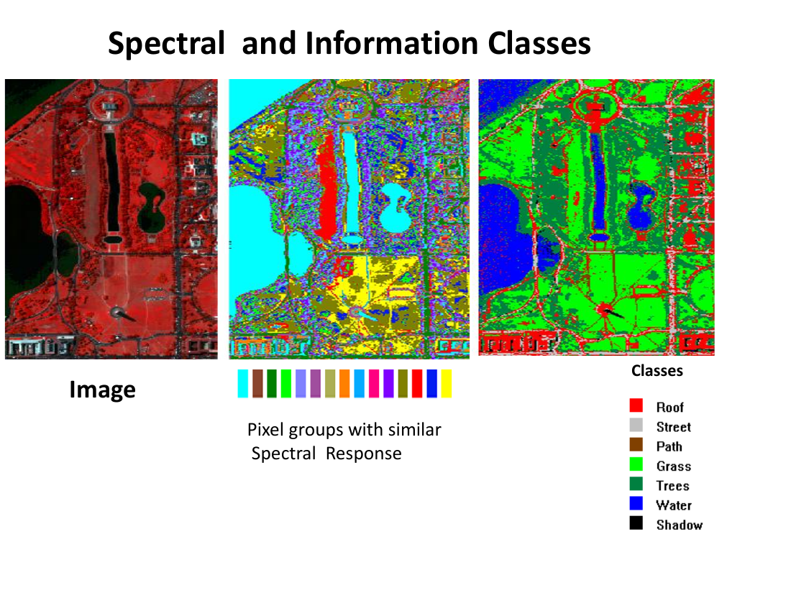
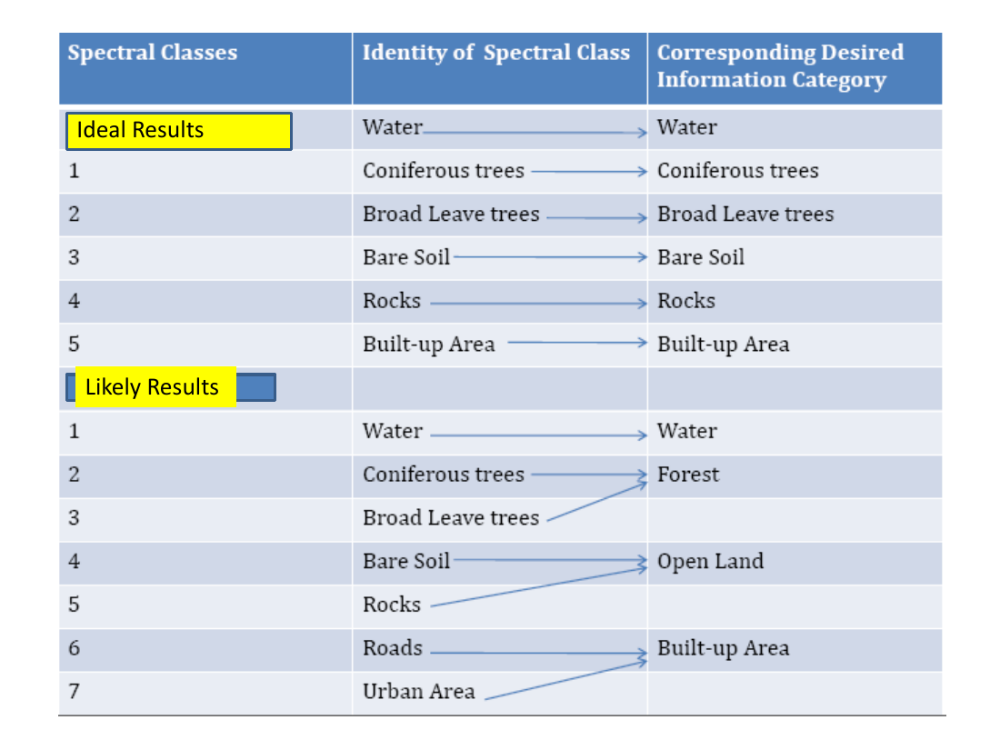

# Lecture 12 — Image Classification (Introduction)

> **Big idea in one line:** Image classification turns raw pixels into **useful information** by **grouping pixels with similar spectral characteristics** and labelling each group as a real-world land cover (water, forest, urban…). It's how an image becomes a **map**.

---

## 1. Where Classification Fits (the typical RS process)

Classification is one step in a whole remote-sensing workflow:

1. **Image data acquisition.**
2. **Importing** images into image-processing software.
3. **Initial statistics & display** to assess image quality.
4. **Preprocessing / image restoration** — radiometric and geometric corrections.
5. **Image enhancement and transformation.**
6. **Image analysis for thematic information extraction** ← *(includes classification)*.
7. **Accuracy assessment.**
8. **Applications** (e.g. change detection).
9. **Integration** with other data in a **GIS**.

> **Memory tip:** Correct → enhance → **classify** → assess accuracy → apply. Classification only makes sense **after** the image has been cleaned up.

---

## 2. What is Image Classification?

- A **process of converting remotely sensed data into useful information**.
- It **automatically assigns a land-cover class category to every pixel** of the image.
- The core task: **identify groups of pixels with similar spectral characteristics**, then **determine which feature/land cover** each group represents.

### Visual Interpretation vs. Digital Classification
| | Visual Interpretation | Digital (Image) Classification |
|--|----------------------|-------------------------------|
| **Who does it** | **Human analyst** | **Computer** |
| **What it uses** | Elements of visual interpretation (shape, tone, pattern…) | **Spectral information** (DNs in one or more bands) |
| **Also called** | — | **Spectral pattern recognition** |

> **Memory tip:** **Visual = a person reading the picture; Classification = a computer reading the spectra.**

---

## 3. Spectral Classes vs. Information Classes (the key distinction)

An image contains **both** kinds of classes, and the analyst must connect them:

- **Spectral classes** = groups of pixels with **nearly uniform spectral characteristics** in all bands. *(What the computer sees.)*
- **Information classes** = the **themes/objects that represent real features on the ground** — classes **humans define** (e.g. deciduous forest, residential land). *(What we want.)*

A **broad information class** can contain **several spectral sub-classes**. For example, a single **"Forest" class** may have spectral sub-classes from variations in **age, species, density, shadowing, or scene illumination**. The analyst decides which spectral classes are useful and how they map to information classes.

### Three outcomes of matching spectral ↔ information classes
| Outcome | Relationship | Result |
|---------|--------------|--------|
| **Ideal** | **One** spectral class ↔ **one** information class | Best results |
| **Likely** | **More than one** spectral class ↔ one information class | Acceptable results |
| **Problematic** | One spectral class ↔ **more than one** information class | **Inaccurate** results |

**Why "problematic" happens** — different ground features can share the **same spectral response**:
- Spectral class **"water"** → could be **Water *or* Shadow**.
- Spectral class **"bare land"** → could be **Bare land *or* Parking area**.

> **Memory tip:** **Ideal = 1↔1, Likely = many→1, Problematic = 1→many.** The problem case is when **one spectrum means two different things** (water vs shadow).

---

## 4. Ways to Perform Classification

Multispectral classification can be done several ways:

- **Training logic:** **Supervised** or **Unsupervised**.
- **Membership:** **Hard** (a pixel belongs to exactly one class) or **Soft / fuzzy** (a pixel can partly belong to several).
- **Spatial unit:** **Per-pixel** or **Object-oriented**.
- **Hybrid approaches** — use **ancillary data/information** to combine methods.

### Per-pixel methods
Conventional approaches work **per pixel** — each pixel is examined **independently** and assigned to a class from its spectral characteristics. The most used per-pixel methods:
- **Supervised** classification.
- **Unsupervised** classification.

### Parametric vs Nonparametric
| | Parametric | Nonparametric |
|--|-----------|---------------|
| **Assumption** | Data are **normally distributed** | **No** normal-distribution assumption |
| **How** | Uses sample data to infer **population parameters** | Applies to non-normal data |
| **Example** | (Maximum likelihood) | **Rule-based decision-tree** classifiers |

### Per-pixel vs Object-oriented
- **Per-pixel** → classify the whole scene **pixel by pixel**.
- **Object-oriented (object-based)** → first **decompose the scene into homogeneous image objects (segments)** via **multi-resolution image segmentation**, then classify those objects using statistics or fuzzy logic.
  - Often used for **high-spatial-resolution imagery**.

> **Memory tip:** **Per-pixel = judge each pixel alone. Object-based = group pixels into objects first, then classify the objects** (great for sharp, high-res images).

---

## 5. Land Use vs Land Cover

| Term | Meaning | Examples |
|------|---------|----------|
| **Land use** | What **people do** on the land (human activity / economic function) | Agriculture, commerce, settlement, residential, industry |
| **Land cover** | The **type of material** present on the landscape | Water, sand, crops, forest, buildings, roads |

> **Memory tip:** **Cover = the material that's there; Use = what humans do with it.** A grass field (cover) could be a park or a pasture (use).

### The USGS Land-Use / Land-Cover Classification System
- Designed to be driven mainly by the **interpretation of remote sensor data** at **various scales and resolutions** (the **Anderson** system, 1976).
- Organised in **levels** of increasing detail:

| Level I (broad) | Example Level II sub-classes |
|-----------------|------------------------------|
| 1. Urban / built-up land | Residential, commercial, industrial, transportation, mixed |
| 2. Agricultural land | Cropland & pasture, orchards/vineyards, feeding operations |
| 3. Rangeland | Herbaceous, shrub/brush, mixed |
| 4. Forest land | Deciduous, evergreen, mixed |
| 5. Water | Streams/canals, lakes, reservoirs, bays/estuaries |
| 6. Wetland | Forested, non-forested |
| 7. Barren land | Salt flats, beaches, sandy areas, bare rock, quarries |
| 8. Tundra | Shrub/brush, herbaceous, bare ground, wet, mixed |
| 9. Perennial snow/ice | Snow fields, glaciers |

- **Level III** adds even finer detail (e.g. Residential → single-family, multifamily, apartments, hostels, mobile-home parks).
- **Finer levels need higher spatial resolution.** There is a **dramatic increase in resolution required** to map Level II (and beyond) compared with Level I.

> **Memory tip:** **More detail (higher level) → finer resolution needed.** Level I you can map with coarse imagery; Level III/IV demands sharp, high-res data.

---

## ⭐ Quick Revision Cheat-Sheet (Lecture 12)

- **Classification** = convert pixels → useful info by grouping **similar spectra** and labelling them as land cover.
- It sits **after** preprocessing/enhancement in the RS workflow, **before** accuracy assessment and applications.
- **Visual interpretation = human**; **digital classification = computer** (a.k.a. **spectral pattern recognition**).
- **Spectral class** = what the computer sees (uniform spectra); **Information class** = what humans want (forest, urban…).
- Matching them: **Ideal (1↔1), Likely (many→1), Problematic (1→many** — e.g. water vs shadow).
- **Choices:** Supervised/Unsupervised · Hard/Soft(fuzzy) · Per-pixel/Object-oriented · Hybrid.
- **Parametric** assumes normal data; **nonparametric** (decision trees) does not.
- **Object-oriented** segments the scene into objects first — best for **high-res** imagery.
- **Land cover = material; Land use = human activity.** USGS/Anderson system has **Levels I–IV**; finer levels need **higher resolution**.
