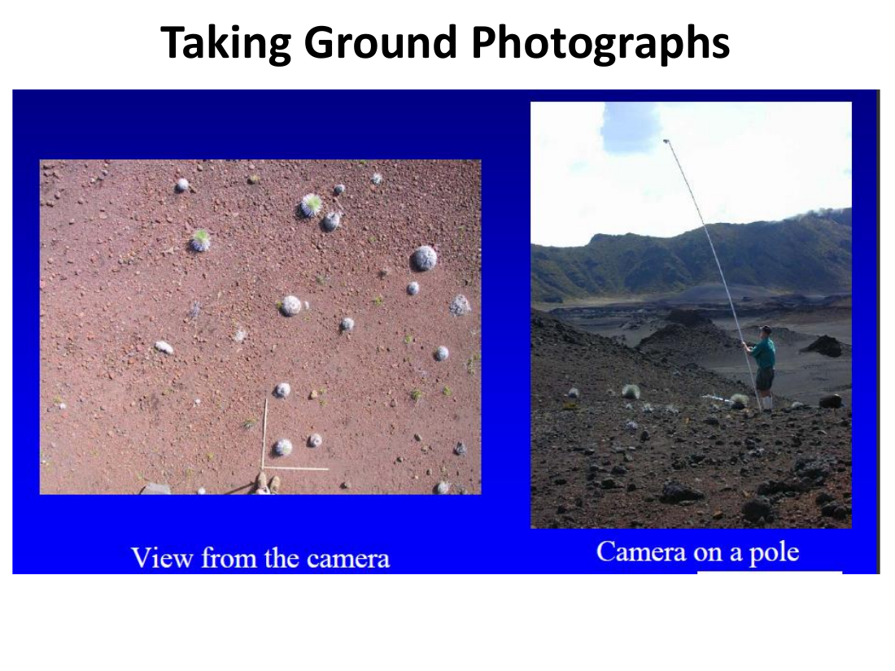

# Lecture 13 — Ground Reference Data

> **Big idea in one line:** A satellite image is only a guess until you check it against reality. **Ground reference data** = the measurements and observations collected on the ground that we use to **interpret, calibrate and verify** what the imagery tells us.

---

## 1. What is Reference Data?

**Reference data** = the **measurements or observations** collected about the **objects, areas, or phenomena** that are being (or have been) remotely sensed.

### "Ground Truth" vs "Ground Reference"
The older term **"ground truth"** suggests perfect, absolute fact — but ground measurements have their own errors. So **"ground reference"** is preferred: it's our **best reference**, not infallible truth.

### Design objectives — ask before collecting
- **What is the end goal?**
- **What information is necessary?**

> **Memory tip:** Decide the **goal first**, then collect data to match it. *"Right goal → right data."*

---

## 2. Why We Collect Reference Data (purposes)

- **To aid analysis and interpretation** of remotely sensed data (e.g. interpreting **classification results**).
- **To verify information** extracted from remote sensing data (e.g. **accuracy assessment**).
- **To design and calibrate a sensor.**

### Data integrity — the four jobs it supports
| Job | What it covers |
|-----|----------------|
| **Data integration** | Matching **scale** and **resolution** between datasets |
| **Data interpretation & analysis** | Making **inferences**, achieving **accurate classification** |
| **Quantify data for application** | Measuring **area** and **location** |
| **Verify / calibrate** | Correcting **sensor or measurement errors** |

> **Memory tip — reference data has two big roles: "Help interpret" and "Check accuracy."** Plus it calibrates the sensor itself.

---

## 3. Types of Reference Data

- **Maps** — relief maps, soil-survey maps, contour maps.
  - A **good starting point**, **scaled to match many resolutions**, and **readily available**.
- **Descriptive reports** and **inventory tallies.**
- **Aerial photography, satellite imagery, DEM/DSM, DOQ** (digital orthophoto quads).
- **In-situ measurements** (taken on site).
- **Ground reference information** — e.g. **type of crops, stage of growth, locals' knowledge, field history**.

> **Memory tip:** Reference data ranges from **maps & reports** (desk) → **imagery & DEMs** (remote) → **in-situ field notes** (boots on the ground).

---

## 4. Agricultural Ground Reference Data

When the application is agriculture, useful field data includes:

| Crop & planting | Field & management | Environment |
|-----------------|--------------------|-------------|
| Crop type & variety | Planting techniques | Soils & soil moisture content |
| Plant population | Date of planting / harvest | Temperature |
| Growth stage | Type of harvesting method | Precipitation |
| Row spacing / direction | Agricultural patterns | — |
| Yield | Species variety | — |
| Previous crop & residue | — | — |

> **Memory tip:** Think **"what, when, how, where"** of the crop — *what* type/variety, *when* planted/harvested, *how* managed, and the *where* (soil, weather).

---

## 5. Assessment of Site Suitability

Choosing a land use depends on **many factors** — physical, economic and regulatory:

- **Physical:** topographic relief, **slope** & slope stability, **bearing strength of soils**, extent of forest cover, available water, flooding potential, soil productivity, prevailing winds.
- **Economic / legal:** land ownership, cost of available land, commodity prices, **government regulations**.

> **Memory tip:** Site suitability = **land (physical) + money (economic) + law (regulations).** All three steer the final land-use choice.

---

## 6. Geo-referenced Data & Field Photos

Tie observations to a **location** so they can be matched to image pixels:

- **Recording observations/measurements with GPS.**
- **Yield-monitor data.**
- **Remotely sensed imagery** — used to **locate areas of interest** within a field, **quantify potential control areas**, and **aid analysis**.

Taking **ground photographs** is a simple, powerful form of reference data — a visual record of conditions on the ground at a known location and time.

---

## 7. Summary — Good Practice

- Data should **reflect / be homogeneous with the level of precision of the end goal**.
- It must accurately represent the **"within-field spatial variability."**
- **Accuracy of information is only as good as the technology and data** used.
- **Most of the time, people collect the *wrong* reference data** — a common, costly mistake.
- **Planning** is what lets you collect the **"right data and information."**

> **Memory tip:** **Plan first.** Reference data is only useful if it **matches the goal's precision** and captures the field's real variability — otherwise you've measured the wrong thing.

---

## ⭐ Quick Revision Cheat-Sheet (Lecture 13)

- **Reference data** = on-ground measurements/observations of what was remotely sensed. Prefer **"ground reference"** over **"ground truth"** (ground data isn't perfect either).
- **Design first:** know the **end goal** and **what information is needed**.
- **Three purposes:** (1) aid interpretation/classification, (2) **verify** results (accuracy assessment), (3) **design/calibrate** sensors.
- **Data integrity jobs:** integration (scale/resolution), interpretation, quantify (area/location), verify/calibrate.
- **Types:** maps (great starting point), reports/tallies, aerial/satellite imagery, DEM/DSM/DOQ, in-situ measurements, field info (crop type, growth stage, history).
- **Agricultural data:** crop type/variety, growth stage, planting/harvest dates, soils, moisture, weather.
- **Site suitability** = physical factors + economic factors + regulations.
- **Geo-reference** everything (GPS); **ground photos** are valuable.
- **Accuracy of info = accuracy of data/tech used.** Bad planning → wrong data; **plan to get the right data.**
