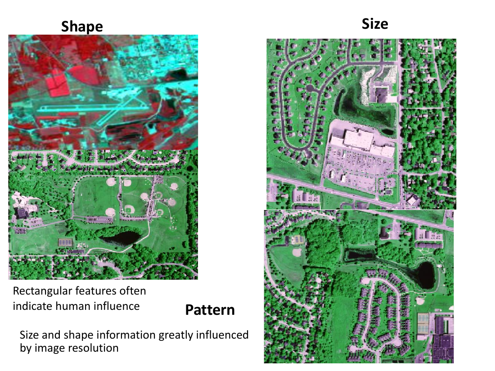
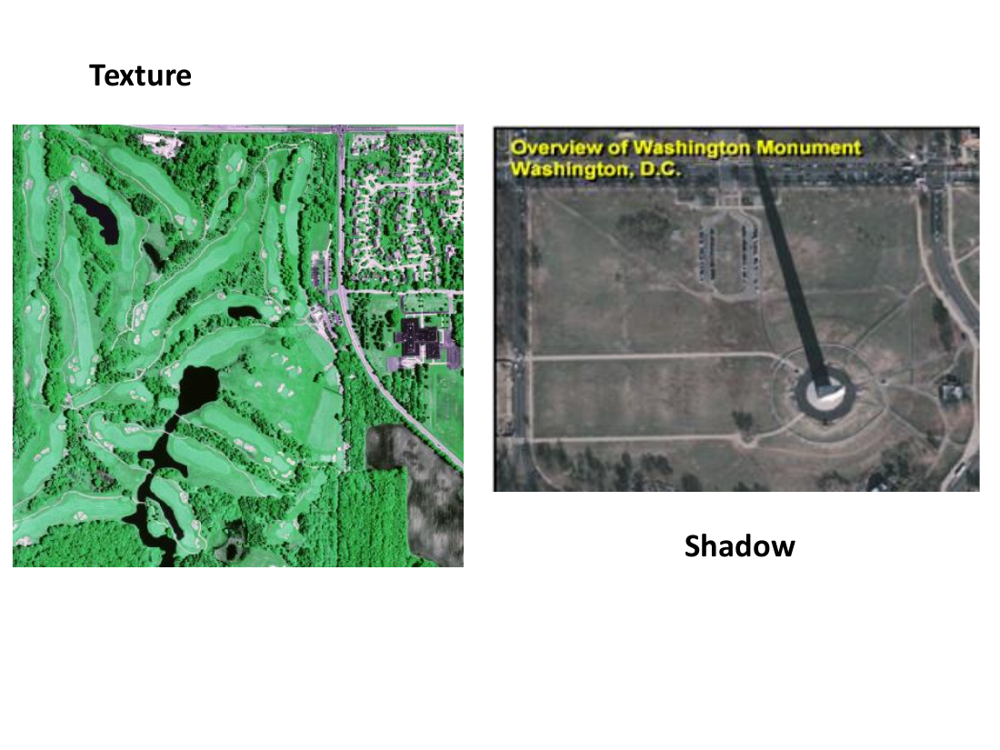
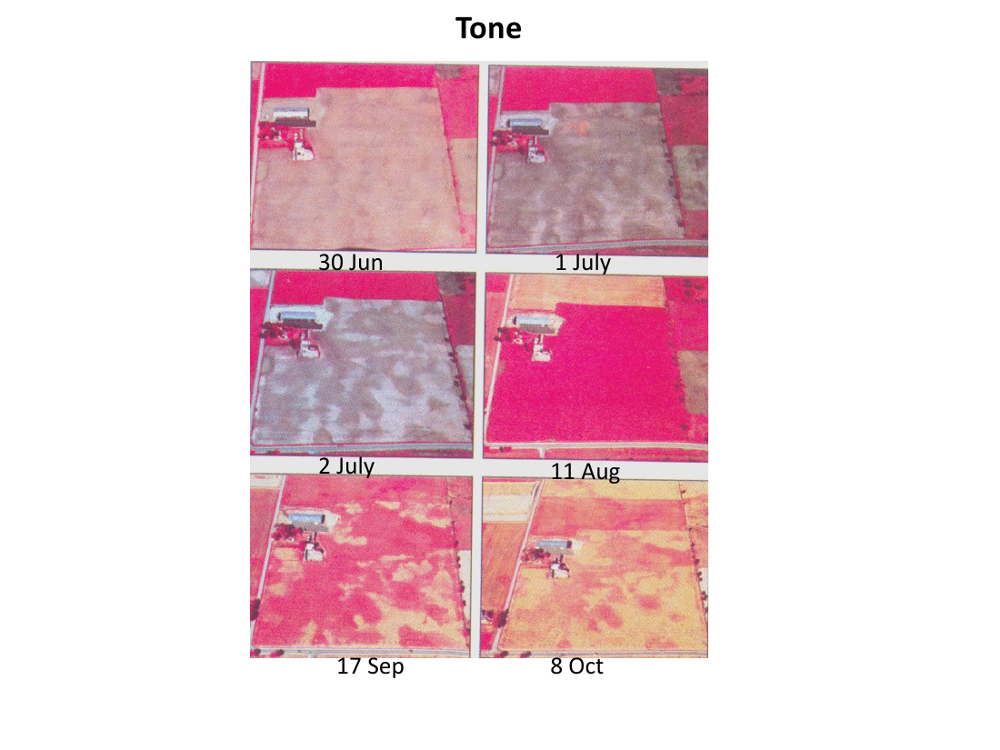

# Lecture 14 — Visual Image Interpretation

> **Big idea in one line:** Before computers, a trained human eye reads an image — using clues like **shape, tone, pattern, shadow and association** — to identify objects and judge their significance. This is **visual image interpretation**, the most intuitive way to extract information from remote-sensing data.

---

## 1. What is Image Interpretation?

When we look at images we see objects of different **shapes and sizes**. Some are **readily identifiable**, others not — depending on the individual's **perception and experience**.

- **Image interpretation** = the **act of examining images to identify objects and judge their significance.**
- When we can **identify what we see and communicate it to others**, we are interpreting an image.

### Why visual interpretation works
- It's the **most intuitive** way to extract information from RS data — it relies on the human ability to relate **colours, shapes and patterns** to **real-world features**.
- Human vision goes **beyond colour perception** — a person can **draw conclusions by observation**.
- It needs **training and experience**, plus **keen observation, imagination and patience**.

### Results depend on
- The **nature of the objects/phenomena**.
- The **quality of the image**.
- **Supporting materials** — maps, reports, and **field observations**.

> **Memory tip:** Interpretation = **see → identify → communicate.** A good interpreter is part observer, part detective, backed by training and reference materials.

---

## 2. The Elements of Visual Interpretation

These are the **clues** an interpreter uses. A common way to remember the core set:

> **Acronym → "STP-SaSh-ToTeAsR":** **S**hape, **T**one, **P**attern, **S**ite, **S**ize, **Sh**adow, **To**ne, **Te**xture, **As**sociation, **R**esolution.
> Simpler grouping to memorise the nine: **Shape, Size, Tone, Texture, Pattern, Shadow, Site, Association, Resolution.**

| Element | What it tells you |
|---------|-------------------|
| **Shape** | Form/outline of an object. **Rectangular/regular shapes often indicate human influence.** |
| **Size** | Dimensions of a feature (relative & absolute). **Heavily influenced by image resolution.** |
| **Tone** | Relative brightness/colour of an object — the most basic element. |
| **Texture** | Frequency of tonal change — the **arrangement of a group of neighbouring pixels** (smooth vs rough). |
| **Pattern** | Spatial arrangement of objects (e.g. orchard rows, street grids). |
| **Shadow** | Reveals an object's **height/profile**; can also hide detail. |
| **Site** | **Topographic / geographic location** of the object. |
| **Association** | What the object is found **near** (related features). |
| **Resolution** | How much detail the image can show; limits what is identifiable. |

> **Memory tip — "tone is what, texture is how rough."** Tone = brightness of one area; **texture = the pattern of tonal change across neighbouring pixels.**

---

## 3. The Key Elements Explained

### Site
- The **location of a feature narrows the list of possible cover types**.
- Site = the **topographic and geographic location** of the object.
- Certain **vegetation/tree types occur only in certain geographic areas**, not everywhere.
- **Relative location** is especially useful for **land use** — e.g. a large building near a **converging network of railroads** is probably a **railway station, not a hospital**.

### Association
- The **relationship between an object and other recognizable features nearby**.
- Identifying features you'd **expect to find together** helps identification.
- Examples:
  - **Commercial properties** → near **major transport routes** with **large parking areas**.
  - **Residential areas** → near **schools and playgrounds**.

### Resolution
- Depends on many factors but **always matters** for identification.
- Knowing the resolution lets you **convert feature dimensions on the image to actual ground dimensions**.
- Some objects are **too small** or have **too little contrast** with their surroundings to be clearly seen.

> **Memory tip:** **Site = where it is; Association = what's beside it; Resolution = how much detail you can see.** Together they often clinch an ID that tone/shape alone can't.

---

## 4. Interpretation Strategies

Image interpretation runs across **levels of complexity**, from simple direct recognition to inference:

- **Direct recognition** — straightforward identification, e.g. spotting a **highway interchange**.
- **Inference** — when you must **deduce** characteristics rather than directly observe them. Conditions of the **site** give clues:
  - **Moist soils** or **loose backfill soil** can imply the presence of **buried objects**.
  - Knowing the **crop calendar** for an area helps **crop identification** (when a crop is visible and at which growth stage).

> **Image interpretation is like detective work** — putting all the pieces of evidence together to "solve the case." For the interpreter, the mystery might be *why one area of an agricultural field looks different from the rest.*

> **Memory tip:** **Direct recognition = "I can see it." Inference = "I can reason it out."** A good interpreter uses both, like a detective.

---

## ⭐ Quick Revision Cheat-Sheet (Lecture 14)

- **Image interpretation** = examining images to **identify objects and judge their significance**; the most **intuitive** way to extract info.
- Needs **training, experience, observation, imagination, patience**; results depend on **object nature, image quality, supporting materials**.
- **Nine elements:** **Shape, Size, Tone, Texture, Pattern, Shadow, Site, Association, Resolution.**
- **Tone = brightness; Texture = tonal change across neighbouring pixels; Pattern = spatial arrangement; Shadow = height clue.**
- **Site** = location narrows cover type (some plants grow only in certain regions; building by rail lines = station).
- **Association** = nearby features (commercial ↔ roads + parking; residential ↔ schools + playgrounds).
- **Resolution** lets you convert image dimensions to ground dimensions; small/low-contrast objects may be invisible.
- **Strategies:** **direct recognition** (see it) vs **inference** (reason it from site clues, crop calendar). Interpretation = **detective work**.
