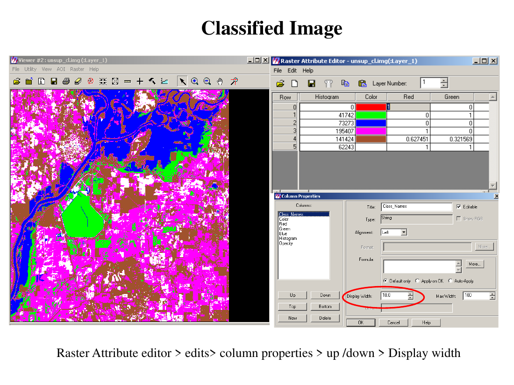
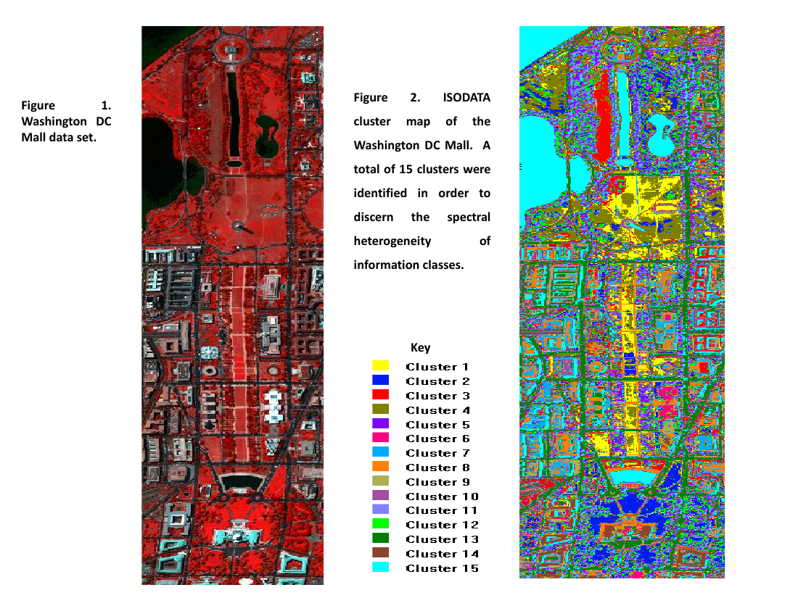

# Lecture 15 — Image Classification: Unsupervised

> **Big idea in one line:** Let the **computer find the natural groupings** of pixels on its own (this is **clustering**), with almost no input from you. Afterwards, the analyst looks at each cluster and gives it a real-world label (forest, water, crops). No training samples are needed up front.

---

## 1. What is Unsupervised Classification?

- Commonly called **clustering**.
- Requires only a **minimal amount of initial input** from the analyst — because clustering **does not need training data**.
- It **searches for natural groupings of pixels** that have **similar spectral properties**.
- The result is a **classification map of *m* spectral classes (clusters)**.
- The analyst then uses **prior knowledge/reference information** to **assign (transform) the spectral classes into thematic information classes** (e.g. forest, agriculture).

⚠️ Some spectral clusters may be **meaningless** because they represent **mixed classes** of Earth-surface materials (different materials sharing a **similar spectral response**). The analyst must understand the **terrain's spectral characteristics** well enough to **label clusters correctly**.

> **Memory tip — unsupervised is "cluster first, label later."** The computer groups by spectra with no training; the human supplies the meaning afterward.

### A two-step process
1. **Iterative process of forming clusters** (done by the algorithm).
2. **Assignment of thematic classes to the clusters** (done by the analyst).

---

## 2. The Two Main Methods

> **Memory tip:** Two algorithms to remember — **K-Means** and **ISODATA**. ISODATA = "K-Means that can split and merge."

The **"K"** in the algorithm names is the **number of groups/clusters** we want to classify the data into.

---

## 3. K-Means Clustering

- An **unsupervised machine-learning algorithm** that groups an **unlabelled dataset** into different clusters.
- You **specify the number of clusters (K) as a constraint** — clustering starts with this **fixed, a-priori number** of clusters.

### K-Means = "Minimum Distance to Means"
- Uses the **minimum spectral distance formula** to form clusters.
- **Begins** with either **arbitrary cluster means** or the means of an **existing signature set**.
- Each repeat (iteration):
  1. The **means of the clusters are shifted** (recalculated).
  2. The **new means are used for the next iteration**.
  3. **Pixel assignments are updated** to the relevant clusters.
- This **iterative assignment continues until there is no substantial change** between successive iterations (it converges).

### Classifying an unknown pixel (Minimum Distance to Means)
- Compute the **distance between the unknown pixel and the mean value of each class/cluster**.
- **Assign the pixel to the closest class.**

The distance is the **Euclidean distance** from a point to a class mean, measured in bands *k* and *l*:

```
Dist = √[ (BVijk − μck)² + (BVijl − μcl)² ]
```

where **μck** and **μcl** are the **mean vectors for class c** in bands *k* and *l*.

> **Memory tip — K-Means loop: "Assign → Recompute means → Repeat until stable."** Every pixel joins its **nearest mean**; means shift; repeat until they stop moving.

---

## 4. ISODATA Clustering

**ISODATA** = **Iterative Self-Organizing Data Analysis Technique** — a **modification of K-Means** that adds two extra abilities:

- **Merging** of clusters (combine clusters that are too close or too small).
- **Splitting** of clusters (split a cluster that is too spread out).

- It is **iterative** — it makes **many passes** through the dataset until the specified results are obtained.
- Like K-Means, it uses the **minimum spectral distance formula**, and the **new cluster means feed the next iteration**.

### When ISODATA stops
- A **maximum number of iterations** has been performed, **or**
- A **maximum percentage of unchanged pixels** has been reached between two iterations.

### Criteria the analyst must specify
| Parameter | What it controls |
|-----------|------------------|
| **Maximum number of clusters** | Most classes the algorithm may identify |
| **Minimum distance** | Cluster pairs with a **Euclidean distance below this** are **merged** into one |
| **Number of iterations** | Max times ISODATA reclassifies pixels & recalculates means (terminates when reached) |
| **Minimum members in a cluster (%)** | If a cluster has **fewer than this % of pixels**, it is **deleted** and members reassigned |
| **Maximum standard deviation (σmax)** | If a cluster's std-dev in any band **exceeds this**, the cluster is **split into two** |

So ISODATA additionally **merges** clusters that are too small or whose centres are too close, and **splits** a big cluster when its standard deviation exceeds a predefined value. After the required clusters form, the analyst uses **prior knowledge / reference data** to **assign information classes** and build the final thematic map.

> **Memory tip — ISODATA = K-Means + "Split & Merge."** Too small or too close → **merge/delete**; too spread out → **split**. That self-organizing flexibility is what the "SO" stands for.

---

## 5. Software Settings (in practice)

When running unsupervised classification (e.g. in ERDAS-style software):

- **Initialize from Statistics** → generate **arbitrary clusters** from the **file statistics** of the entire `.img` file.
- **Use Signature Means** → use **only the selected signatures** in the Signature Editor to generate clusters.
- **Convergence Threshold** → the **maximum percentage of pixels whose cluster assignments can stay unchanged** between iterations (controls when to stop).
- **Skip Factors (X, Y):** speed-vs-detail trade-off:
  - **1** = process **all** pixels,
  - **2** = process **every other** pixel,
  - **3** = process **every third** pixel.
- **Assignment of colour to the clusters** for display.



> **Memory tip:** **Convergence threshold = "how many pixels must settle before we stop." Skip factor = "how many pixels to sample for speed."**

---

## 6. Post-Classification

After clustering, the analyst **interprets** the spectral classes:

- **Compare spectral classes with reference data** to identify what each cluster is.
- Use **spectral reflectance curves** to help identify spectral classes.
- **Define the level of classification** (how detailed).
- **Merge different classes** to reach the desired outcome.
- **Accuracy assessment** through **field truthing or reference data**.

Example: a study of the **Washington DC Mall** data set identified **15 clusters** to capture the **spectral heterogeneity** of the information classes, then mapped them with ISODATA.



> **Memory tip:** **Post-classification = name the clusters, tidy them up, then check accuracy.** Clustering gives shapes; the analyst gives meaning and verification.

---

## ⭐ Quick Revision Cheat-Sheet (Lecture 15)

- **Unsupervised = clustering**: computer finds **natural spectral groupings**, **no training data** needed; analyst **labels clusters afterward**.
- **Two steps:** (1) algorithm forms clusters iteratively, (2) analyst assigns thematic classes.
- **Watch out:** clusters can be **mixed/meaningless** (different materials, similar spectra).
- **Two methods:** **K-Means** and **ISODATA**; **K = number of clusters**.
- **K-Means** = Minimum Distance to Means: start with means → **assign each pixel to nearest mean → recompute means → repeat until stable**. Uses **Euclidean distance** to class mean.
- **ISODATA = K-Means + Split & Merge**; iterates until **max iterations** or **max % unchanged pixels**.
- **ISODATA parameters:** max clusters, **min distance** (merge), iterations, **min members %** (delete), **σmax** (split).
- **Software:** initialize from statistics / signature means; **convergence threshold** (when to stop); **skip factor** (1/2/3 for speed); assign colours.
- **Post-classification:** compare with reference data, use reflectance curves, merge classes, **accuracy assessment**.
