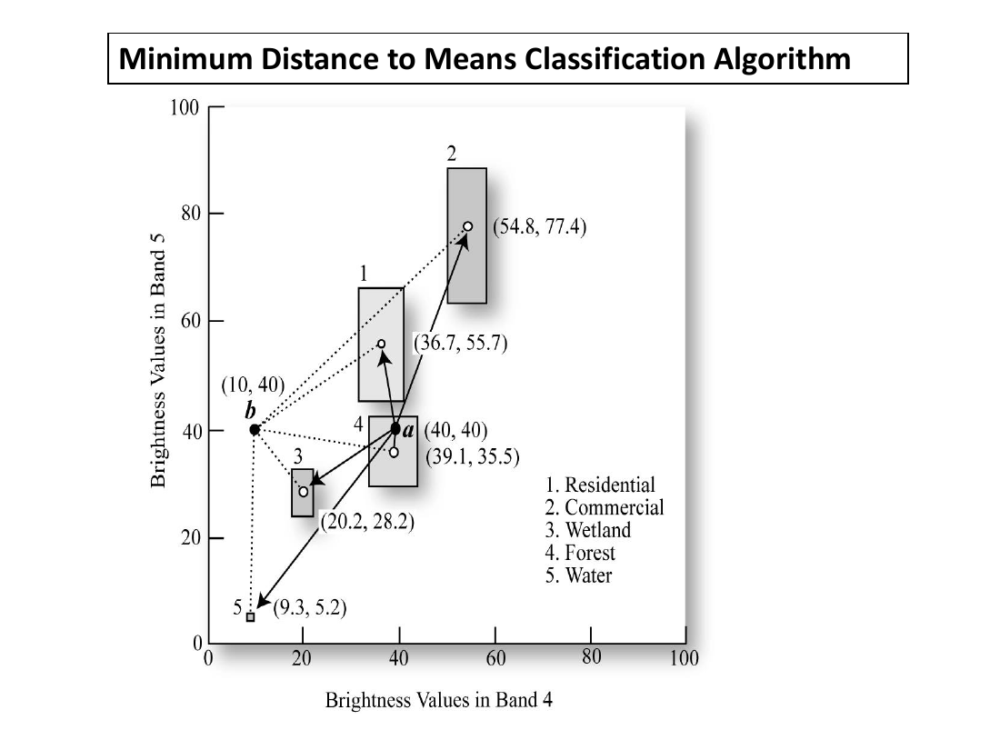
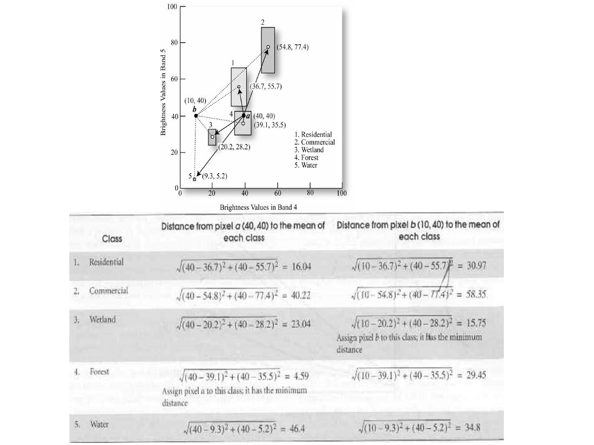
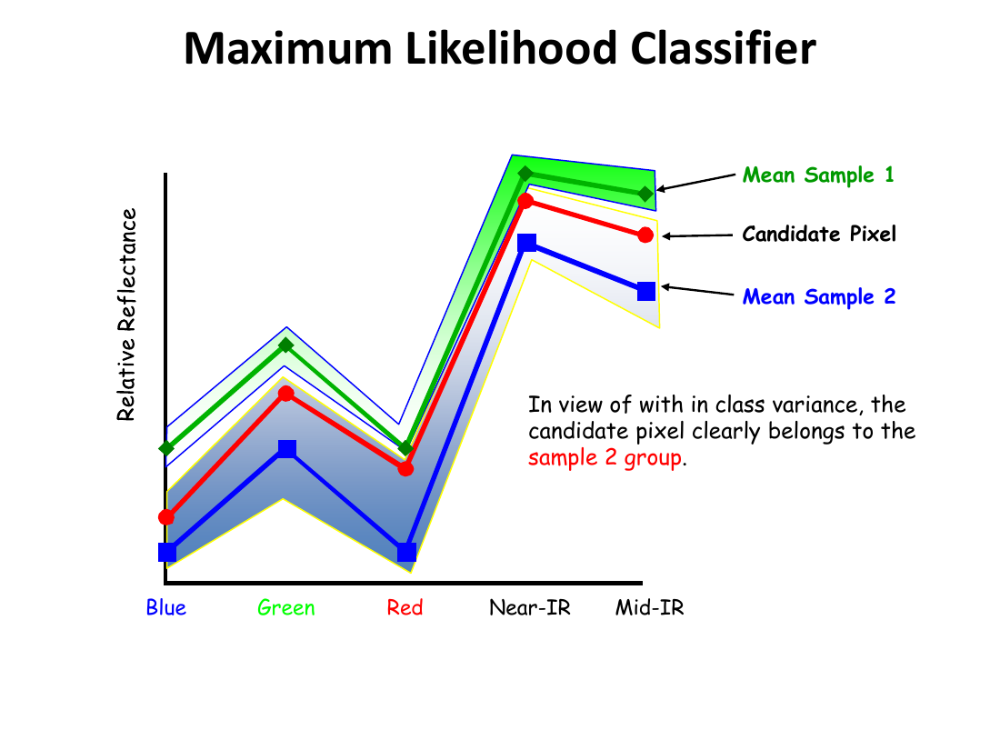
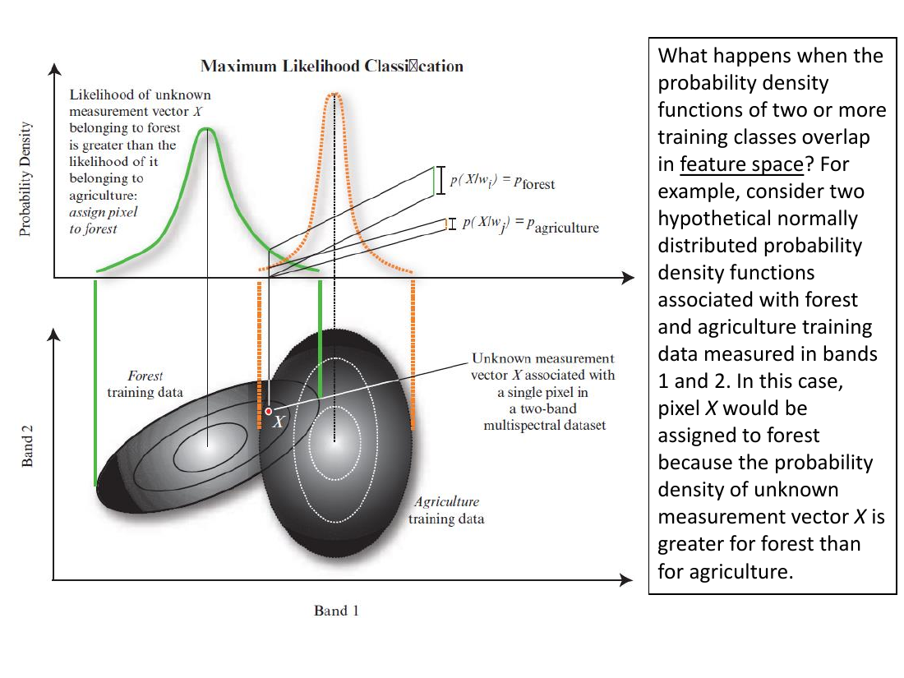
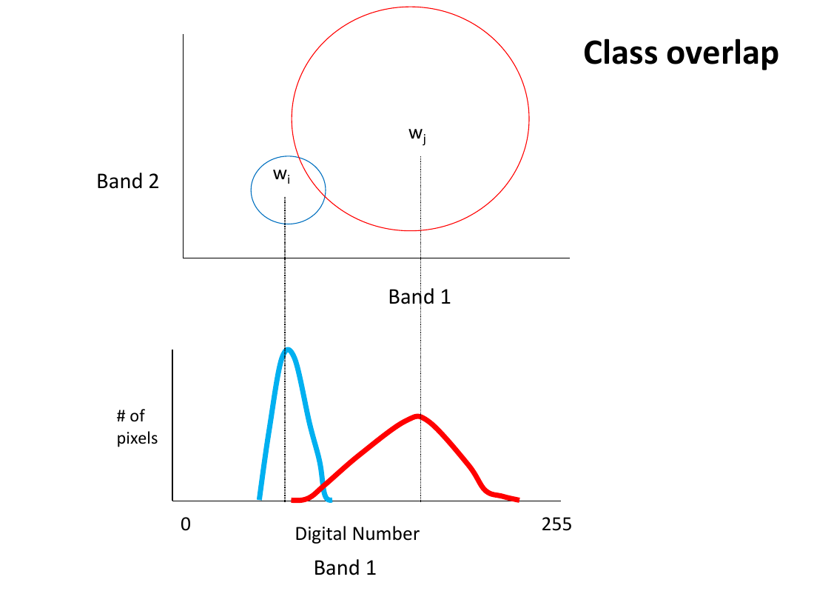
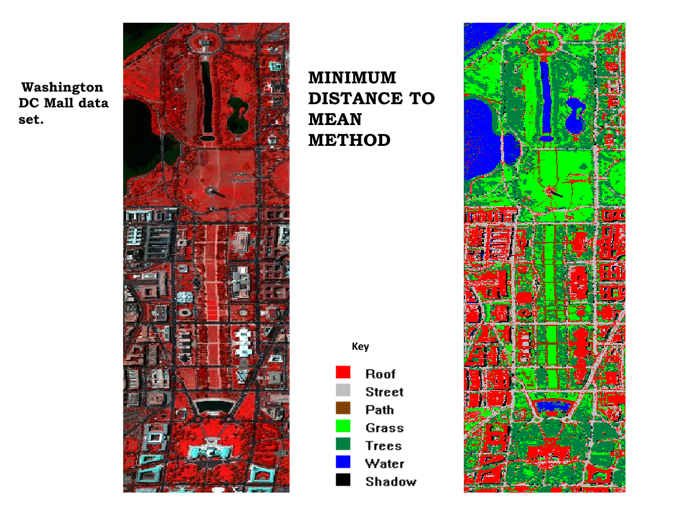
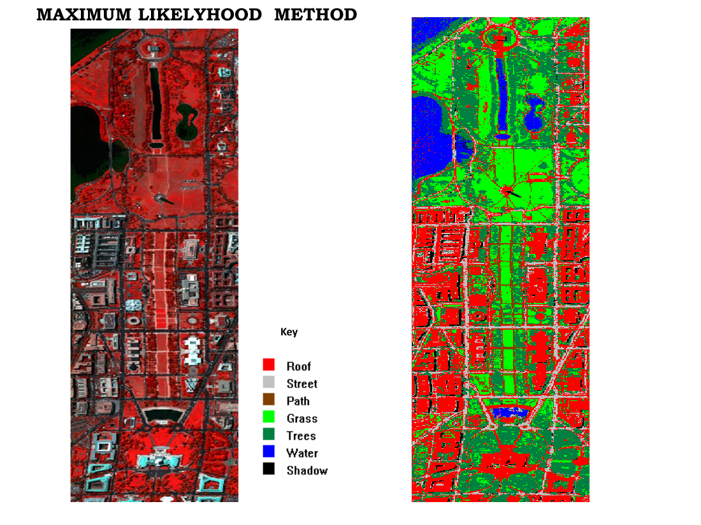
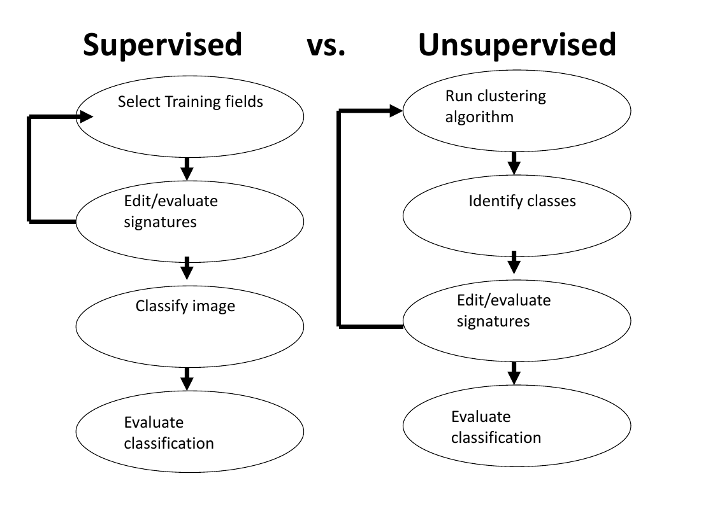

# Lecture 16 — Image Classification: Supervised

> **Big idea in one line:** **You teach the computer first.** You hand-pick small areas in the image where you *know* the land cover (the "training samples"), the computer learns each class's spectral fingerprint, and then it labels every other pixel by comparing it to those fingerprints.

---

## 1. What is Supervised Classification?

- The process of **using samples of known classes** to classify the **remaining unknown pixels** to those classes within the image.
- It **exploits prior knowledge** about the data to identify which of the **predefined informational classes** most closely resembles a given pixel.
- This prior knowledge is supplied as **training samples** (a.k.a. **signatures**).

### The procedure
1. **Analyst selects training samples / signatures** for all classes of interest.
2. **Training samples = a collection of representative pixels** whose **class labels are known** to the analyst.
3. The **statistical characteristics** (means, variances, etc.) of the training samples are used to **train the classifier**.
4. The classifier then **matches the class labels** to unknown pixels.

> **Memory tip — supervised is "label first, classify later."** (The mirror image of unsupervised, which is "cluster first, label later.")

---

## 2. Training Samples — Rules of Thumb

Bad training samples = bad classification. Follow these guidelines:

- Samples must be **homogeneous** and **represent the classes as closely as possible**.
- **Do NOT pick pixels at class boundaries** — those mixed-spectra pixels cause **between-class confusion** (e.g. the edge of a field).
- Samples must capture **within-class spectral variation** (e.g. forest at different ages) but **must not include obvious mixtures** (e.g. deep + shallow water together).
- **Spread samples across the entire image** so they represent the **whole information class**.
- An image with **high within-class spectral variability** and **low between-class spectral similarity** is the hardest to classify well.
- **Sample size rule:** at least **10×N to 100×N pixels per class**, where **N = number of bands** being used. **Minimum number of samples = number of parameters to estimate.**

### What is computed from training data
For each class, from training pixel **brightness values**, calculate:
- **Mean**
- **Standard deviation**
- **Variance–covariance matrix**
- **Correlation matrix**

These statistics **represent the spectral characteristics** of each class and feed the classification algorithm.

> **Memory tip — training samples must be: HOMOGENEOUS · PURE · SPREAD OUT · ENOUGH.** Avoid boundaries and mixtures.

---

## 3. Feature (Band) Selection

After getting training statistics, the analyst decides **which bands are most effective at discriminating each class from all others**:

- This is called **feature selection**.
- The goal: **exclude bands that provide redundant spectral information**.
- Doing so **minimises the computational cost** of classification.

> **Memory tip:** **Feature selection = drop the redundant bands.** Keep only those that actually separate the classes.

---

## 4. The Full Supervised Workflow

1. **Training stage** — analyst's prior knowledge + collection of training samples/signatures.
2. **Band selection** — pick the most discriminating bands.
3. **Classification stage** — categorize each pixel to the class it most closely resembles.
4. **Accuracy assessment.**
5. **Output stage** — results can be used to:
   - Generate **thematic maps**.
   - Tabulate **scene/classification statistics**.
   - Feed the derived information into **GIS** for further analysis.

---

## 5. Minimum Distance to Means (the simple classifier)

> **The decision rule:** assign each unknown pixel to the class whose **mean vector** is **closest**.

- **Computationally simple** and commonly used.
- The user must supply the **mean vector** for each class in each band (μck), from the training data.
- For each unknown pixel **BVijk**, the program **measures the distance** to each class mean and **assigns it to the nearest**.

### Watch out — the rule can fail
Looking at a feature-space scatter:
- **Point 1** is unknown — its **shortest straight-line distance** is to the **Soil** mean, so it is assigned to **Soil**.
- **Point 2** sits at the **edge of the "Urban" spread** but is **slightly closer to "Soil"**. The rule assigns it to **Soil** — but **"Urban" would have been more likely**.
- **Point 3** is **not near any cluster** and is **about equidistant** from Urban, Water, Forest and Heather. The rule may assign it to Urban by chance — a textbook case of **misclassification**.

> **Memory tip:** **Min-distance ignores how spread out a class is.** A pixel just outside a tight cluster can still be closer to a wide cluster's mean even though it visually belongs to the tight one.

---

## 6. Maximum Likelihood Classification (the parametric workhorse)

The most widely used **parametric** classification algorithm.

### Requirements
- The **number of classes must be specified in advance**.
- Certain **statistical characteristics of each class** must be known (estimated from training samples).

### The decision rule
- Based on **probability**.
- For each pixel, compute the **probability of belonging to each of the m classes**.
- **Assign the pixel to the class with the highest probability.**
- Needs the **mean, variance and covariance** of each training class to compute the probability function.

### Why Maximum Likelihood beats Minimum Distance
Min-distance only looks at the **distance to the mean**. Maximum Likelihood also looks at the **variance** (the spread) of each class.

- A candidate pixel may **look closest to Sample 1's mean** by distance alone.
- But when **within-class variance** is considered, the pixel may actually fit **Sample 2's spread** better — and Max-Likelihood correctly assigns it to **Sample 2**.

> **Memory tip — "Min-Distance asks WHERE the mean is. Max-Likelihood also asks HOW SPREAD OUT each class is."** That's why ML is more accurate but needs more statistics.

### When probability density functions overlap
What if two classes' probability density functions **overlap** in feature space?

Example: forest and agriculture training data in bands 1 and 2 form **overlapping normal distributions**. A pixel **X** in the overlap zone is assigned to **forest** because the **probability density** of X is **greater for forest than agriculture**.

### Class overlap and band orientation
The classifier evaluates how distributions overlap in feature space — this is why **good band selection** and **good training samples** matter so much.

---

## 7. Two Worked Maps — Same Data, Two Algorithms

Comparing classifiers on the same **Washington DC Mall** data set shows that the **algorithm choice changes the map**:

---

## 8. Supervised vs Unsupervised — Side by Side

| Step | **Supervised** | **Unsupervised** |
|------|---------------|------------------|
| 1 | Select **training fields** | Run **clustering algorithm** |
| 2 | Edit / evaluate **signatures** | **Identify classes** in the clusters |
| 3 | **Classify** image | Edit / evaluate signatures |
| 4 | Evaluate classification | Evaluate classification |

> **Memory tip:** **Supervised = teach then classify; Unsupervised = cluster then name.** The number of human-vs-machine decisions is just flipped.

---

## ⭐ Quick Revision Cheat-Sheet (Lecture 16)

- **Supervised** = **train on known samples**, classify the rest. Needs **prior knowledge** + **training signatures**.
- **Training rules:** **homogeneous, pure (no mixed/edge pixels), spread across the image, ≥ 10–100 × N pixels per class** (N = bands).
- For each class compute **mean, standard deviation, variance–covariance, correlation matrix**.
- **Feature selection** = drop redundant bands to cut cost.
- **Workflow:** training → band selection → classification → accuracy assessment → output (maps/stats/GIS).
- **Minimum Distance to Means** = assign each pixel to its **nearest class mean**. Simple, but **ignores variance** → fails near edges or for outliers.
- **Maximum Likelihood** = pick the class with the **highest probability** for that pixel; uses **mean + variance + covariance**. Handles **overlapping** distributions.
- Same scene, different algorithm = **different map**.
- **Supervised vs Unsupervised:** train-then-classify vs cluster-then-name; both finish with **accuracy evaluation**.
