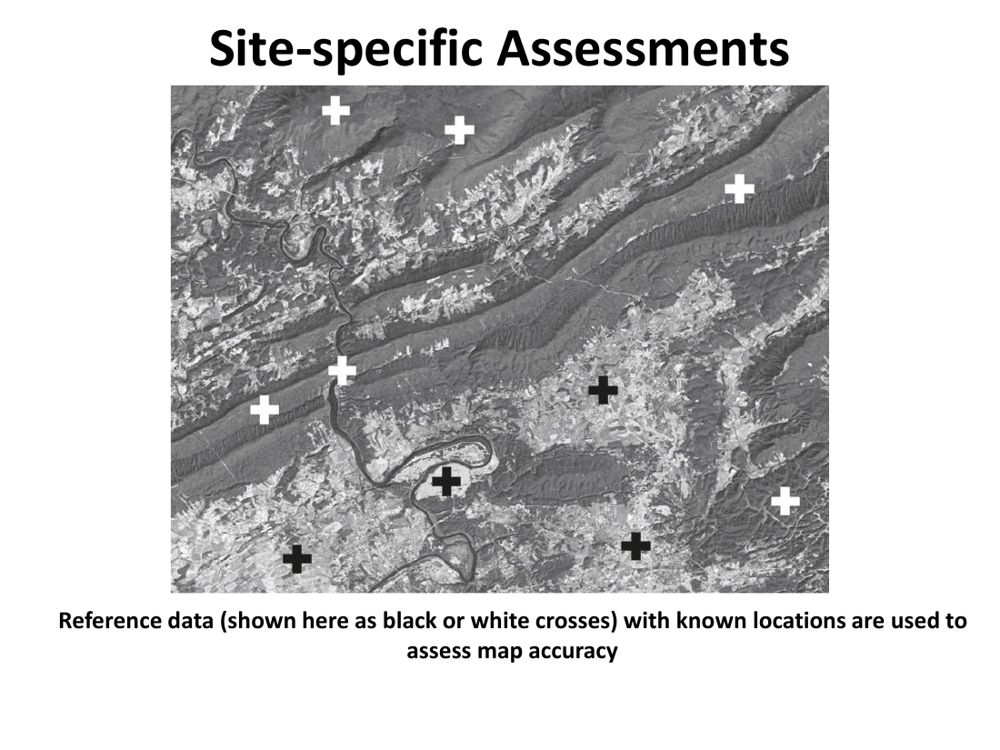
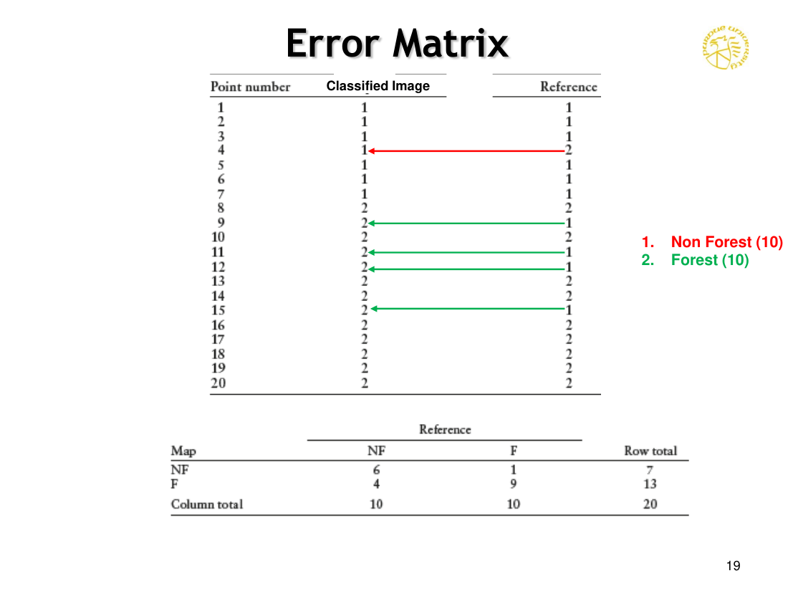
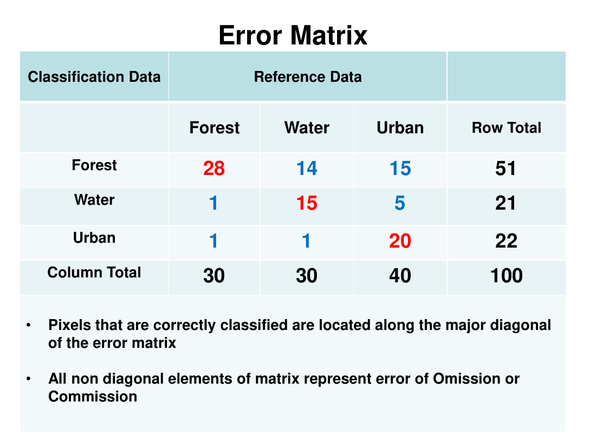
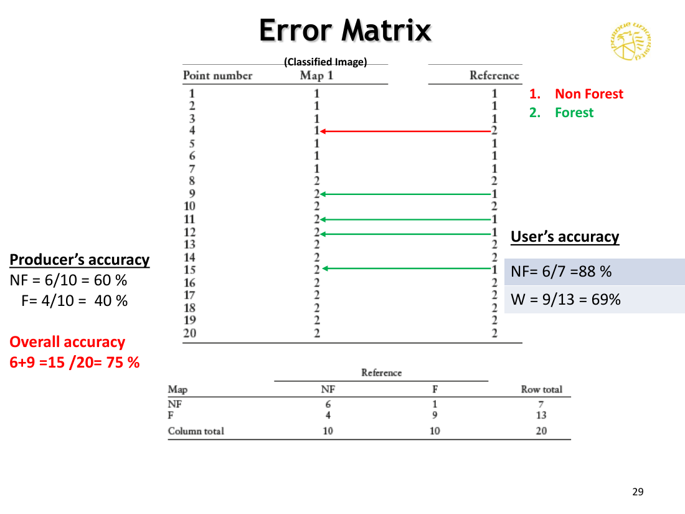

# Lecture 17 — Classification Accuracy Assessment

> **Big idea in one line:** A classified map is only worth as much as we can prove it's correct. **Accuracy assessment** compares the map to **ground reference data** in a structured table called the **error matrix**, and from that table we compute **overall, producer's, user's and Kappa** accuracies.

---

## 1. Why Bother? — Sources of Classification Error

A classified image isn't perfect. Errors can come from:
- **Misidentification of parcels** / **inaccurate selection of training samples**.
- **Excessive generalization** (too coarse a class scheme).
- **Variations in detail of interpretation.**
- **Analyst's experience.**

### Purpose of accuracy assessment
- **Determine the quality** of information derived from RS data via classification.
- **Validate the classification results** so they can be used in **decision-making**.
- The **end user must have a clear view of the quality of information** before using it for any practical application.

> **Memory tip:** **No accuracy assessment = no credibility.** Errors come from people, samples and over-generalization, so we have to check.

---

## 2. How Accuracy is Checked

We **compare two sources of information**:
- **Pixels or polygons from the classified RS image**.
- **Ground reference information** (the test data — a standard).

- If the classification results **correspond closely with the test data**, the processing is called **"accurate"** (high accuracy).
- **Statistically: high accuracy = low bias** between the classified and reference values.
- The classified image and the reference data **must be co-registered**, so they are at a **comparable level** (same projection, same pixel grid).

---

## 3. Two Types of Assessment

| Type | What it looks at | How |
|------|------------------|-----|
| **Qualitative** | Visual / general | Compare the classified image against **reference maps, high-resolution aerial images, or ground-truth data** (mostly visual) |
| **Quantitative** | Statistical | Check **agreement** between classified and reference data; **identify the different types of errors** |

For a **quantitative** assessment to be meaningful, the **reference data must itself be highly accurate**. Better to have **fewer but more accurate** reference points that **truly represent** the classes under assessment.

### Three flavours of quantitative assessment
- **Non-site-specific assessments**
- **Site-specific assessments**
- **Error Matrix**

> **Memory tip:** **Qualitative = "Looks right?" Quantitative = "Prove it."**

---

## 4. Non-Site-Specific vs Site-Specific

### Non-site-specific
- **Does NOT consider agreement at specific locations** — only **overall totals** (area-based comparison).
- Even with **close agreement on total class areas**, the classification can still be **inaccurate spatially** — it gives **no information about locational accuracy**.

### Site-specific
- Assesses **agreement at specific locations** between the classified and reference maps.
- Uses **reference points with known locations** to evaluate map accuracy.



> **Memory tip:** **Non-site = right totals, possibly wrong places. Site-specific = checks the actual locations.** The latter is what we trust.

---

## 5. Sampling — How to Pick Reference Points

Two big questions:
- **What sampling scheme should be used?**
- **How many samples should be collected?**

### Schemes
- **Simple random sample** — best when the sample size is **large enough**. As sample size decreases, **less prevalent categories can be missed**.
- **Stratified random sample** — samples are allocated **by class category**, so rare classes are still represented.

### Sample size guideline
- **"Sufficient" = 50–100 samples per category** as a general guideline.

> **Memory tip:** **Simple random for big samples; stratified random when some classes are rare. Aim for 50–100 per class.**

---

## 6. The Error Matrix (a.k.a. Confusion / Contingency Matrix)

The **standard** way of evaluating and reporting classification accuracy.

- Sometimes called **error**, **confusion** or **contingency** matrix.
- It identifies **errors, misclassifications, and confusion between classes**.
- Built from a **site-specific assessment**.
- The matrix is **square**: **number of rows = number of classes** (= number of columns).
- **Rows = classification (map) data**, **columns = reference (ground) data** (one of two standard conventions — check headings).
- **Diagonal elements** = correctly classified pixels.
- **All non-diagonal elements** = **errors of omission or commission**.



### Example error matrix (3 classes — Forest, Water, Urban)
| Classification ↓ / Reference → | Forest | Water | Urban | **Row total** |
|----|------|------|------|------|
| **Forest** | **28** | 14 | 15 | 57 |
| **Water** | 1 | **15** | 5 | 21 |
| **Urban** | 1 | 1 | **20** | 22 |
| **Column total** | **30** | **30** | **40** | **100** |



---

## 7. The Three Accuracy Measures

> **Memory tip — the three numbers everyone reports: "OA · PA · UA."**

### a) Overall Accuracy (OA)
The **percentage of correctly classified pixels**:

```
Overall Accuracy (OA) = (∑A / ∑B) × 100
```
- **∑A** = sum of pixels assigned to **correct classes** (the **diagonal** of the matrix).
- **∑B** = sum of **all elements** of the error matrix.

For the table above: **OA = (28 + 15 + 20) / 100 = 63%**.

### b) Producer's Accuracy (PA) — Errors of Omission
- A measure of **errors of omission**.
- Evaluated from the **analyst's (producer's) point of view**.
- Tells the analyst: "**of the actual forest on the ground**, what % was correctly classified?"

```
Producer's Accuracy (PA) = (C / ∑C) × 100
```
- **C** = number of reference pixels **correctly assigned** to a class.
- **∑C** = total reference pixels of that class (the **column total**).

For the example: **PA Forest = 28/30 = 93%, PA Water = 15/30 = 50%, PA Urban = 20/40 = 50%.**

### c) User's Accuracy (UA) — Errors of Commission
- A measure of **errors of commission**.
- The **reliability of the classified data from the user's perspective** — the **probability that a pixel labelled X on the map really is X on the ground**.
- Tells the map user: "**of the area labelled forest on the map**, what % is actually forest on the ground?"

```
User's Accuracy (UA) = (C / ∑R) × 100
```
- **C** = number of reference pixels **correctly assigned** to a class.
- **∑R** = total pixels **classified** to that class (the **row total**).

For the example: **UA Forest = 28/57 = 49%, UA Water = 15/21 = 71%, UA Urban = 20/22 = 91%.**



> **Memory tip — Omission vs Commission:**
> **Producer's = column / "of actual class, how many did we catch?" → errors of OMISSION (we missed it).**
> **User's = row / "of mapped class, how many are real?" → errors of COMMISSION (we wrongly committed it to this class).**

### Omission vs Commission — the same error from two viewpoints
If a pixel that is actually **grass on the ground** is classified as **trees on the map**, that single pixel is:
- an **error of omission for class "Grass"** (grass was missed), **and**
- an **error of commission for class "Trees"** (trees took something that wasn't theirs).

---

## 8. Kappa (κ̂) — The Index of Agreement

Another statistical measure that improves on overall accuracy because it **considers the possibility of agreement occurring by chance**.

```
                N · Σxii  −  Σ(xi+ · x+i)
κ̂  =  ────────────────────────────────────
                N²  −  Σ(xi+ · x+i)
```

- **r** = number of land-cover classes (rows).
- **N** = total number of test pixels in the error matrix.
- **Σxii** = sum of the **diagonal** elements.
- **xi+** = total in **row i**.
- **x+i** = total in **column i**.

- **Kappa values typically lie between 0 and 1.**
- κ̂ tells you the observed classification is **that fraction better than chance**.

### Worked example
```
Diagonal sum:            480 + 52 + 313 + 126 + 342 + 359  =  1672
Σ(row × column totals):  (485×480)+(72×68)+(353×356)+(142×248)+(459×402)+(481×438) = 793 776
N = 1992

κ̂ = (1992·1672 − 793 776) / (1992² − 793 776)  ≈  0.799
```

So the classification is **~79.9 % better than chance** agreement.

> **Memory tip:** **Overall accuracy can be fooled by lucky chance. Kappa subtracts the chance agreement → a fairer score.** κ̂ = 0 → no better than chance; κ̂ = 1 → perfect.

---

## ⭐ Quick Revision Cheat-Sheet (Lecture 17)

- **Errors come from:** bad training samples, over-generalization, interpretation differences, analyst experience.
- **Purpose:** validate the map for decision-making; **high accuracy = low bias** between classified & reference.
- Image and reference data must be **co-registered**.
- **Qualitative** (visual comparison) vs **Quantitative** (statistical). Reference data must be **highly accurate** itself.
- **Non-site-specific** = area totals only → may miss locational errors. **Site-specific** = location-by-location.
- **Sampling:** simple random (large samples), **stratified random** (rare classes); aim for **50–100 per class**.
- **Error matrix:** square; **rows = classified, columns = reference**; **diagonal = correct**; **off-diagonal = omission/commission**.
- **Overall Accuracy = diagonal sum / total ×100.**
- **Producer's Accuracy (column) = errors of OMISSION** ("did we catch all the real X?").
- **User's Accuracy (row) = errors of COMMISSION** ("are mapped X's really X?").
- A single misclassified pixel is **omission for its true class** and **commission for the wrong class**.
- **Kappa (κ̂)** corrects for chance agreement; values 0–1; higher is better.
