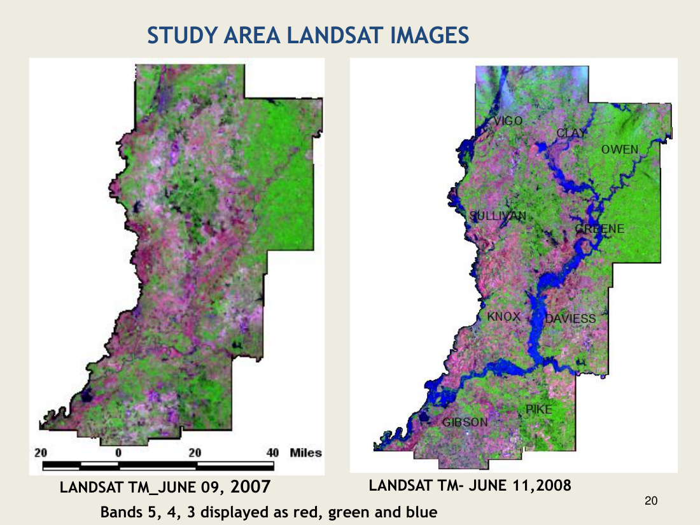
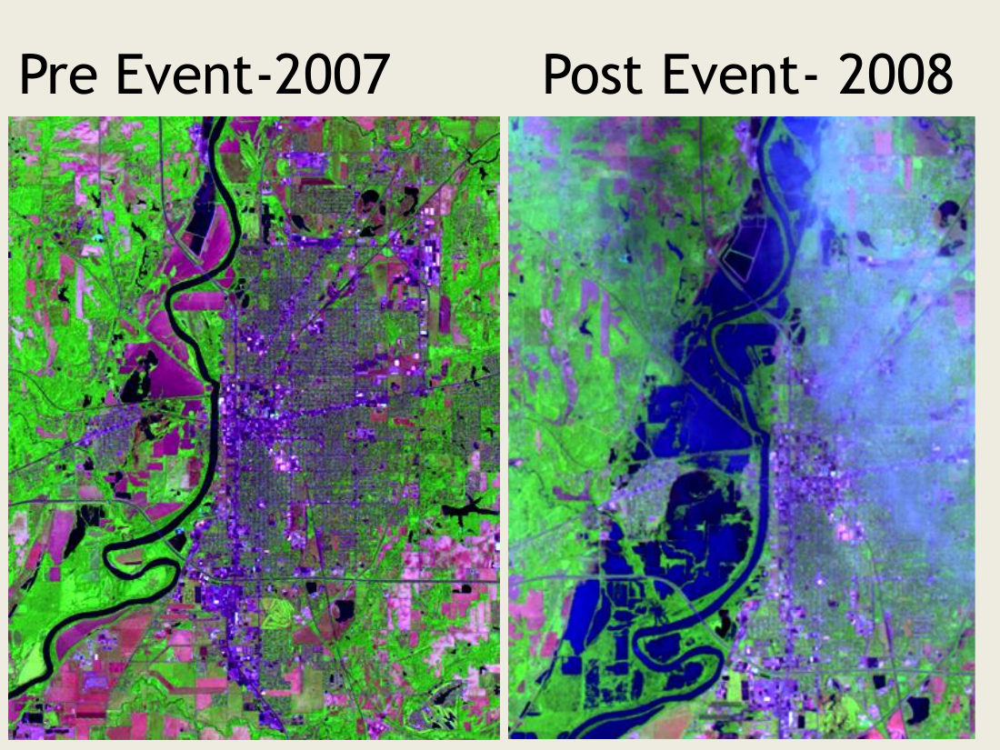
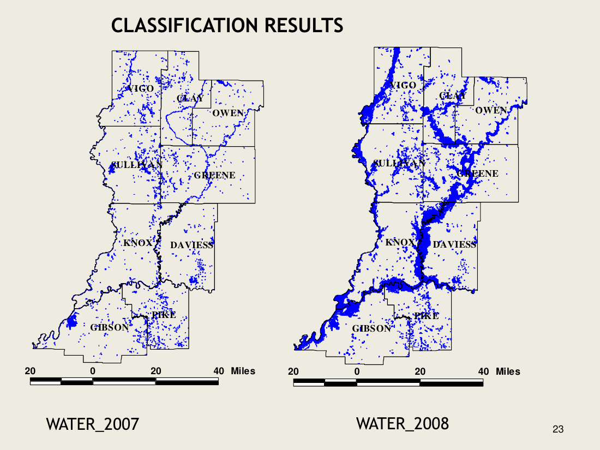
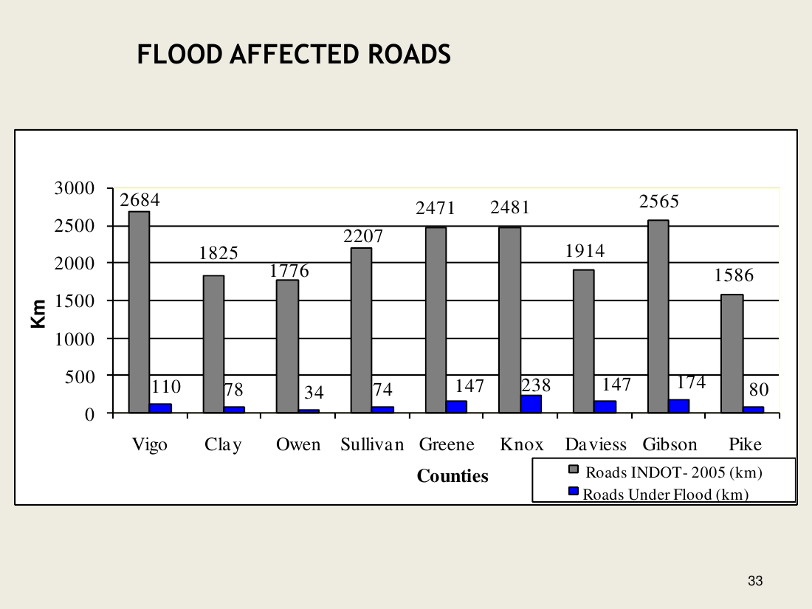
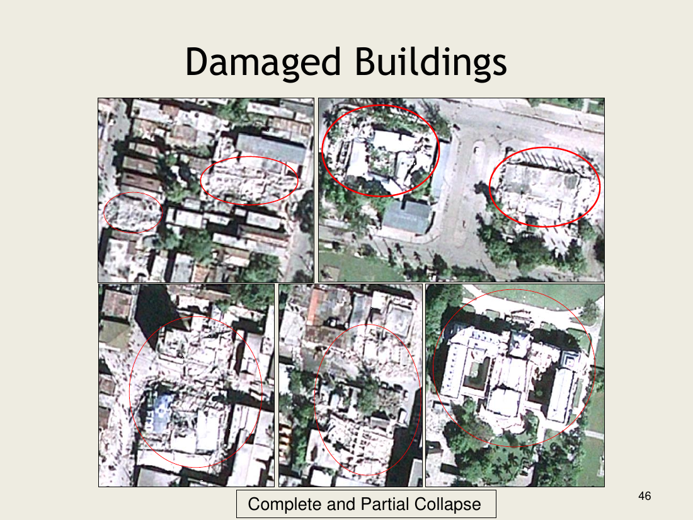

# Lecture 18 — Mapping Disasters with RS Data

> **Big idea in one line:** Disasters are **spatial** problems — they happen somewhere, to something, with some severity. Remote sensing gives us **before-and-after imagery** to **quickly map the extent of the disaster, assess damage, and plan response**, all on a scale ground surveys can't match.

---

## 1. Disasters as Spatial Problems

A disaster is **widespread** and varies:

- **Spatially** — by location and extent.
- **Temporally** — by how often it repeats.

Response requires **resources for Rescue, Relief and Rehabilitation**, and those need **data** — with constraints:
- **Pre- and post-event** imagery.
- **Scale / resolution** that matches the question.
- **Availability and cost** of imagery.
- **Expertise** to interpret it.

> **Memory tip — "3 R's of response: Rescue, Relief, Rehabilitation"**, all powered by **timely RS data**.

### Risk = a spatial problem (flood example)
For a flood, **risk = hazard × elements at risk × vulnerability**:
- **Hazard** → **how much water, when and where**?
- **Elements at risk** → **which elements where, and how many/much**?
- **Vulnerability** → **how much water is where the elements at risk are**?

### Key questions remote sensing helps answer
- Where did hazards occur before, what type, how often, **why there**?
- How can we **map** them?
- Where will they happen next, how frequent, how big?
- What is the **expected damage and where**?
- **What can we do to reduce future damage**?

> **Memory tip:** Disaster mapping answers **WHAT happened, WHERE, WHEN, HOW BIG, and WHAT NEXT.**

---

## 2. The International Charter "Space and Major Disasters"

A cooperative agreement among space agencies to **deliver satellite data free of charge during major disasters**. Member agencies include:

- **CSA** (Canada), **ESA** (Europe), **NOAA / USGS** (USA), **CNES** (France), **CNSA** (China), **JAXA** (Japan), **ISRO** (India), **CONAE** (Argentina), **DLR** (Germany), **DMC** (Disaster Monitoring Constellation), and partners such as **SERTIT, UN-SPIDER, UNOSAT, USGS Hazards Data Distribution System**.

### What gets activated, for what?
The Charter has been activated for many disaster types — these are the data the Charter typically provides for each:
- **Floods / ocean waves** — most frequent activations (1780+).
- **Storms / hurricanes**.
- **Earthquakes, volcanic eruptions, landslides**.
- **Oil spills, forest fires, ice/snow hazards** and other hazards.

### How the Charter operates (operational loop)
- **Authorized User (AU)** triggers a request.
- **Emergency On-Call Officer (ECO)** receives it.
- **On-Duty Operator (ODO)** tasks the satellites; the **Project Manager (PM)** oversees it.
- Sensors used: **RADARSAT-1, ERS-2, ENVISAT, SPOT-1/2/4/5, NOAA-12/14/15/16/17 (POES/GOES), IRS, SAC-C, ALOS, Landsat, DMC Constellation, CBERS**.
- Data flow to a **Value-Added Reseller (VAR)** and then to the **End User (EU)** on the ground.

> **Memory tip:** **Charter = a 911 line for satellites.** When a disaster hits, member agencies pool imagery for free, fast, to whoever asks under the right channel.

---

## 3. Case Study 1 — Flood Extent Mapping (Indiana, June 2008)

A **classic RS workflow** for flood mapping:

1. **Precipitation event** — heavy rain over a short period (e.g. June 1–7, 2008).
2. **Establish water-level context** — USGS gauge stations along the Wabash and White rivers.
3. **Acquire pre- and post-event imagery** — **Landsat TM** scenes from June 2007 and June 2008.

When displaying the **bands 5, 4, 3 as red, green, blue**:
- **Water** appears very **dark** (NIR/SWIR are strongly absorbed).
- Flooded areas pop out clearly against vegetation.

### Classify and difference
- **Classify water** in both 2007 and 2008 images.
- **Subtract pre-event water from post-event water** → the difference is the **flood extent** (water present only in 2008).

### Quantify damage
Once flood extent is mapped, **overlay other layers** to compute impact:

| Layer overlaid | Damage product |
|----------------|---------------|
| **County boundaries** | Flooded **area per county** & **% flooded** |
| **USDA crops 2008** layer | **Crop damage by type** (corn, soybean, wheat, pasture, woods) |
| **INDOT roads 2005** | **Length of roads under flood (km)** |
| **FEMA floodplains** | Flood water **inside vs outside** floodplains |

**Headline numbers** from the case study:
- **Total flood area ≈ 93 000 hectares** (excluding 2007 water) across **nine counties**.
- About **12 ft increase in water level over five days** on average.
- **Highest water level**: Mt Carmel, IL on June 14, 2008 — **33.24 ft**, remaining **8 days above flood stage**.
- **Average ~15 % of corn and soybean areas affected.**
- Flooded roads: tracked county-by-county.

### Result: a web-based flood map
The flood maps were made available through a **web mapping portal**, so emergency responders could **allocate/route resources**.

> **Memory tip — flood mapping in five steps: "Get pre + post imagery → classify water → difference → overlay other data → put it on the web."**

---

## 4. Case Study 2 — Earthquake Damage (Port-au-Prince, Haiti 2010)

After the **12 January 2010** earthquake, **GeoEye-1** (0.5 m, **13 Jan 2010**) and **1-m LiDAR DSM** (21–22 Jan 2010, supported by **World Bank and RIT**) were used to map damage.

### Why high resolution + LiDAR?
- **Urban complexity** in Port-au-Prince meant individual buildings had to be mapped one by one.
- Different **building types** were visible at 0.5 m optical and 3-inch aerial.
- **LiDAR** added the **third dimension** — heights, collapses, and rubble piles.

### Categories of building damage
| Category | What it looks like |
|----------|-------------------|
| **Roof collapse** | Roof has fallen in |
| **Side-wall collapse** | One or more walls gone, structure may stand |
| **Partial collapse** | Part of the structure failed |
| **Complete collapse** | Whole structure flat / rubble |

### Other products
- **Rubble mapping** — outline rubble piles for clearance planning.
- **Roads and streets blocked by rubble/debris** — to plan access routes.
- **Pre- and post-earthquake aerial images** with **building vector polygons** overlaid to flag changed footprints.

> **Memory tip:** **Floods = need wide-area, multi-date imagery. Earthquakes = need very-high-resolution + LiDAR for buildings.**

---

## 5. Conclusions

- **Timely availability of RS data** helps:
  - **Quickly map and visualize disaster impact.**
  - **Assess damage.**
  - **Plan remedial measures.**
- **Availability of flood-extent maps on the internet** helps **allocate and route resources** during the response.

---

## ⭐ Quick Revision Cheat-Sheet (Lecture 18)

- A disaster is **spatial + temporal**; response needs **Rescue, Relief, Rehabilitation** (3 R's), all data-driven.
- Risk = **Hazard × Elements at risk × Vulnerability** (e.g. "how much water, what's there, how exposed?").
- **International Charter "Space and Major Disasters"** = member agencies (CSA, ESA, NASA/NOAA/USGS, CNES, JAXA, ISRO…) provide **free satellite data during major disasters**.
- Charter loop: **AU → ECO → ODO → PM → VAR → End User.**
- **Floods:** acquire **pre + post Landsat**, classify water, **difference** the two, overlay **counties/crops/roads/floodplains** to compute damage; publish on the **web**.
- Floods imagery uses **bands 5-4-3 as R-G-B** to make water very dark.
- **Earthquakes (Haiti 2010):** **GeoEye-1 (0.5 m) + LiDAR DSM (1 m)** map **complete / partial / roof / side-wall collapse**, rubble, and blocked roads.
- **Floods need wide swath; earthquakes need very high resolution and 3D (LiDAR).**
- Timely RS → faster mapping, damage assessment and response planning.
