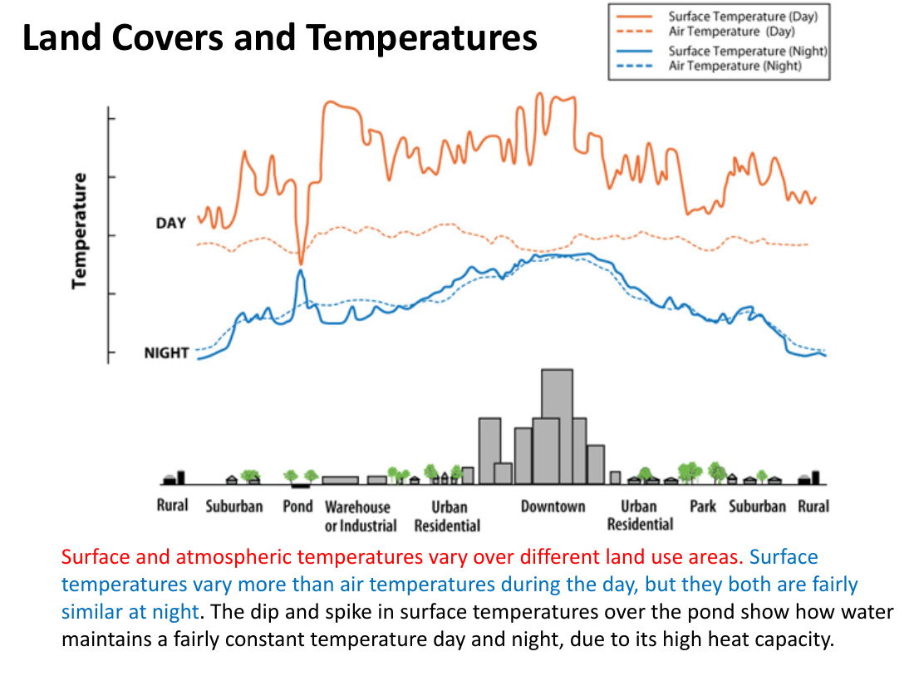
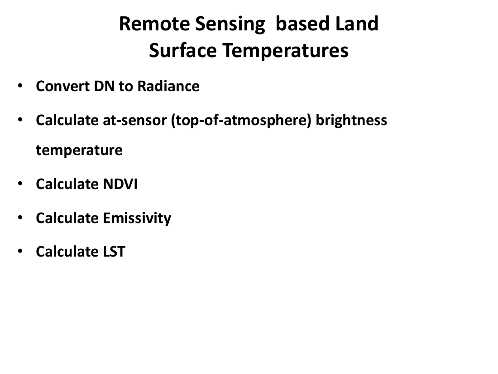

# Lecture 19 — Urban Heat Island (UHI) & Land Surface Temperature (LST)

> **Big idea in one line:** Cities are **hotter than the countryside around them** because their materials soak up sunlight and trap heat. We can **measure this from space** by converting the **thermal infrared signal** that a satellite records into a **Land Surface Temperature (LST)** map.

---

## 1. Urban Heat Island (UHI) — What and Why

- A **UHI** is a **metropolitan area that is significantly warmer than its surrounding rural areas** due to **human activities**.
- The term **"heat island"** describes **built-up areas that are hotter than nearby rural areas**.

### Why cities heat up
- Urban materials — **construction materials, roofs, asphalt, concrete, roads** — **absorb more heat from the sun**.
- The subsequent **re-emission of that energy** keeps urban areas warmer than the non-urban surroundings → the **UHI effect**.
- The effect is **aggravated by the absence/removal of vegetation**, which would otherwise provide **shade and evapotranspiration cooling** on warm days.

> **Memory tip — UHI = "Concrete soaks, plants cool."** Strip out the trees and add asphalt and you get a heat island.

### Dynamics of UHI (what controls it)
The UHI effect is a **function of**:
- **Time** (of day, season).
- **Meteorological conditions**.
- **Local and urban characteristics**.

Consequently the **effect is unique to each urban area**. In general:
- **Parks, lakes and open areas** → **cooler**.
- **Commercial, industrial or dense-building zones** → **hotter**.

### When is UHI strongest?
- In the morning, urban materials **absorb heat slowly**.
- **Urban heat islands are best observed at night** when maximum **radiation from urban materials occurs**.
- **Satellite overpass timing is therefore not optimised for UHI** — most satellites cross during the day.

### How UHI was traditionally measured
- From **air-temperature measurements** at **fixed weather stations** and **sensors mounted on moving vehicles**.

### Steps to reduce the UHI effect
- **Increase tree and vegetative cover.**
- Create **green roofs** ("rooftop gardens").
- Install **cool / reflective roofs**.
- Use **cool pavements** (e.g. permeable pavement parking lots with shade trees).

> **Memory tip — UHI cures: "More green, more reflective."** Plant trees, paint roofs light, use permeable pavements.

---

## 2. Land Surface Temperature (LST) — Definition

> **Memory tip:** UHI is the **phenomenon**; **LST is the variable we measure**.

LST is defined as:
- The **temperature of the interface between the Earth's surface and its atmosphere**.
- The **temperature of the air near the Earth's surface**.
- The **skin temperature of the ground**.

In **remote sensing**, LST is more specifically:
- The **average surface temperature of the ground under the pixel** (pixel size), **mixed with different fractions of surface types**.

### LST is a function of 4 surface/sub-surface properties
1. **Reflectance / Albedo.**
2. **Emissivity.**
3. **Thermal properties of urban construction materials** (including moisture).
4. **Composition and structure of the urban canopy.**

> **Memory tip — LST factors: "REM-C" → Reflectance, Emissivity, Materials, Canopy."**

### Why LST matters
- **Important parameter** for understanding the urban thermal environment and its dynamics.
- Because of the **strong heterogeneity** of vegetation, topography and soil, **LST changes rapidly in space and time**.
- Widely used in:
  - **Evapotranspiration**
  - **Climate change**
  - **Hydrological cycle**
  - **Vegetation monitoring**
  - **Urban climate and environmental studies**

### Why satellites?
- Surface temperature over land is so complex that **ground measurements can't practically cover wide areas**.
- **Satellite data are the only practical way** to measure LST **over the entire globe** with sufficient temporal frequency and **spatially averaged (not point) values**.

---

## 3. Surface vs Air Temperature & Land Cover

Different land covers behave differently when day turns to night:

- **Surface temperatures vary more than air temperatures during the day.**
- **At night, surface and air temperatures are fairly similar.**
- **Water** (ponds, lakes) shows a **dip during the day and a spike at night** relative to its surroundings — water **maintains a fairly constant temperature day and night** thanks to its **high heat capacity**.



> **Memory tip:** **Daytime → surface temperatures spread out (big differences between covers); Nighttime → they converge. Water is the steady one.**

### Why thermal RS still has issues
- Surface temperatures defined using the **radiance emitted by a surface** are the **skin temperature**.
- The **brightness temperature** is the LST **obtained at the satellite level** by **Thermal Infrared (TIR) sensors**.
- **Direct estimation of LST from TIR is difficult** because radiances measured by satellites depend on:
  - **Surface parameters** (temperature, **emissivity**), **and**
  - **Atmospheric effects** (absorption/emission along the path).

---

## 4. Thermal Infrared Remote Sensing

- **Thermal IR radiation** = electromagnetic energy in wavelengths **between 3 and 14 µm**.
- **Most RS applications use the 3–5 µm and 8–14 µm ranges** — these are the **atmospheric windows** (minimum atmospheric absorption).
- Systems on **aircraft flying below the ozone layer** are **not affected by ozone** and **record the full 8–14 µm band**.

> **Memory tip:** **TIR has two windows: 3–5 µm and 8–14 µm.** Outside these, the atmosphere blocks the signal.

---

## 5. The LST Workflow (turning DNs into degrees)

To compute LST from a satellite scene (e.g. Landsat), follow **five steps**:

1. **Convert DN → Radiance**.
2. **Calculate at-sensor (top-of-atmosphere) brightness temperature**.
3. **Calculate NDVI**.
4. **Calculate Emissivity**.
5. **Calculate LST**.



> **Memory tip — "DN → Radiance → Brightness T → NDVI → Emissivity → LST."** The first step puts the image in physical units; the last three correct for the land surface.

### Step 1 — DN to Radiance
DN values range from **0–255**. Each band has spectral radiance limits **LMIN** and **LMAX**, corresponding to DNs 1 and 255 (or QCALMIN/QCALMAX). The linear conversion is:

```
Lλ = LMIN + (LMAX − LMIN) × (DN − QCALMIN) / (QCALMAX − QCALMIN)
```

- **DN** = pixel digital number.
- **λ** = wavelength.
- **LMIN, LMAX** = spectral radiances at DN 1 and DN 255 (from the **metadata / header** file).
- **QCALMIN, QCALMAX** = pixel-value limits for each band.

### Step 2 — Radiance to Brightness Temperature (Planck inversion)
Use the **Planck radiance function** inverted to get the **at-sensor brightness temperature**:

```
T = K2 / ln( K1 / Lλ + 1 )
```

- **T** = brightness temperature in **Kelvin (K)**.
- **Lλ** = spectral radiance in **W m⁻² sr⁻¹ µm⁻¹**.
- **K1, K2** = **calibration constants** (from the **metadata file**).

### Step 3 — NDVI
```
NDVI = (NIR − RED) / (NIR + RED)
```

### Step 4 — Land Surface Emissivity (from NDVI)
A common empirical estimate:

```
εi = 1.0094 + 0.047 × ln(NDVI)
```

### Step 5 — LST (correcting brightness temperature with emissivity)
A widely used form:

```
LST = T / [ 1 + ( λ · T / ρ ) · ln(ε) ]
```

where:
- **λ** = effective wavelength of the TIR band,
- **ρ = h·c/σ** (a constant built from Planck's constant **h**, speed of light **c**, and Boltzmann's constant **σ**).

Physical constants used:
- **σ (Boltzmann)** = **1.38 × 10⁻²³ J/K**.
- **h (Planck)** = **6.626 × 10⁻³⁴ J·s**.
- **c (light speed)** = **2.998 × 10⁸ m/s** (note: the slide writes 2.998 × 10⁻⁸ — that's a typo; the speed of light is 10⁸ m/s).
- **ε** = land surface emissivity (from Step 4).

> **Memory tip — what the corrections do:**
> **Brightness T** treats the surface as a perfect blackbody (ε = 1).
> **Real surfaces have ε < 1**, so we estimate **emissivity from NDVI** and **correct brightness T to get the true LST**.

---

## ⭐ Quick Revision Cheat-Sheet (Lecture 19)

- **UHI** = urban areas are hotter than the rural surroundings due to **concrete, asphalt, roofs absorbing & re-emitting heat** and **lack of vegetation**.
- UHI dynamics depend on **time, weather, urban characteristics**; **strongest at night**; satellite timing is **not** optimal for UHI.
- Mitigation: **more trees, green/cool roofs, cool pavements**.
- **LST** = the **skin temperature** of the surface under a pixel; depends on **albedo, emissivity, materials, urban canopy ("REM-C")**.
- Surface temps vary widely **by day**, converge **at night**; **water stays steady** (high heat capacity).
- **TIR windows = 3–5 µm and 8–14 µm.** Aircraft below the ozone layer can use the full **8–14 µm** band.
- **LST workflow (5 steps):** **DN → Radiance → Brightness T (Planck) → NDVI → Emissivity → LST**.
- **Brightness T** is the **at-sensor** temperature (blackbody assumption); **LST** is the **corrected, real-surface** temperature, using **emissivity from NDVI** (εi = 1.0094 + 0.047·ln(NDVI)).
- TIR-derived LST is hard because the **atmosphere also affects radiance** — corrections are essential.
