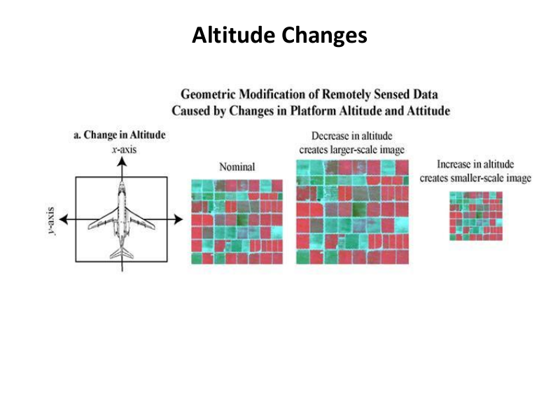
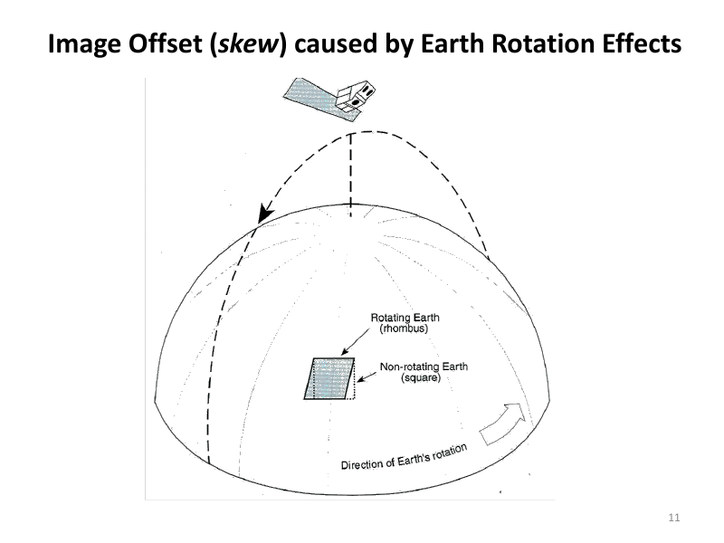
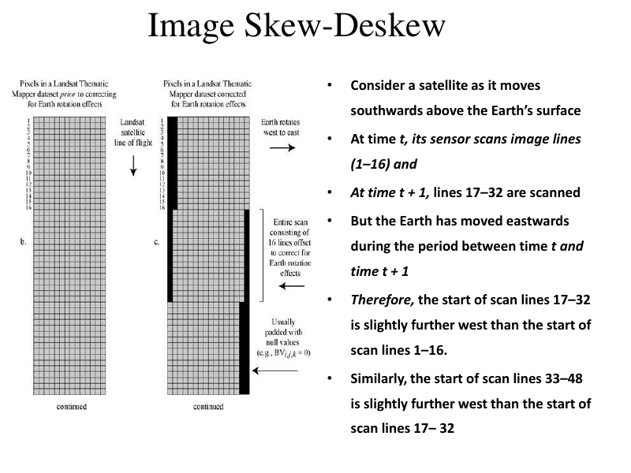
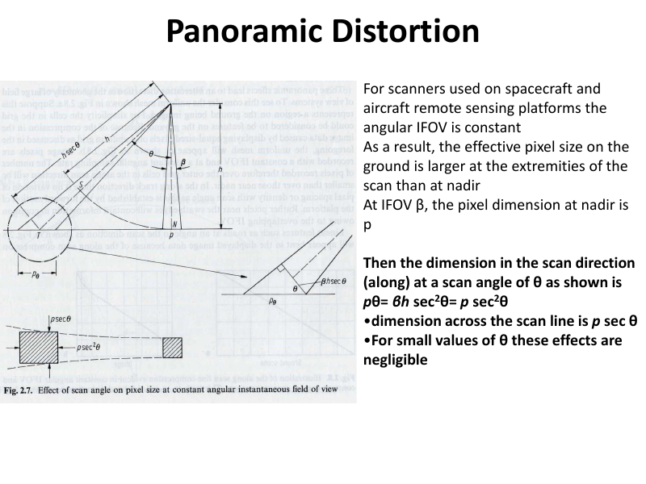
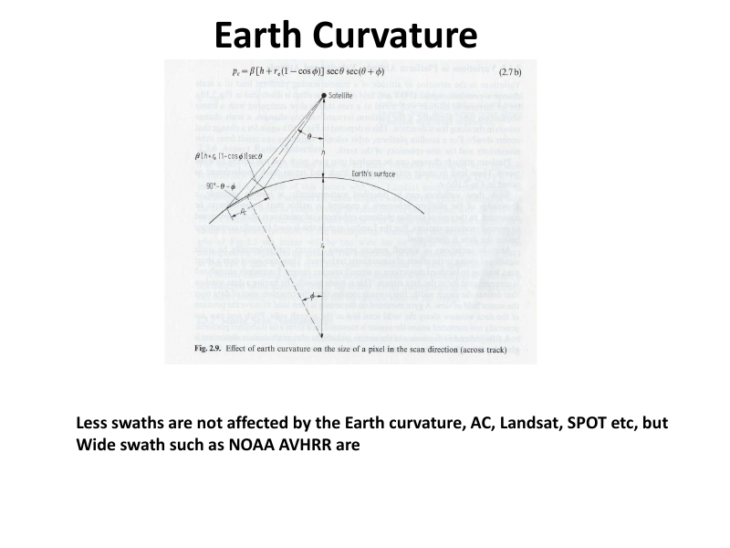
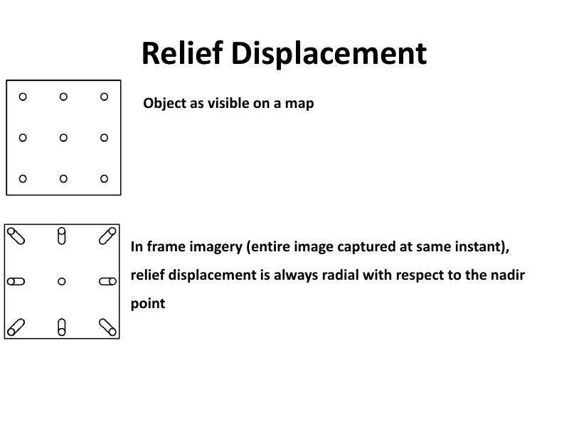
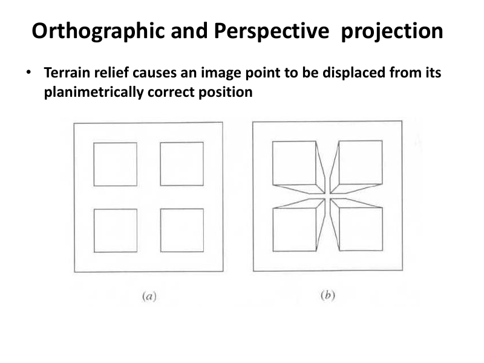
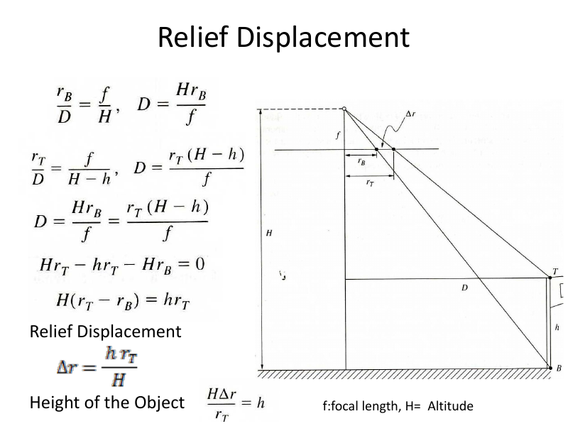

# Lecture 2 — Geometric Corrections (Part II)

> **Big idea in one line:** This lecture digs deeper into *where* the distortions come from — the random platform movements (altitude & attitude) and the systematic ones (Earth rotation skew, panoramic, Earth curvature, and relief displacement).

---

## 1. Un-Systematic (External) Geometric Errors

These are the **random** errors caused by the platform (aircraft/spacecraft) moving unexpectedly at the **exact moment** of data capture. Two main variables:

1. **Altitude changes** (flying height changes)
2. **Attitude changes** → **Roll, Pitch, Yaw**

> **Memory tip — "the two A's":** **Alt**itude (how high) and **Att**itude (how tilted). Attitude rotations = **"RPY" (Roll, Pitch, Yaw)**.

### Altitude Changes
- A sensor flown at a **constant altitude AGL** (Above Ground Level) → image has a **uniform scale** all along the flight line.
- If altitude **changes gradually** → the **scale** of the image changes.
- **Increasing altitude → smaller-scale** imagery (large area shown in small space).
- **Decreasing altitude → larger-scale** imagery (small area shown in more detail).
- Same rule applies to digital sensors collecting pixel-by-pixel.

> **Memory tip:** **"Higher = smaller scale, Lower = larger scale."** (Go up, things look smaller.)



### Attitude Changes
- **Satellite platforms** are usually **stable**.
- **Aircraft** must fight updrafts, downdrafts, head/tail/cross-winds → constantly wobbling.
- Even at constant altitude, the platform can **rotate about 3 axes** = **Roll, Pitch, Yaw**.
- Good systems use **gyro-stabilization** to isolate the sensor from **roll and pitch**.
- Systems **without** stabilization introduce error through roll/pitch/yaw that can **only be corrected using GCPs**.

> **Roll, Pitch, Yaw quick picture:**
> - **Roll** = tipping side to side (like a boat rolling).
> - **Pitch** = nose up / nose down.
> - **Yaw** = turning left/right (like shaking your head "no").

---

## 2. Systematic Distortion #1 — Image Skew (from Earth Rotation)

This is the classic **parallelogram-shaped** distortion.

**Why it happens:**
- Sun-synchronous, Earth-observing satellites fly in fixed orbits, scanning **north → south** (descending mode).
- Meanwhile the **Earth rotates west → east** underneath.
- The interaction between the **fixed orbit** and the **rotating Earth** **skews** the captured image.



**The mechanism (step by step):**
- At time **t**, the sensor scans lines 1–16.
- At time **t + 1**, it scans lines 17–32.
- But during that gap, the **Earth moved east**.
- So the start of lines 17–32 is **slightly further west** than lines 1–16.
- And lines 33–48 are further west again → the image leans into a **parallelogram**.

> **Memory tip:** Each scan sweep starts a little **further west** than the last → image becomes a slanted parallelogram. *"Earth slides east, so each new line lands a bit west."*



### Deskewing (the fix)
- Each successive scan sweep is **shifted slightly to the west** to undo the skew.
- The resulting **parallelogram look** of satellite scanner data *is* the result of this correction.
- **How much** to skew depends on:
  1. The **relative velocities** of satellite and Earth.
  2. The **length** of the image frame recorded.

### Skew Assessment (the formulas)

> You don't need to memorise these perfectly, but understand what each term means.

- Angular velocity of satellite: **ω₀** (in mrad·s⁻¹)
- **L** = frame length on the ground (km)
- Time to scan the frame:
  ```
  ts = L / (re · ω0)     [seconds]
  ```
  where **re = radius of the Earth = 6378.16 km**.

- Surface velocity of the Earth:
  ```
  ve = ωe · re · cos λ
  ```
  - **λ** = latitude
  - **ωe** = Earth's rotational velocity = **72.72 μrad·s⁻¹**

- Eastward shift of Earth's surface during frame acquisition:
  ```
  δxe = ve · ts     [km]
  ```
- **Skew distortion** as a % of frame size = Frame size / δxe.
- Because the satellite doesn't travel exactly north–south, correct by the **inclination angle**:
  ```
  δx = δxe · cos(inclination°)     [km]
  ```

> **Memory tip — the chain:** *time to scan → how far Earth moved east → correct for orbit tilt.* (ts → δxe → δx).

---

## 3. Systematic Distortion #2 — Panoramic Distortion

- For scanners, the angular **IFOV** (Instantaneous Field Of View) is **constant**.
- But the **ground pixel size is larger at the edges** of the scan than at **nadir** (directly below), because the sensor sees a bigger ground area off to the sides.

**The geometry:**
- At IFOV **β**, the pixel size at nadir = **p**.
- **Along** the scan direction at scan angle **θ**:
  ```
  pθ = β·h·sec²θ = p·sec²θ
  ```
- **Across** the scan line:
  ```
  p·sec θ
  ```
- For **small θ**, these effects are **negligible**.

> **Memory tip:** Edges = bigger pixels. The `sec²θ` term blows up as θ grows, so **wide-angle edges stretch the most**. Nadir pixel is the "true" size.



---

## 4. Systematic Distortion #3 — Earth Curvature

- **Narrow-swath** sensors are **NOT** much affected (e.g., **AC** aerial cameras, **Landsat, SPOT**).
- **Wide-swath** sensors **ARE** strongly affected (e.g., **NOAA AVHRR**).
- For large field-of-view systems, panoramic + curvature effects can be **severe** and distort the image geometry.

> **Memory tip:** **"Narrow swath = safe (Landsat/SPOT); Wide swath = warped (NOAA AVHRR)."** → *"Wide = Worry."*



---

## 5. Systematic Distortion #4 — Relief Displacement

This is the distortion caused by **terrain height (topography)**.

**Definition:** A shift in the image position of an object caused by topographic (height) variations.

- On a **map**, a vertical object (power pole, building corner) has **only one position**.
- On an **aerial photo/image**, you can often see **both the bottom and the top** of a vertical object — as if the top and bottom have **different horizontal coordinates**.
- It's very obvious on tall objects **unless** the object is **directly below the image center**.



**Key behaviour:**
- Vertical objects appear to **lean along a radial line away from the nadir point**.
- The **relief displacement** = the distance in the image between the **top** and **bottom** of the object.
- It depends on the object's **height** and its **distance from the nadir point**.
- An object **at nadir** → **NOT displaced**. An object at the **edge** → appears **leaning away** from nadir.

### Orthographic vs Perspective projection
- Terrain relief causes an image point to be displaced from its **planimetrically correct** position.
- **Ortho-rectification** removes relief displacement (needs a DEM).



### Scanning system — One-Dimensional relief displacement
- Along-track / across-track scanners create **1-D relief displacement** that is **perpendicular to the flight line** (not radial from a single point).
- Instead of one principal point, **each scan line's nadir** acts like its own principal point.
- At nadir, the scanner looks **straight down** (e.g., a round water tank appears as a perfect circle).

### Factors affecting the AMOUNT of relief displacement

> **Memory tip — "Higher, Taller, Farther = MORE; Fly higher = LESS."**

| Factor | Effect on relief displacement |
|--------|-------------------------------|
| **Distance from principal point** (farther) | **More** displacement |
| **Elevation** (higher ground) | **More** displacement |
| **Object height** (taller object above terrain) | **More** displacement |
| **Flying height** (higher aircraft/satellite) | **LESS** displacement |

The relationship can be derived from the geometry of a vertical photo, using:
- **f** = focal length
- **H** = altitude (flying height)
- height of the object



---

## ⭐ Quick Revision Cheat-Sheet (Lecture 2)

- **Random (external) errors = the two A's:** **Alt**itude + **Att**itude (Roll, Pitch, Yaw).
- **Altitude:** higher → smaller scale; lower → larger scale.
- **Attitude:** satellites stable, aircraft wobble; gyro fixes roll/pitch; rest needs GCPs.
- **4 systematic distortions → "SPRE":**
  1. **S**kew (Earth rotation → parallelogram, fixed by *deskewing*; each line shifts west).
  2. **P**anoramic (edge pixels bigger, `p·sec²θ`; negligible at small θ).
  3. **R**elief displacement (terrain height; objects lean away from nadir).
  4. **E**arth curvature (wide swaths like NOAA AVHRR affected; Landsat/SPOT safe).
- **Relief displacement MORE when:** farther from center, higher elevation, taller object. **LESS when:** flying higher.
- **Nadir** = directly below sensor → no relief displacement there.
- **Ortho-rectification** (with DEM) removes relief displacement.
