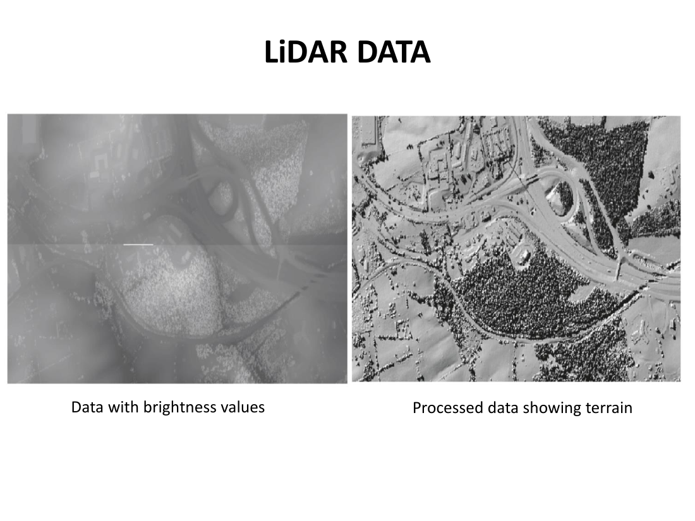
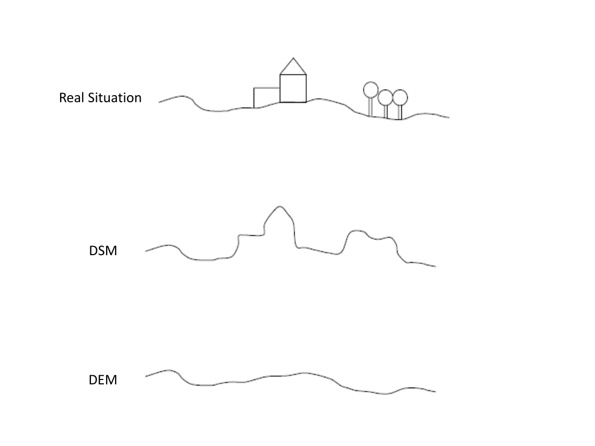
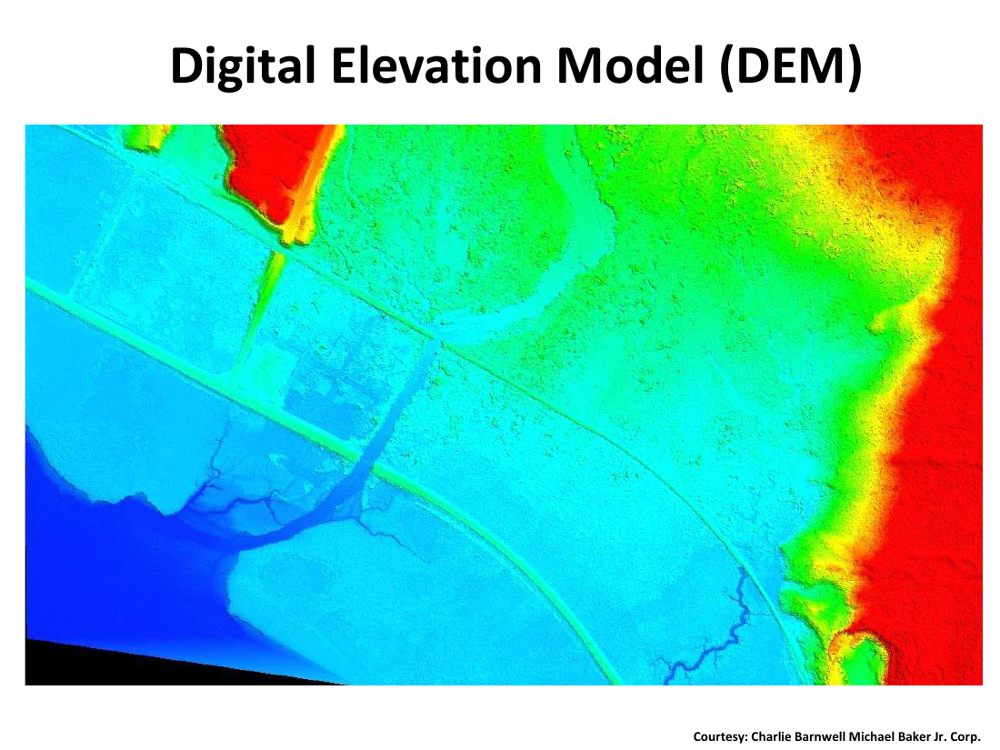
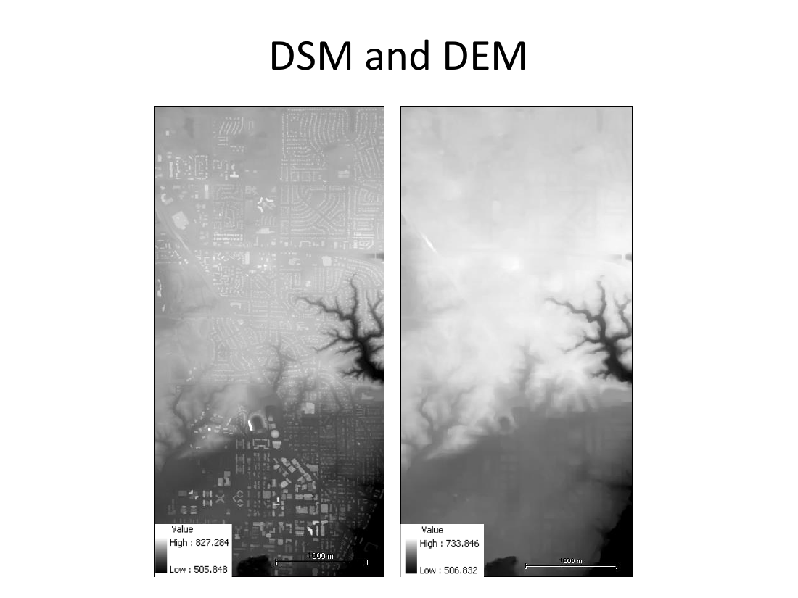
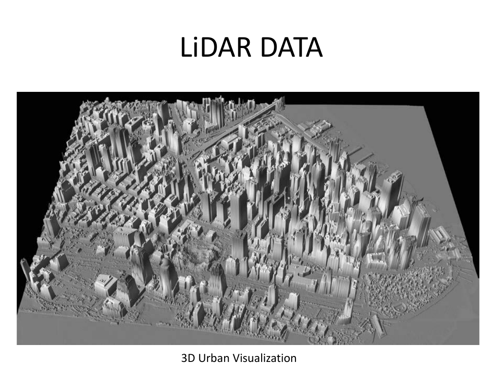
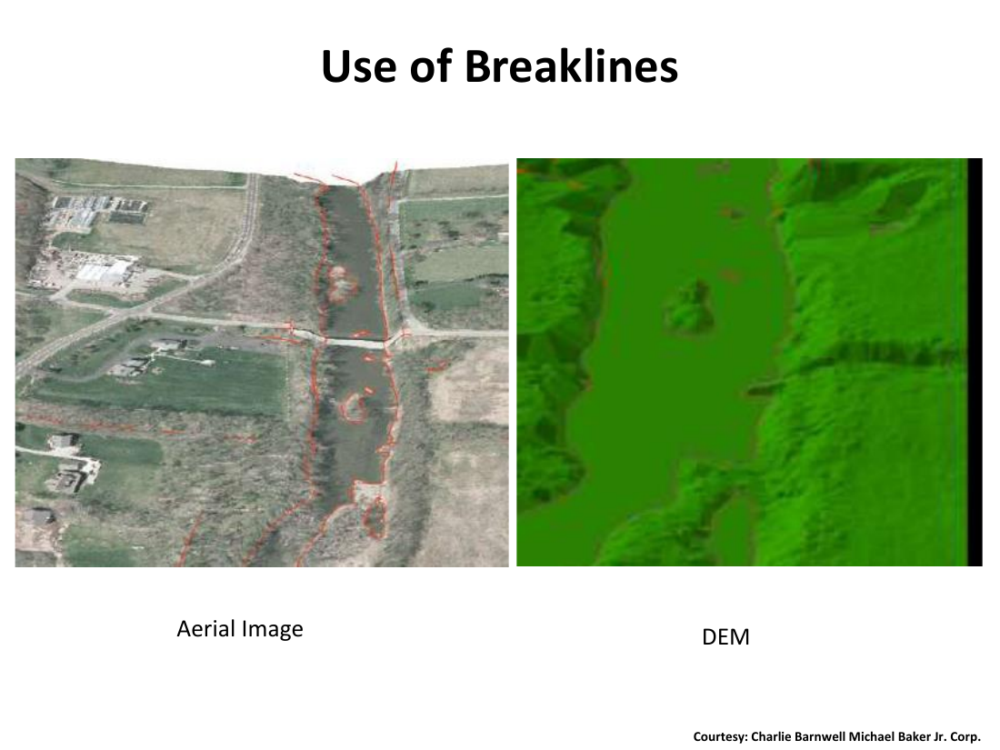

# Lecture 20 — LiDAR & Digital Elevation Models

> **Big idea in one line:** **LiDAR fires laser pulses at the ground and times the bounce back.** Combine those times with a precise aircraft position and you get **millions of 3-D points** — enough to build **Digital Surface Models (DSM)**, **Digital Elevation Models (DEM)** and **3-D urban models**.

---

## 1. What is LiDAR?

- **LiDAR** = **Li**ght **D**etection **a**nd **R**anging.
- Also called **LADAR** (LASER Detection and Ranging) and **LASER altimetry**.
- Built on an application of **lasers** — light in a **very narrow band of wavelengths**.
- That light can be **transmitted over large distances as a narrow beam** that **diverges only slightly** — unlike ordinary light.

### Key characteristics
- LiDAR is an **active sensor** (it provides its own illumination).
- Uses electromagnetic energy in the **visible and near-infrared** wavelengths.
- It is a **nadir-looking instrument** (it points straight down).
- Because it operates in visible/NIR, its signal **is affected by atmospheric conditions**.
- It **records information at discrete points** across the swath (not a continuous image).

> **Memory tip — LiDAR: "Active, narrow, near-IR, nadir, points (not pixels)."**

### How it measures distance
- The instrument measures the **time for an energy pulse to reach the ground** and for **part of the scattered radiation to return** to the sensor.
- **Higher pulse rate → more swath/coverage but weaker returns** (typically **a few hundred to ~30 000 pulses per second**).
- A **single pulse may yield multiple returns** (it bounces off branches, the ground, etc., on the way down).

### Why LiDAR has exploded
Two technological developments drove rapid growth:
1. **Improved electro-mechanical technology** — sensors and lasers can be **accurately and reliably controlled** on moving aircraft.
2. **Precise aircraft positioning and orientation** using **GPS** and **Inertial Navigation Systems (INS)**.

Current results:
- **Accuracy up to ~15 cm**.
- **DEM/DSM at ~1 m grid spacing**.

### The supporting hardware
| Component | Role |
|-----------|------|
| **Inertial Measurement Unit (IMU)** | Precise control & recording of aircraft **roll, pitch, yaw** |
| **GPS** | Accurate **geographic location** of the aircraft |
| **High-accuracy clocks** | **Precise timing** of LiDAR pulses for high-performance scanning |

> **Memory tip — three things make LiDAR work: "Where (GPS) + How (IMU) + When (clock)."**

---

## 2. From Pulses to Elevations

- LiDAR measures the **distance from the sensor to the ground**.
- Because the **instrument's position is known**, the **position of each return pulse** can be calculated, and **distances become elevations** above a **specified geodetic datum**.
- A **raster map of elevations** is generated by **interpolation** of the points.

### First Return vs Last Return
- **First return / first bounce** = time between **pulse emission** and the **first echo** received back.
- **Last return** = time of the **last indication of backscatter**.
- If the target **does not transmit light**, **first and last return are the same** (e.g. a hard ground or rooftop).
- If the target **does transmit light** (e.g. a tree canopy), the **time difference between first and last bounce is proportional to the height** of the object above the ground.

> **Memory tip:** **First return = treetop / roof; Last return = ground.** The gap between them tells you the object's height.

---

## 3. DSM vs DTM vs DEM (the elevation family)

| Term | Stands for | Represents |
|------|-----------|-----------|
| **DEM** | **D**igital **E**levation **M**odel | Earth's surface elevation as an **array of points** (image intensity = elevation; brighter = higher) |
| **DSM** | Digital **S**urface Model | **Elevation of the *highest* reflective object** at each point (top of trees, roofs, etc.) |
| **DTM / DTEM** | Digital **T**errain Model / Digital Terrain Elevation Model | The **elevation of bare terrain / bare Earth** |
| **nDSM** | **n**ormalized DSM | **DSM − DTM** = height of objects **above the ground** (tree height, building height) |

> **Memory tip — three layers stacked:**
> **DTM = bare earth** (ground only).
> **DSM = everything you see from above** (ground + trees + buildings).
> **nDSM = the things on top** (DSM − DTM = object heights).

### Why does it matter?
- A set of point elevations from LiDAR builds a **DSM** by default — because the pulse is **reflected by the first object of sufficient size and density** it hits (a branch, a tree crown, a building roof, the ground).
- **To get a DEM from a DSM**, the **surface objects must be removed**, or **the object heights must be estimated and subtracted**.
- The **DSM is useful in itself** — e.g. to map the **highest point on a building or a tree**.
- **LiDAR images can be used to generate 3-D urban models.**

### Visualizing the difference

> **Memory tip:** **LiDAR gives you DSM "for free"; DEM takes extra work to strip the objects off.**

---

## 4. The DEM — Reliability & Break Lines

- The reliability of representing the Earth's surface is determined by:
  - The **horizontal spacing** of elevation points, **and**
  - The **vertical accuracy** of the elevations.
- **Sudden elevation changes** (e.g. **cliffs**, drainage features) **cannot be represented well by gridded DEMs**.
- **Interpolation across such a feature is misleading** because slopes there are **not continuous**.

### Break lines — what they do
- Some gridded DEMs include **break lines** that **indicate discontinuities** in the topographic surface.
- A **break line** = a **line of terrain where there is a significant change in slope** (ridge lines, valleys, ditches, and other natural or artificial features where slope changes).
- When interpolating elevations near a break line, **only points on the same side of the break line are used** — interpolation does not cross the line.

> **Memory tip:** **Break lines = "don't cross this line when interpolating."** They stop a smooth interpolation from flattening cliffs, ridges and ditches.

---

## 5. Advantages and Applications

### Advantages
- **Quick data delivery** — DEM and DSM **within 24 hours** of acquisition.
- Can **operate at night** (it brings its own light).
- **Convenience and flexibility in flight planning**.

### Applications
- **Forested areas** — **tree heights and density**.
- **Urban areas** — **building densities, urban structures, building footprints**.
- **Highway planning.**
- **Pipeline route planning.**
- **Designing wireless communication systems** in urban regions.
- **Floodplain mapping.**

> **Memory tip — LiDAR shines because:** **fast (24 h), works at night, flexible to plan, gives heights.**

---

## ⭐ Quick Revision Cheat-Sheet (Lecture 20)

- **LiDAR** = **Light Detection and Ranging** (also LADAR / laser altimetry). **Active**, **NIR/visible**, **nadir-looking**, records **discrete points**.
- It **times a laser pulse to and from the ground**; pulse rate **few hundred → ~30 000/s**; higher rate = more coverage, weaker returns.
- **Multiple returns per pulse**: **First return = treetop/roof; Last return = ground.** Their gap = **object height**.
- Drivers of growth: **better lasers/sensors + precise GPS + INS**. Modern accuracy **~15 cm**; DEM/DSM at **~1 m grid**.
- Hardware: **IMU** (orientation: roll/pitch/yaw), **GPS** (position), **high-accuracy clocks** (timing).
- **Three elevation models:**
  - **DTM/DTEM** = bare-earth.
  - **DSM** = top of everything (objects included).
  - **DEM** = elevation as an array (often = DTM in practice).
  - **nDSM = DSM − DTM** = object heights.
- LiDAR naturally produces a **DSM**; making a **DEM** requires **removing surface objects**.
- DEM reliability = **horizontal spacing × vertical accuracy**. Cliffs/drainages need **break lines** so interpolation **doesn't cross discontinuities**.
- **Applications:** forest heights, urban modelling, road/pipeline planning, wireless coverage, floodplain mapping.
- **Advantages:** **24-hour delivery, works at night, flexible flight planning, 3-D urban models.**
