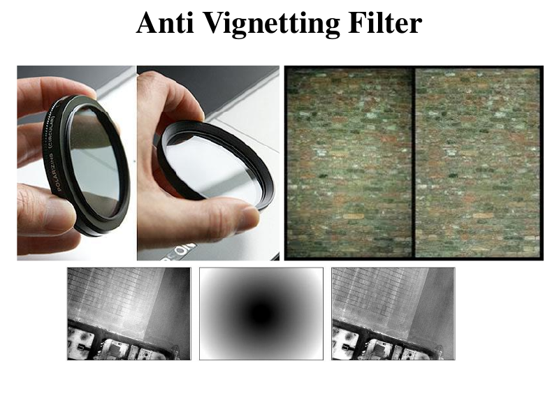
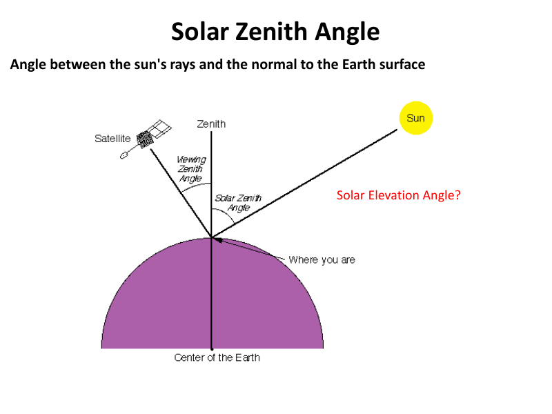
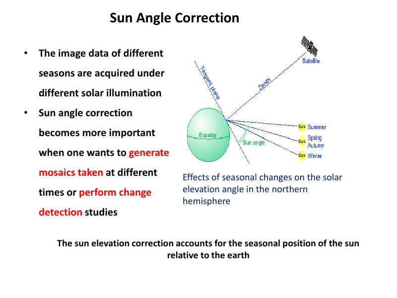
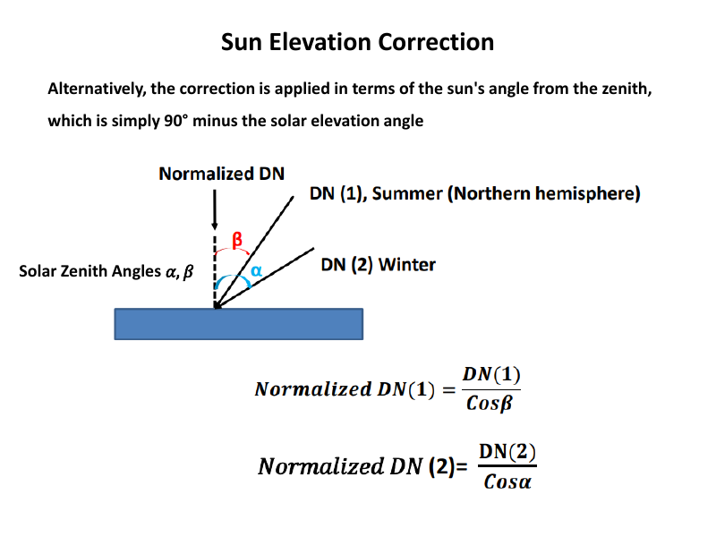
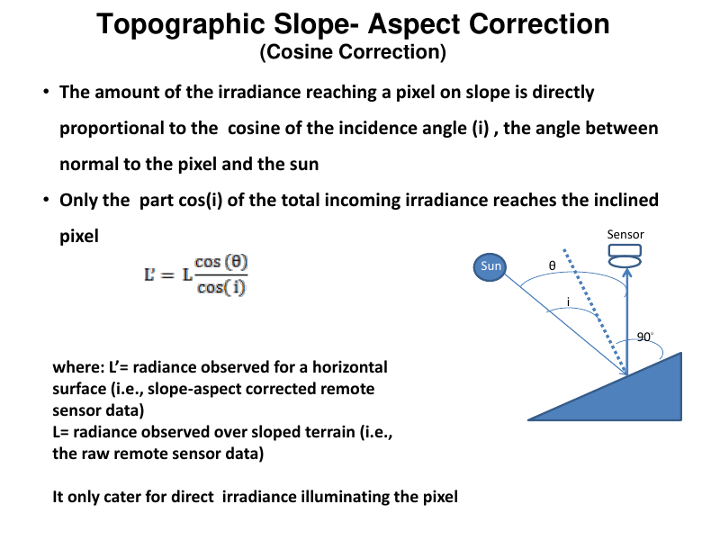

# Lecture 3 — Radiometric / Atmospheric Distortions and Corrections (Part I)

> **Big idea in one line:** Geometric correction fixed *where* pixels are; radiometric correction fixes *how bright* they are. It adjusts brightness values to fix sensor problems and to compensate for sun angle, view angle, and terrain.

---

## 1. What is Radiometric Preprocessing?

**Radiometric preprocessing** changes the **brightness values** of an image to:
- Correct for **sensor malfunctions**, and/or
- Adjust values to compensate for **atmospheric degradation**.

**Do you always need it?** No — it depends on the **application**. You especially need it when you want to:
- Make **mosaics** of images taken at **different times**, or
- Study **changes in reflectance** of ground features over time.

> **Memory tip:** *Geometric = position; Radiometric = brightness.* (Both are "pre-processing.")

---

## 2. Why Radiometric Correction is Needed — 4 sources of variation

Radiometric corrections may be needed because of variations in:

> **Acronym → "SAST":**
- **S** — **S**cene illumination and viewing geometry
- **A** — **A**tmospheric conditions
- **S** — **S**ensor noise and response
- **T** — **T**opography

Each varies depending on **the specific sensor/platform** used and **the conditions during acquisition**.

---

## 3. Radiometric Distortion from the Sensor itself

### a) Electro-Optical type sensors
- Distortion = **inaccurate representation of the radiance** actually leaving the object.
- Happens when individual **detectors malfunction** or are **improperly calibrated**.
- Examples: **missing scan lines**, **bad pixels (shot noise)**.

### b) Lens type sensors — Vignetting
- Optical sensors that use a **lens** show **darker corners** (a "fringe" area) compared to the bright **center**.
- This darkening of the edges is called **vignetting**.

**Correction → Anti-Vignetting Filter:**
- A glass plate whose **transmissivity decreases from edge towards center**.
- It is **darker in the center** and gradually **lighter towards the edges** — so it cancels out the lens's natural darkening of the corners, evening out the brightness.

> **Memory tip:** **Vignette = "shadowy corners"** (like an old photo). The filter is the *opposite*: dark in middle, light at edges → balances it out.



---

## 4. Illumination and View Angle Effects

The strength of the signal reaching the sensor depends on several things:

> **Things that affect the received signal → "R-A-S-V-S":**
- **R**eflectance of the target
- **A**tmospheric interactions (nature + magnitude)
- **S**lope and aspect of the target (relative to solar azimuth)
- **V**iew angle of the sensor
- **S**olar elevation / zenith angle

### Solar Zenith Angle vs Solar Elevation Angle (don't mix these up!)
- **Solar Zenith Angle** = angle between the **sun's rays** and the **normal (vertical/perpendicular)** to the Earth's surface.
- **Solar Elevation Angle** = angle of the sun **above the horizon**.
- **They are complementary:**
  ```
  Zenith angle = 90° − Elevation angle
  ```

> **Memory tip:** **Zenith** is measured **from straight up (the vertical)**; **Elevation** is measured **from the flat horizon**. They add up to **90°**.



### How angles affect the signal
- **Upwelling radiance** from a target must pass through the atmosphere → the **sensor's view angle** affects the **upward path length**.
- If atmosphere is present, **irradiance at the target is reduced** depending on **atmospheric path length**.
- As **solar elevation decreases → path length increases → more atmospheric interference**.
- **Nadir view** (straight down) is **less affected** than off-nadir.
- With **no atmosphere**, the recorded radiance depends mainly on **illumination angle** and **sensor view angle**; reflectance varies as these angles change, plus **slope/aspect**.

> **Memory tip:** **Low sun = long path = more haze/interference.** Look straight down (nadir) = shortest path = cleanest.

---

## 5. Sun Angle / Sun Elevation Correction

**The problem:** Images of different **seasons** are taken under **different solar illumination** (the sun sits at different heights). This matters most for **mosaics from different times** or **change detection**.

**The fix:** Normalize images as if the **sun were directly overhead (at the zenith)** on every date.

> **Memory tip:** Sun-elevation correction = *"pretend the sun was straight overhead on every image"* so they're comparable.



### Sun Elevation Correction formula
Divide each pixel by the **sine of the solar elevation angle**:
```
DNc = DNa / sin(θ)
```
- **DNc** = Sun-angle corrected (normalized) Digital Number
- **DNa** = Actual DN
- **θ** = solar elevation angle

Alternatively use the **zenith angle** (= 90° − elevation). Either way, this correction **ignores topographic and atmospheric effects**.



### Radiometric correction for view angle effects
- If solar zenith angle = **θ**, observed radiance = **L**, desired view angle = **X**, a correction standardizes images to a **standard solar illumination angle**.
- The **sensor elevation angle** also affects the **upward path length**.
- **Shadowing** also depends on the **solar elevation angle**.

---

## 6. Radiometric Distortion from Topography

In **mountainous regions**, images contain a distortion called **topographic effect**.

**Cause:** Differences in **illumination** because of the **angle of the sun** and the **angle of the terrain (slope)**.

**Result:**
- Variation in brightness values.
- The **same object** gets **different brightness values** on the **sunlit side vs the shadowed side**.
- Similar land covers → **different reflectances** (in extreme cases, data is **lost** to heavy shadow).
- Inclined surfaces give different radiance than horizontal ones.

> **Memory tip:** Same hill, two sides → sunny side looks bright, shady side looks dark, even though it's the **same land cover**. That's the topographic effect.

### Topographic Slope-Aspect Correction (Cosine Correction)

The irradiance reaching a sloped pixel is **directly proportional to the cosine of the incidence angle (i)** — the angle between the **normal to the pixel** and the **sun**.

- Only the portion **cos(i)** of the total incoming irradiance reaches the inclined pixel.

```
L' = correction applied to L
```
- **L'** = radiance for a horizontal surface (slope-aspect corrected data)
- **L** = radiance observed over sloped terrain (raw data)

It only accounts for **direct irradiance** illuminating the pixel (not diffuse/sky light).

> **Memory tip:** **"Cosine Correction"** → flatter sun-to-slope angle = more light = bigger cos(i). It rescales sloped pixels as if the ground were flat.



---

## ⭐ Quick Revision Cheat-Sheet (Lecture 3)

- **Radiometric = brightness correction** (sensor faults + atmosphere/sun/terrain).
- **4 sources of variation → "SAST":** Scene illumination, Atmosphere, Sensor noise, Topography.
- **Sensor distortions:** electro-optical → missing lines/bad pixels; lens → **vignetting** (dark corners), fixed with an **anti-vignetting filter** (dark center, light edges).
- **Zenith vs Elevation:** `Zenith = 90° − Elevation`. Zenith from vertical, elevation from horizon.
- **Low sun → long atmospheric path → more interference.** Nadir = cleanest.
- **Sun elevation correction:** `DNc = DNa / sin(θ)` → normalize as if sun overhead.
- **Topographic effect:** same land cover looks different on sunny vs shady slope.
- **Cosine correction:** light reaching a slope ∝ **cos(incidence angle i)**; corrects sloped pixels to horizontal-equivalent.
