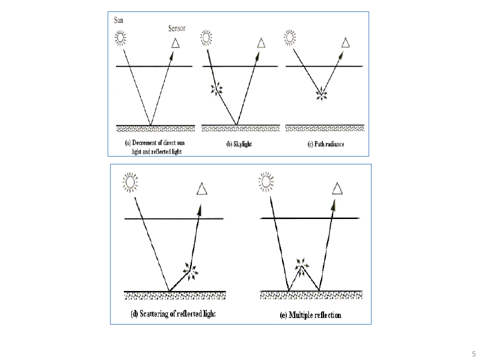
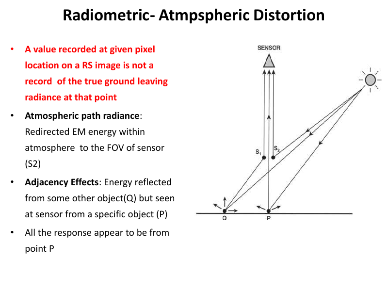
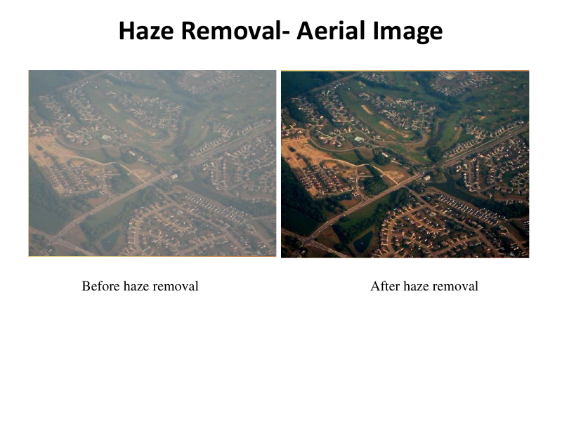
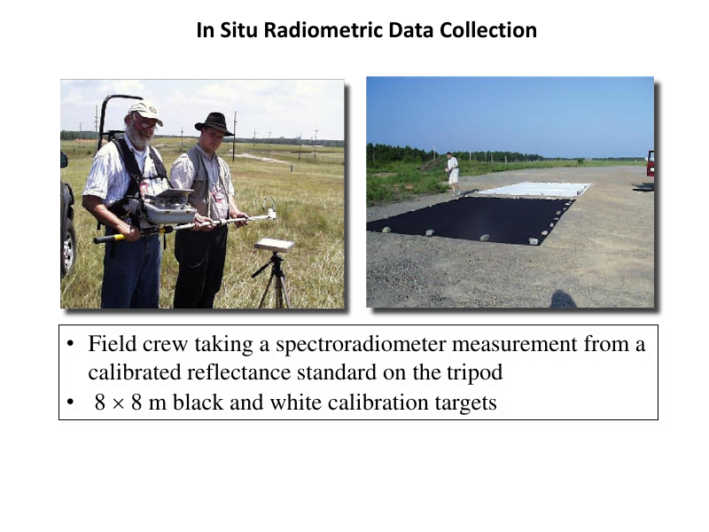
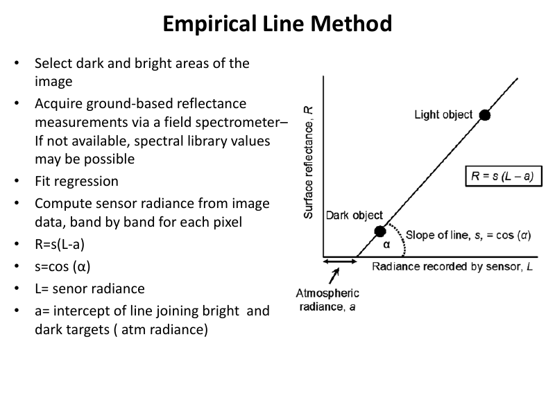
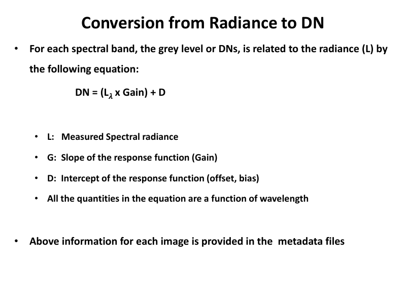
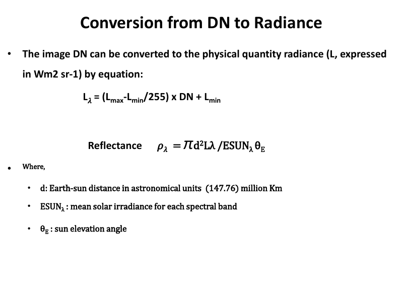

# Lecture 4 — Radiometric / Atmospheric Distortions and Corrections (Part II)

> **Big idea in one line:** The atmosphere scatters and absorbs light on its way to and from the ground, adding "haze" and unwanted signal. This lecture covers how to *remove that atmospheric effect* and how to *convert raw DN values into real physical units* (radiance/reflectance).

---

## 1. Radiometric Distortion — the journey of light

The electromagnetic (EM) radiance reaching the sensor goes through **complex interactions**.

**Solar radiance reaching the upper atmosphere depends on:**
- **Longitude and latitude**
- **Time** (date and hour) of the year

**Going through the atmosphere (down and back up), EM radiance is affected by:**
- **Scattering**
- **Absorption**

**The incident radiance on the surface depends on:**
- **Optical depth** (height of the surface)
- **Slope and aspect** of the surface

> **Memory tip — two atmospheric "thieves": "S & A" = Scattering + Absorption.**

---

## 2. Atmospheric Distortion — the core problem

Ideally, the radiant flux the sensor records would **exactly** represent the flux leaving the target. **But it doesn't.**

The energy a sensor sees does **NOT** equal the energy actually leaving the object, because of:

1. **The atmosphere as a transmission medium** (it scatters/absorbs light).
2. **Adjacency effect** — signal from one pixel gets **mixed with signals from surrounding pixels**.

### Key terms (very important)
- **Atmospheric Path Radiance (Lp):** EM energy that is **redirected within the atmosphere** into the sensor's field of view (FOV) — energy that **never touched your target** but still reaches the sensor. This is **unwanted noise/haze**.
- **Adjacency Effect:** Energy reflected from **a neighbouring object (Q)** but seen by the sensor **as if it came from your target object (P)**.
- The problem: **all the response appears to come from point P**, even though some came from elsewhere.



### The 5 paths of radiance (useful mental model)
- **Paths 1, 3, and 5** carry the **valuable, intrinsic** spectral information about the **target**. This is the **target radiance (LT)** you actually want.
- **Paths 2 and 4** are **path radiance (Lp)** — diffuse sky light or radiance from **neighbouring areas**. This is **unwanted noise** that complicates interpretation.



> **Memory tip:** **Odd paths (1,3,5) = good (Target); Even paths (2,4) = bad (Path radiance noise).**

---

## 3. Atmospheric Corrections — removing the haze

**Effect of scattering:** it **lifts the overall brightness** of every band and **reduces contrast** (introduces **haze**).

So atmospheric correction = **"Haze Removal"** = **haze compensation**, designed to minimize **path radiance** effects and **improve image contrast/intensity**.

### When do you NEED atmospheric correction? (3 cases)
1. To compute a **ratio** of pixel values in two bands.
2. To **relate upwelling radiance to a surface property** — the atmospheric component must be estimated and removed.
3. To **compare two or more images from different times** — since the atmosphere varies, you must correct each.

> **Memory tip — "Ratio, Relate, Compare" = the 3 reasons to correct the atmosphere.**

### The key assumptions
- Each band should have **some pixels at or near zero brightness** (very dark areas like deep/clear water).
- Atmospheric path radiance has added a **constant value** to every pixel in that band.
- So: find that constant (the "extra" floor) and **subtract it**.

---

## 4. Image-Based Correction Methods

Both methods estimate the **path radiance** and **subtract it** from the sensor signal.

### a) Histogram Minimum Method (HMM) — a.k.a. Dark Object Subtraction (DOS)
- Compute **histograms** of pixel values in all bands (use areas of **low reflectance** like clear/deep water).
- These dark pixels should be **near zero** in the **near-infrared (NIR)** bands and near zero in other bands too.
- But the histograms of the visible/NIR bands are **shifted/offset towards higher values** — that offset is the **path radiance**.
- **Subtract** each band's minimum value from that band.



> **Memory tip — "Dark Object Subtraction":** The darkest pixel *should* be 0. Whatever value it actually has is the haze → subtract it from the whole band.

### b) Regression Method
- Applies to **dark pixel areas**.
- Plot pixel values in **NIR** (x-axis) against values in another band (y-axis).
- Compute the **best-fit line** (regression) for each band.
- The **offset/intercept on the x-axis** = estimate of **atmospheric path radiance** for that band.
- This intercept is the **correction value** → **subtract** it from each visible band.
- Can be applied to **local areas**.



> **Memory tip:** HMM looks at the **histogram floor**; Regression looks at the **line's intercept**. Both find "the extra haze" and subtract it.



---

## 5. Empirical Line Method (uses field measurements)

This method **forces the image data to match real measured reflectance** from the ground.

**How it works:**
- Requires **ground measurements** (taken at roughly the same time/date as the imaging).
- Identify **two or more ground targets** — at least **one light and one dark** area — and measure their reflectance in the field (with a **field spectrometer/spectroradiometer**).
- Find the **same two targets** in the image and extract average spectra for those **Regions of Interest (ROIs)**.
- Calculate a **linear regression** between **field reflectance** and **image radiance** (each band separately) → gives a transform from **radiance to reflectance**.
- Apply the **gains and offsets** to every pixel → produces **apparent reflectance pixel-by-pixel**.

**The formula:**
```
R = s · (L − a)
s = cos(α)
```
- **R** = reflectance
- **L** = sensor radiance
- **a** = intercept of the line joining the bright and dark targets (the atmospheric radiance)
- **s** = slope/gain (= cos of the solar angle α)

> **Memory tip — "Empirical Line = 1 Light + 1 Dark target + a straight line."** You need at least one bright and one dark known target to draw the calibration line.



**Field data collection:** A field crew uses a **spectroradiometer** on a calibrated reflectance standard (e.g., 8 × 8 m black-and-white calibration targets) on a tripod.



> If multi-temporal images are processed, they **must** be atmospherically corrected so they're comparable.

---

## 6. Radiometric Calibration (DN ↔ Radiance ↔ Reflectance)

**The problem with DN values:**
- Pixel values in commercial imagery are **Digital Numbers (DN)** — calibrated to fit a fixed range.
- DNs have practical value but are **not physical brightness units**.
- Each image becomes its **own entity** with **no defined relationship** to other images or to ground features.

**When calibration is essential:**
- When **absolute radiance** measurement is required.
- When measuring **changes in absolute reflectance over time** using **different sensors**.
- For **comparative analysis** of several images from **different sensors**.

> **Why:** Each sensor has its own calibration parameters, so **the same DN in two different sensors can mean two different radiances** (or vice versa). You must convert to physical units to compare fairly.

### Three parameters the detector measures (per band)
1. **Range of DN values** in the image
2. **Lowest radiance (Lmin)** — radiance at the minimum DN (usually DN = 0)
3. **Highest radiance (Lmax)** — radiance at the maximum DN (usually DN = 255)

Data is commonly **8-bit → 256 DN levels (0–255)**.

### Conversion: Radiance → DN
For each spectral band:
```
DN = (Lλ × Gain) + D
```
- **Lλ** = measured spectral radiance
- **Gain (G)** = slope of the response function
- **D** = intercept of the response function (offset / bias)
- All quantities are functions of **wavelength**.
- This info is in the image's **metadata file**.

### Conversion: DN → Radiance
```
Lλ = ((Lmax − Lmin) / 255) × DN + Lmin
```
And reflectance:
```
ρλ = (π · d² · Lλ) / (ESUNλ · θE)
```
- **d** = Earth–Sun distance in astronomical units (≈ 147.76 million km)
- **ESUNλ** = mean solar irradiance for the band
- **θE** = sun elevation angle

### DN → Radiance for Landsat 8 (uses metadata scaling factors)
```
Lλ = ML × Qcal + AL
```
- **Lλ** = spectral radiance (W/(m²·sr·μm))
- **ML** = radiance **multiplicative** scaling factor (`RADIANCE_MULT_BAND_n` in metadata)
- **AL** = radiance **additive** scaling factor (`RADIANCE_ADD_BAND_n` in metadata)
- **Qcal** = pixel value in DN

> **Memory tip — Landsat 8: "Multiply then Add" → `L = ML·Qcal + AL`** (it's just `y = mx + c`).

---

## 7. Do you always need atmospheric correction?

It **mainly depends on the application.**

**REQUIRED if you need to:**
- Do **calibrated analysis**
- **Compare** calibrated spectra across **location and time**
- Compare calibrated spectra to **spectral libraries**

**NOT required if:**
- Only **visual analysis** is needed
- Only **basic classification** (obvious land covers)
- **Single-image** analysis

> **Memory tip:** **"Comparing across time/sensors/libraries → correct. Just looking at one image → don't bother."**

---

## 8. Pre-Processing Tips (Conclusion)

Before starting a project:
- Get as much info as possible from the **vendor** about what was already done to the image.
- **Check the header** and all files supplied with the image.
- **Visually check** the image for atmospheric effects (e.g., visible haze).

Evaluate your needs:
- If **not** doing change detection → you **don't** need atmospheric correction.
- For a **visual overlay** with map data → use **bicubic resampling**, but **never** for quantitative analysis.

Know your algorithms:
- Be aware of each method's **assumptions, implications, and limitations** — know exactly **what** it is correcting.

---

## ⭐ Quick Revision Cheat-Sheet (Lecture 4)

- **Two atmospheric thieves:** **Scattering + Absorption.**
- **Path radiance (Lp):** unwanted light into the sensor that never hit your target (= haze). **Adjacency effect:** light from neighbouring pixels mistaken as yours.
- **5 paths:** odd (1,3,5) = good target signal; even (2,4) = bad path radiance.
- **Atmospheric correction = "Haze Removal."** Needed for: **Ratio, Relate, Compare.**
- **HMM / Dark Object Subtraction:** darkest pixel should be 0 → subtract its actual value (histogram floor).
- **Regression method:** plot NIR vs band; x-intercept = path radiance → subtract.
- **Empirical Line Method:** 1 light + 1 dark field target → regression → `R = s(L − a)`, `s = cos α`.
- **DN problem:** not physical units; same DN ≠ same radiance across sensors → calibrate.
- **DN → Radiance:** `Lλ = ((Lmax−Lmin)/255)·DN + Lmin`. **Landsat 8:** `Lλ = ML·Qcal + AL`.
- **Correct atmosphere when comparing across time/sensors/libraries; skip for single-image visual work.**
