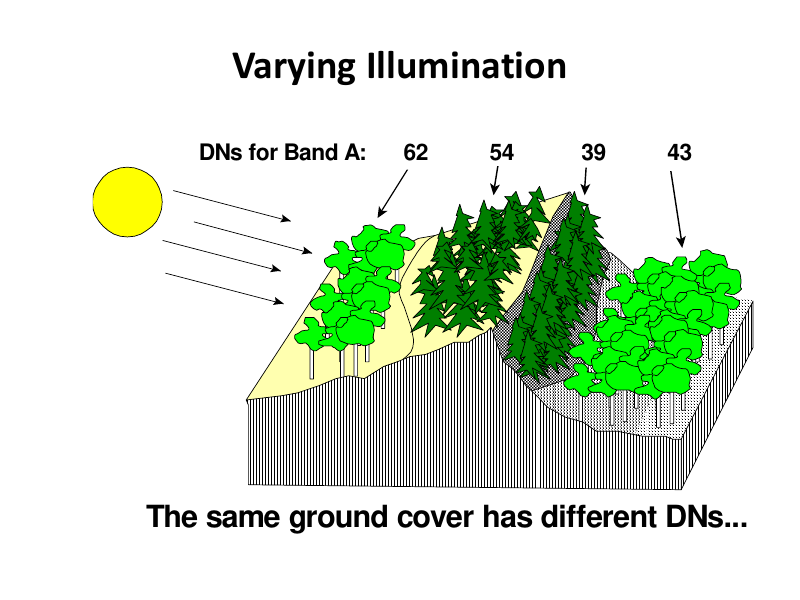
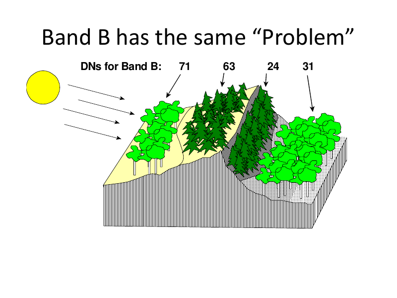
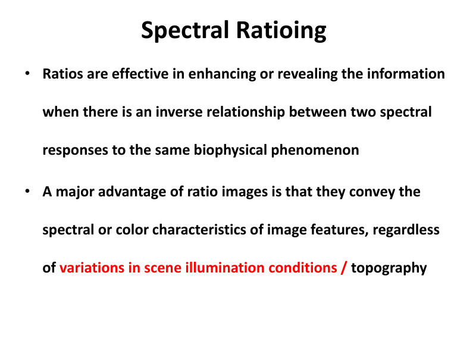

# Lecture 5 — Multi-band Operations & Spectral Transforms

> **Big idea in one line:** Combine two or more image bands with simple arithmetic (add, subtract, multiply, divide) to reveal features you can't see in a single band. The star of the show is **band ratioing**, which cancels out illumination/topography effects.

---

## 1. Image Transform vs Spectral Transform

- **Image Transform:** an operation that **re-expresses the information content** of an image (or set of images).
- **Spectral Transform:** uses the **spectral information** of an object recorded in **multiple bands**.

> **Memory tip:** *Transform = re-express the info in a new, more useful form.*

---

## 2. Multi-band Operations

**What they do:** generate a **derived image** from **two or more bands** of a multispectral or multi-temporal image.

**Why:** to **enhance or extract features** that **cannot be clearly seen in a single band**. The derived image may be **better suited to a purpose** than the originals.

**What images can be combined:**
- Separate spectral bands from a **single multispectral dataset**, OR
- Individual bands from datasets recorded at **different dates** or by **different sensors** — but **preferably from the same sensor**.

**Requirement:** The images must be **co-registered** (same geographic area, aligned) — operations are done **pixel-by-pixel**.

> **The 4 arithmetic operations → "ASMD": Add, Subtract, Multiply, Divide.**

---

## 3. The Four Arithmetic Operations

### a) Addition
```
Gsum(i, j) = [G1(i, j) + G2(i, j)] / 2
```
- Really a form of **averaging**.
- Averaging multiple images of the **same area** is used to **reduce the noise** component.

> **Memory tip:** **Add → average → less noise.** (Random noise cancels out when you average.)

### b) Subtraction
```
Gabsdiff(i, j) = | G1(i, j) − G2(i, j) |
```
- Reveals **differences** between two images.
- Main use: **change detection** when images are from **different dates**.
- Done **pixel-by-pixel**.
- The bars `| · |` mean **absolute value** (ignore the sign).

> **Memory tip:** **Subtract → spot the change** (what's different between two dates).

### c) Multiplication
- Pixel-by-pixel multiplication of two images — **rarely used directly**.
- Usually involves **one 'real' image** and **one binary image (0s and 1s)** used as a **mask**.
- Pixels multiplied by **0 → become 0** (hidden); pixels multiplied by **1 → stay the same** (kept).
- Useful when you want to **isolate one region** of interest from the rest.

> **Memory tip:** **Multiply = masking.** ×1 keeps it, ×0 kills it.

### d) Division / Ratioing
- The **most widely applied** arithmetic operation in remote sensing.
- Detects the **magnitude of differences between spectral bands**.
- A **ratio image** = dividing the DN values of one band by the corresponding values of another band.

---

## 4. Band Ratio (the most important operation)

```
BVi,j,ratio = BVi,j,k / BVi,j,l
```
- **BVi,j,k** = input brightness value in **band k**
- **BVi,j,l** = input brightness value in **band l**
- **BVi,j,ratio** = the output ratio brightness value

### Why ratioing is so powerful
- It conveys the **spectral/colour characteristics** of features, **regardless of variations in scene illumination/topography**.
- It is **effective when there's an inverse relationship** between two spectral responses to the same biophysical phenomenon.

> **Memory tip:** **Ratio = relative, not absolute.** Brightness differences from sun angle/slope **cancel out** when you divide one band by another.

---

## 5. Spectral Ratioing fixes brightness/illumination variation

**The scenario:** When a satellite passes over terrain with relief, it records both **shaded** and **sunlit** areas.
- Observed DNs are **much lower on the shaded side** than the sunlit side.
- **BUT the ratio values are nearly identical**, regardless of illumination.
- A ratio image **compensates for brightness variation** caused by topography.

### Worked example (from the slides)

The **same ground cover** gives different DNs on sunlit vs shaded slopes:

| | Pixel 1 | Pixel 2 | Pixel 3 | Pixel 4 |
|---|---|---|---|---|
| **Band A** | 62 | 49 | 19 | 27 |
| **Band B** | 71 | 63 | 24 | 31 |
| **Ratio A/B** | **0.87** | **0.78** | **0.79** | **0.87** |

Notice: the raw DNs vary wildly (62 vs 19), but **after ratioing the values become similar** → the same ground cover now has similar values. The topographic brightness problem is "alleviated."



### Benefits of spectral ratioing (summary)
- Looks at **relative values (ratios)** instead of **absolute brightness**.
- **Reduces variations** in scene illumination from **topographic effects**.
- Absolute reflectance of forest slopes may vary with sun orientation, but the **ratio between two bands stays very similar**.



> **Memory tip — the headline fact:** *"Same land cover, different brightness on sunny vs shady slope → but the BAND RATIO stays almost the same."* That's why ratios beat raw DNs for identifying materials.



---

## 6. Important Caution about Ratios

- The ratio between two **raw DNs** will normally be **quite different** from the ratio between two **radiance values** for the same pixel.
- So band selection and whether you use DN or radiance **matters**.
- Some **trial and error** is often needed to pick the best band combination.

> **Memory tip:** **Ratio of raw DNs ≠ ratio of radiances.** Be consistent about which you use.

---

## 7. Ratio Composites

- Ratio images can be combined into **false-colour composites** by combining **three** monochromatic (single-band) ratio datasets.

**Advantages:**
- Combines data from **more than two bands**.
- Presents data in **colour** → easier to interpret slight spectral reflectance differences.

**Challenges:**
- Choosing **which ratios** to include and **which colours** to assign can be **difficult**.
- Often needs **trial and error**.

> **Memory tip:** **3 ratios → R, G, B → one colourful composite.**

---

## ⭐ Quick Revision Cheat-Sheet (Lecture 5)

- **Multi-band operation:** combine ≥2 co-registered bands (pixel-by-pixel) to reveal hidden features.
- **4 operations → "ASMD":**
  - **A**dd → averaging → **reduces noise**.
  - **S**ubtract (absolute) → **change detection** between dates.
  - **M**ultiply → **masking** with a binary 0/1 image (×1 keep, ×0 remove).
  - **D**ivide (ratio) → **most used**; reveals band differences, cancels illumination.
- **Band ratio = band k ÷ band l.** Gives **relative** (not absolute) values.
- **Killer benefit:** same land cover on sunny vs shady slope → raw DNs differ, but **ratio stays nearly the same** (cancels topography/illumination).
- **Best when** there's an **inverse relationship** between two band responses.
- **Caution:** ratio of raw DNs ≠ ratio of radiances.
- **Ratio composite:** 3 ratio images → false-colour RGB composite (needs trial & error).
