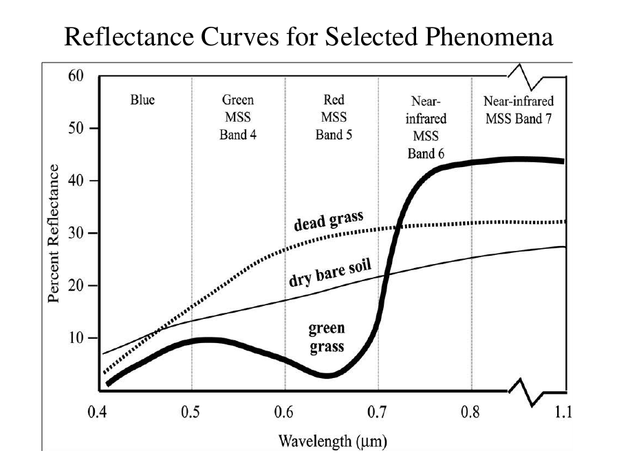
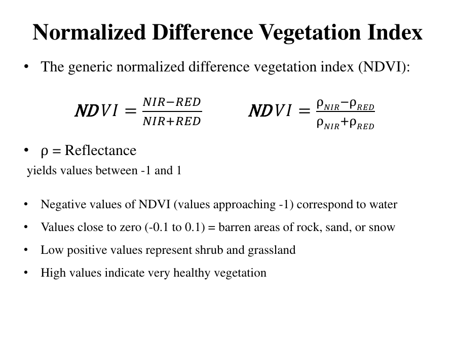
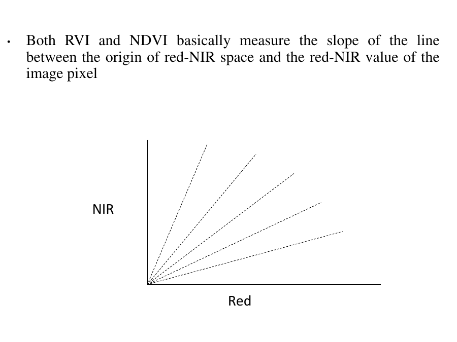
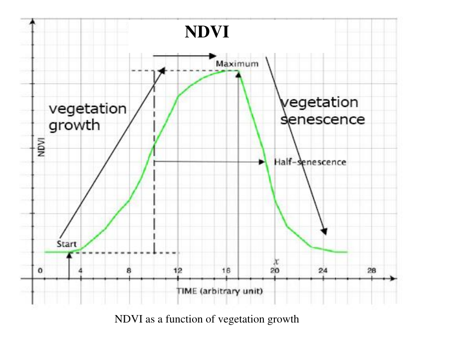

# Lecture 6 — Normalized Difference Vegetation Index (NDVI)

> **Big idea in one line:** Healthy green plants absorb red light and strongly reflect near-infrared (NIR). By combining the red and NIR bands into a single number (NDVI), we get a "greenness map" that tells us how much healthy vegetation is in each pixel.

---

## 1. Vegetation Spectral Response (why this works)

Most natural surfaces are about **equally bright in red and NIR**. The big **exception is green vegetation**:
- **Red light** is **strongly absorbed** by **chlorophyll** (plants use it for photosynthesis).
- **NIR (near-infrared)** is **strongly reflected** by the same healthy leaves.

So an area with lots of green vegetation is **very bright in NIR** and **very dark in red**.

### The healthy-vegetation reflectance curve (in order of wavelength)
- **Blue → absorbed**
- **Green → reflected** (that's why plants look green to us)
- **Red → absorbed**
- **NIR → strongly reflected**

> **Memory tip — "A-R-A-R" up the spectrum:** **A**bsorb blue, **R**eflect green, **A**bsorb red, **R**eflect NIR (the last one is the strongest).

This is why using the **red and NIR** range so strongly separates vegetation from everything else.



### NIR reflectance drops when the plant is unhealthy
NIR reflectance **changes (drops)** with:
- **Stress**
- **Disease**
- **Water stress**
- **Old age** (senescence)

> **Memory tip:** Sick/old plants reflect **less NIR** → lower index values. *"Healthy = high NIR; stressed = low NIR."*

---

## 2. What is a Vegetation Index (VI)?

A **Vegetation Index (VI)** is a **new "image layer"** created from the **existing bands** of a multispectral image. This new layer gives **unique, valuable information** not found in any single band.

**How it's built:** combine two or more spectral bands (add, divide, multiply) → produce a **single value per pixel** that indicates the **amount or vigour** of vegetation.

**What VIs let us do:**
- Identify **unhealthy/stressed** vegetation (stressed plants → low NIR → lower ratio).
- **Enhance/discriminate** vegetation from other surface covers.
- Track **temporal characteristics** (how vegetation changes over time).

**VIs can reduce sensitivity to ("the 4 nuisances"):**
> **Acronym → "TBVA":**
- **T**opographic effects
- **B**ackground (soil)
- **V**iew / illumination angle
- **A**tmosphere

---

## 3. The two categories of Vegetation Indices

> **Memory tip — two families: "Ratio" and "Perpendicular."**

| Category | Members | Idea |
|----------|---------|------|
| **Ratio indices** | **RVI**, **NDVI** | Measure the **slope** of the line from origin to the pixel in red-NIR space |
| **Perpendicular indices** | **PVI**, **SAVI** | Measure **perpendicular distance** from the "soil line" (covered in Lec 7) |

**Other indices mentioned:** RVI, DVI, NDVI, PVI, IPVI, SAVI, MSAVI, GVI… and many more.

---

## 4. The Ratio Indices (the math)

### Ratio Vegetation Index (RVI) / Simple Ratio (SR)
The **first true vegetation index**:
```
RVI = SR = NIR / RED      (or  ρNIR / ρRED  using reflectance)
```
- Uses the **inverse relationship**: chlorophyll absorbs red, leaves reflect NIR.
- **RVI < 1 → un-vegetated.**
- ⚠️ RVI **can create infinite values** (dividing by a tiny red value).
- RVI itself is **no longer generally used** → replaced by **NDVI**.

### Difference Vegetation Index (DVI)
```
DVI = NIR − RED
```
- **DVI < 0 → un-vegetated.**

### Normalized Difference Vegetation Index (NDVI) ⭐ the star
```
NDVI = (NIR − RED) / (NIR + RED)      (or with reflectance ρ)
```
- **ρ = reflectance.**
- **Yields values between −1 and +1.**

> **Memory tip — NDVI = "difference over sum" of NIR and RED.** Normalizing by the sum keeps it bounded between −1 and +1 (no infinite values like RVI).

### What NDVI values mean
| NDVI value | Means |
|------------|-------|
| **Negative** (approaching −1) | **Water** |
| **Close to zero** (−0.1 to 0.1) | Barren: **rock, sand, snow** |
| **Low positive** | **Shrub and grassland** |
| **High** | **Very healthy vegetation** |

> **Memory tip — climbing the scale: "Water → Bare → Grass → Forest"** as NDVI goes from −1 up to +1.



### Geometric meaning
Both **RVI and NDVI measure the slope** of the line between the **origin** of red-NIR space and the **red-NIR value** of the pixel.



---

## 5. NDVI in practice

- NDVI is **one of the most widely used image transforms**.
- Used to monitor vegetation at **continental and global scales** with the **AVHRR** (Advanced Very High Resolution Radiometer) sensor on the **NOAA** satellites.

### NDVI Images = "Greenness Maps"
- Show the **vigour and density** of surface vegetation.
- Let us **compare current vegetation to past periods** (e.g., an average year, a good year, a bad year) to spot **anomalies**.
- NDVI can be computed **per administrative unit** or **per crop/land cover type**.

### NDVI over a crop season
- In a cropped area, NDVI **steadily increases** as the season progresses (young → healthy green crops).
- Reaches a **maximum**, then **falls with senescence** and harvest.

**Time-series NDVI analysis helps:**
- Estimate **net primary production** across biomass types.
- Monitor **phenological patterns** (timing of growth stages).
- Assess the **length of the growing season**.



---

## 6. Strengths & Limitations of NDVI

**Strengths:**
- **Simple** to use.
- Only needs **Red and NIR** bands.
- **Widely used** for monitoring vegetation.

**Limitation:**
- A **poor indicator of biomass when ground cover is low** — e.g., **arid and semi-arid regions**. (This is exactly the problem SAVI fixes — see Lecture 7.)

> **Memory tip:** **NDVI struggles where soil shows through** (sparse cover). That weakness is why SAVI exists.

---

## ⭐ Quick Revision Cheat-Sheet (Lecture 6)

- **Vegetation physics:** chlorophyll **absorbs red**, leaves **reflect NIR**. Curve: **A-R-A-R** (absorb blue, reflect green, absorb red, reflect NIR).
- **Stressed/old/diseased/water-stressed plants → less NIR → lower index.**
- **VI = new layer** from existing bands; reduces **TBVA** (Topography, Background soil, View angle, Atmosphere).
- **Two families:** Ratio (RVI, NDVI) and Perpendicular (PVI, SAVI).
- **RVI = NIR/RED** (<1 un-vegetated, can be infinite). **DVI = NIR−RED** (<0 un-vegetated).
- **NDVI = (NIR−RED)/(NIR+RED)**, range **−1 to +1**.
- **NDVI scale:** Water (neg) → Bare rock/sand/snow (~0) → Grass/shrub (low+) → Healthy forest (high).
- **AVHRR on NOAA** used for global NDVI; NDVI rises through a crop season then falls at harvest.
- **NDVI weakness:** low ground cover (arid regions) → SAVI is better there.
