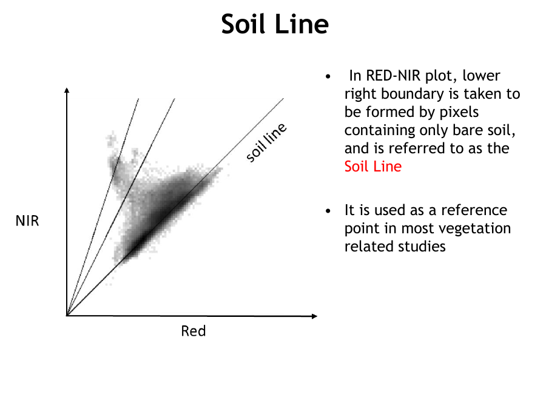
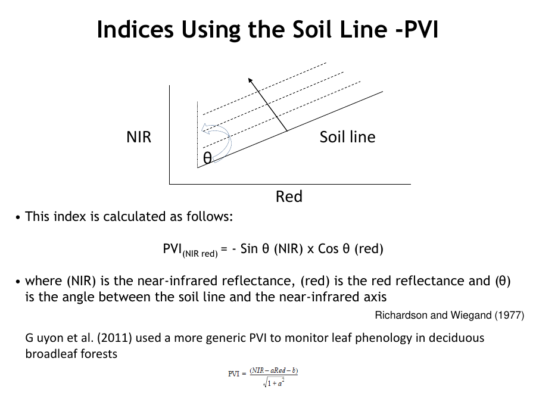
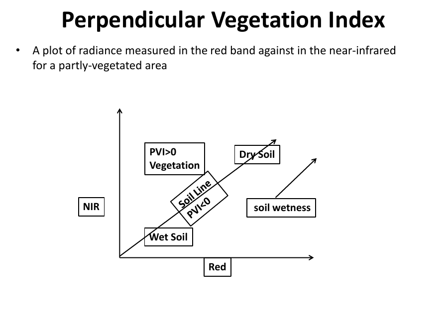
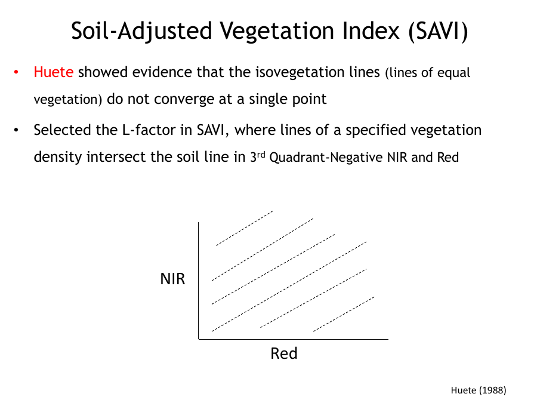
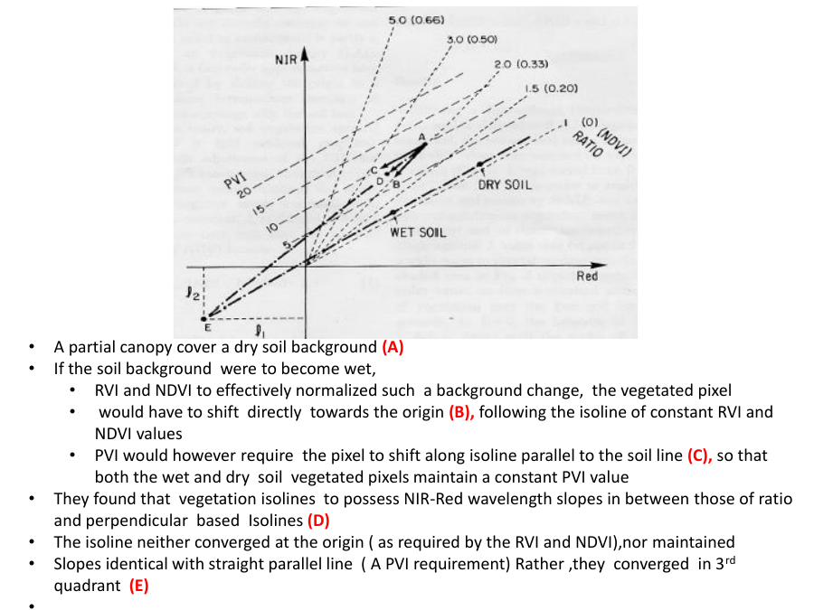

# Lecture 7 — Soil-Adjusted Vegetation Index (SAVI) & the Perpendicular Indices

> **Big idea in one line:** When vegetation cover is sparse, the bare **soil background** distorts NDVI. SAVI (and the perpendicular indices like PVI) fix this by referencing the **"soil line"** and adding a soil-adjustment factor **L**, giving better results in low-cover areas.

---

## 1. Recap: the two index families

- **Ratio indices** (RVI, NDVI): measure the **slope** of the line from the origin to the pixel in red-NIR space.
- **Perpendicular indices** (PVI, SAVI): measure the **perpendicular distance** from the **soil line**.

---

## 2. The Soil Line (the key reference concept)

In a **RED (x) vs NIR (y)** plot:
- The **lower-right boundary** is formed by pixels containing **only bare soil**.
- This boundary line is called the **Soil Line**.
- It is used as a **reference point** in most vegetation studies.

**Key facts about the soil line:**
- The spectral response of living vegetation always has a **consistent relationship** to this line.
- There's a **principal axis of soil spectral variation** extending outward from the origin (brighter soil = farther out).
- Most soil spectra fall **on or close to** the soil line.



**Important cautions:**
- The soil line is **different** for different **areas/soil types**.
- It **varies** for different NIR and red **band passes**.
- The truly valid approach is to **compute the soil line for each image**.
- Assuming all bare-soil spectra form a **single line** can be inaccurate — there's **no universal soil brightness line** (local soils vary). But these variations are **minor in the red and infrared** regions.

> **Memory tip:** **Soil line = the "bare-ground baseline."** How far a pixel sits *above* it tells you how much vegetation is there.

---

## 3. Perpendicular Vegetation Index (PVI)

**Core assumption:** the **perpendicular distance** of a pixel from the **soil line** is **linearly related to vegetation cover**.
- **Iso-vegetation lines** (lines of equal vegetation) are all **parallel to the soil line**.

**Formula:**
```
PVI = −sin(θ)·(NIR) × cos(θ)·(red)
```
- **NIR** = near-infrared reflectance
- **red** = red reflectance
- **θ** = angle between the **soil line** and the **NIR axis**
- (a and b = slope and intercept of the soil line in the generic form)



**What PVI shows on a red-NIR plot:**
- **Vegetation** plots **above** the soil line (PVI > 0).
- Soil ranges from **dry soil** to **wet soil** along the soil line (soil wetness moves the point along the line).



> **Memory tip:** **PVI = how far (perpendicular) a pixel sticks UP from the soil line.** More distance = more vegetation.

---

## 4. Soil-Adjusted Vegetation Index (SAVI)

**Purpose:** a vegetation index designed to **minimize the effect of the soil background** in indices that use red and NIR.

**Why we need it:**
- Vegetation info is **hard to extract when cover < 30%**.
- In **arid/semi-arid** regions cover is always low; even in farming, cover is low when **crops are just emerging**.
- **SAVI is superior for low-cover environments.**

### The insight behind SAVI (Huete, 1988)
- Huete showed the **iso-vegetation lines do NOT converge at a single point** (unlike the assumption in NDVI/RVI).
- He chose an **L-factor** so that lines of a given vegetation density **intersect the soil line in the 3rd quadrant** (negative NIR and red).



### Why ratio vs perpendicular differ (the wet/dry soil test)
Consider a partial canopy over **dry soil (A)**. If the soil becomes **wet**:
- **RVI/NDVI** would need the pixel to shift **directly toward the origin (B)** to stay constant.
- **PVI** would need the pixel to shift **parallel to the soil line (C)** to stay constant.
- Real vegetation iso-lines have slopes **in between** ratio and perpendicular lines (D).
- They **neither converge at the origin** (RVI/NDVI requirement) **nor stay parallel** (PVI requirement) — they **converge in the 3rd quadrant (E)**.



> **Memory tip:** SAVI is the **compromise** between NDVI (ratio) and PVI (perpendicular) — it borrows from both.

---

## 5. SAVI — the formula (built step by step)

Start by adding adjustment factors (l₁, l₂) to handle soil:
- For VI: `(NIR + l2) / (red + l1)`
- For NDVI form: `((NIR + l2) − (red + l1)) / ((NIR + l2) + (red + l1))`

Since the **soil line slope ≈ 1**, the factors are nearly equal (**l₁ = l₂**). Shifting red and NIR equally and using the NDVI format, define **L = l₁ + l₂**. This means SAVI just **adds a constant L to the denominator** of NDVI.

To keep the result bounded between −1 and +1 (like NDVI), multiply by **(1 + L)**:

```
SAVI = [ (NIR − RED) / (NIR + RED + L) ] × (1 + L)
```

- **L** = soil-adjustment / shifted-origin correction factor, **empirically determined** to minimize sensitivity to soil background.

### Choosing the L value
| Vegetation cover | L value |
|------------------|---------|
| **High** cover | **L = 0.0** (SAVI ≈ NDVI) |
| **Intermediate** cover | **L = 0.5** ← **most widely used** |
| **Low** cover | **L = 1.0** |

- SAVI range = **−1 to +1** (same as NDVI).
- Huete (1988): SAVI takes on aspects of **both NDVI and PVI**.
- Elvidge & Chen (1995): **SAVI and PVI** gave **better % green cover** estimates than NDVI or RVI; all improved with **narrower bands**, with **SAVI best at the narrowest bandwidth**.

> **Memory tip — the L rule:** **High cover → L=0** (becomes NDVI); **Low cover → L=1**; **default/middle → L=0.5.** Note: when **L = 0, SAVI = NDVI**.

---

## 6. The SAVI family (further developments)

### TSAVI — Transformed SAVI (Baret & Guyot, 1991)
```
TSAVI = a(NIR − aR − b) / [ a(NIR − b) + 0.08(1 + a²) ]
```
- **a, b** = slope and intercept of the **soil line**.
- **0.08** = adjustment factor tuned to minimize soil effects.
- NIR = near-infrared band values; R = red band values.

### MSAVI — Modified SAVI (Qi et al., 1994)
A version of SAVI where the factor L is computed from the data itself:
```
MSAVI = [ 2·NIR + 1 − √((2·NIR + 1)² − 8(NIR − RED)) ] / 2
```

### EVI — Enhanced Vegetation Index
- Similar to NDVI for quantifying **greenness**, but also **corrects for atmospheric conditions and canopy background noise**.
- Uses an **L** value (canopy background), **C** coefficients (atmospheric resistance), and the **blue band (B)**.

**General form:**
```
EVI = (ρNIR − ρRED) / (ρNIR + C1·ρRED − C2·ρBLUE + L)
```
**For Landsat 8-9:**
```
EVI = 2.5 × ((Band5 − Band4) / (Band5 + 6·Band4 − 7.5·Band2 + 1))
```
- C1, C2, L are empirically derived; standard values **C1 = 6, C2 = 7.5, L = 1**.

> **Memory tip — the family ladder:** **NDVI → SAVI (adds L) → TSAVI (uses soil line a,b) → MSAVI (self-adjusting L) → EVI (adds blue band + atmosphere correction).**

---

## ⭐ Quick Revision Cheat-Sheet (Lecture 7)

- **Soil line** = bare-ground baseline in red-NIR space (lower-right boundary). Differs by soil type/bands → compute per image.
- **PVI** = perpendicular distance of a pixel from the soil line; vegetation plots above it (PVI > 0). Iso-veg lines parallel to soil line.
- **SAVI** fixes NDVI's weakness in **low cover (<30%, arid regions)**.
- **SAVI = [(NIR−RED)/(NIR+RED+L)] × (1+L)**, range −1 to +1.
- **L values:** high cover = 0 (→ NDVI), intermediate = **0.5 (default)**, low cover = 1.
- **TSAVI** uses soil-line slope/intercept (a, b); **MSAVI** computes L automatically.
- **EVI** = NDVI-like but corrects atmosphere + canopy noise using the **blue band**; Landsat 8: `2.5×((B5−B4)/(B5+6·B4−7.5·B2+1))`.
- **Family ladder:** NDVI → SAVI → TSAVI → MSAVI → EVI.
