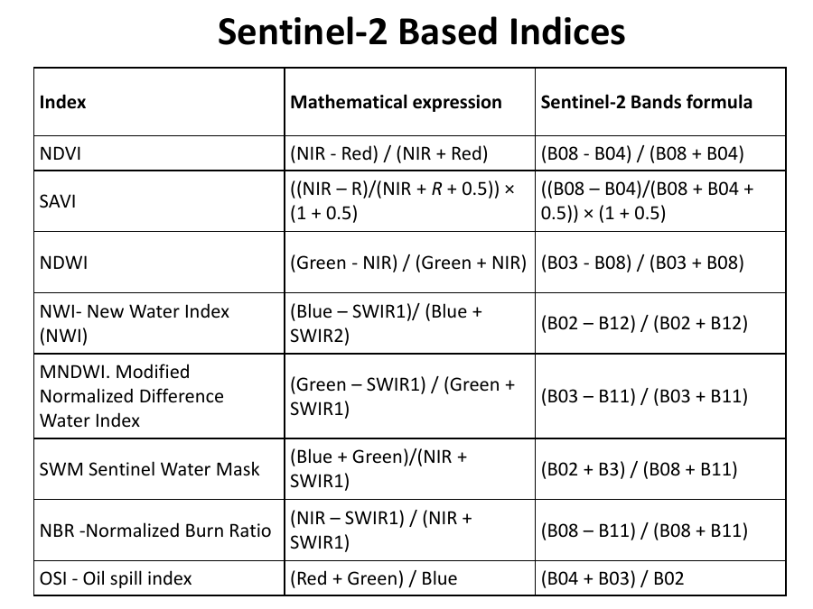
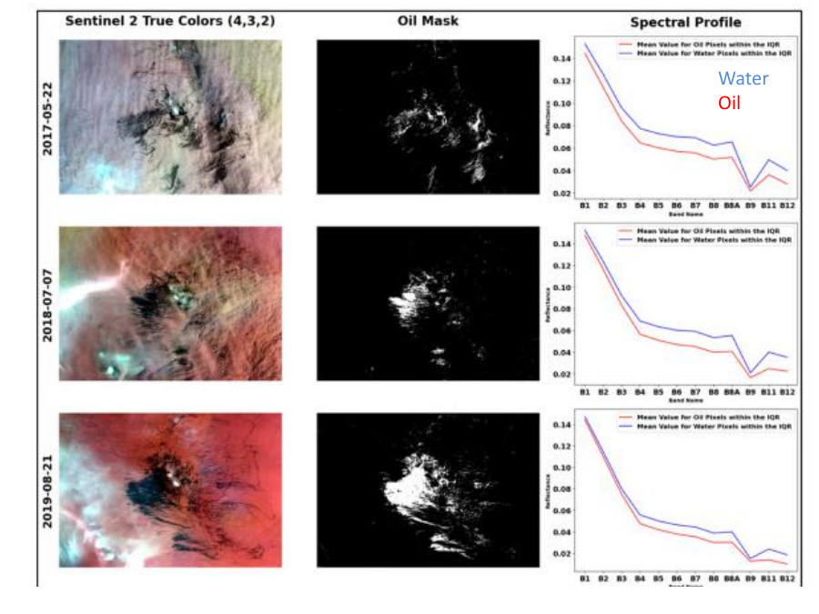

# Lecture 8 — Water, Built-Up & Bare Soil Indices (+ VI Summary)

> **Big idea in one line:** Just like NDVI highlights vegetation, we can build "normalized difference" indices for water, moisture, snow, burns and bare soil by choosing the right pair of bands. The recipe is always the same: **(BandA − BandB) / (BandA + BandB)**.

---

## 1. Summary of Vegetation Indices (recap)

Use VIs to assist in **image classification** and to:
- **Separate** vegetated from non-vegetated areas.
- **Distinguish** different types and densities of vegetation.
- Monitor **seasonal variations** in vigour.
- **Map** abundance and distribution of vigour.
- Monitor **health** of vegetation.
- Monitor/estimate **growth and productivity** of crops (seasonal/yearly fluctuations).

> **Important rule for comparing indices across time or sensors:** **Convert digital numbers (DN) to radiances BEFORE calculating ratios** — this accounts for differences in sensor calibration. (Links back to Lecture 4 calibration.)

---

## 2. The "Normalized Difference" master formula

Almost every index in this lecture follows one pattern:
```
Index = (Band A − Band B) / (Band A + Band B)
```
The result is **dimensionless** and ranges from **−1 to +1**. Change *which* two bands you pick → change *what* you detect.

> **Memory tip:** **"Difference over sum"** is the universal recipe. NDVI uses NIR & Red; the water/snow/burn indices just swap in different bands.

---

## 3. NDWI — Normalized Difference Water Index

- **Dimensionless**, values **−1 to +1**.
- Indicates the **presence of water** in the **top layer of soil** (when soil is bare).

There are **two common formulas** (know both):
```
NDWI = (NIR − SWIR) / (NIR + SWIR)      ← soil/vegetation water content
NDWI = (NIR − GREEN) / (NIR + GREEN)    ← open water bodies (McFeeters)
```
- **SWIR** = Short-Wave Infrared.
- **Time-series** analysis of multi-temporal NDWI tracks changes in water over time.



> **Memory tip:** **NDWI = "water version of NDVI."** Water is bright where vegetation is dark. Two flavours: **NIR-SWIR** (moisture in soil/plants) and **NIR-GREEN** (open water).

---

## 4. NDMI — Normalized Difference Moisture Index

Measures **moisture/humidity** content:
```
Landsat 8:  NDMI = (B5 − B6) / (B5 + B6)  = (NIR − SWIR) / (NIR + SWIR)
MODIS:      NDMI = (B2 − B6) / (B2 + B6)

Generic:    Humidity = (NIR − MIR) / (NIR + MIR)
```
- **MIR** = Middle Infrared.

---

## 5. NDSI — Normalized Difference Snow Index

Detects **snow**:
```
NDSI = (GREEN − IR) / (GREEN + IR)
```
Snow is bright in green/visible and dark in shortwave IR, so the difference flags snow.

Some Landsat-8 band-ratio variants are also listed:
```
LS-8 = (B7 − B6/B2) / (B7 + B6/B2)
LS-8 = B4 / B6
LS-8 = B4 × B6 / B5
```

> **Memory tip — quick band pairings:**
> - **Water (open):** NIR vs Green
> - **Water/Moisture (NDWI/NDMI):** NIR vs SWIR
> - **Snow (NDSI):** Green vs IR

---

## 6. Bare Soil Indices

### Bare Soil Index (BSI) — Sentinel-2
```
BSI = ((SWIR1 + RED) − (NIR + BLUE)) / ((SWIR1 + RED) + (NIR + BLUE))
```

### Modified Bare Soil Index (MBI) — Landsat-8
```
MBI = (SWIR1 − SWIR2 − NIR) / (SWIR1 + SWIR2 + NIR) + 0.5
```

> **Memory tip:** **BSI mixes 4 bands** (SWIR1, Red, NIR, Blue). Bare soil is high in SWIR/Red and low in NIR/Blue, so the numerator goes positive over bare ground.

---

## 7. Sentinel-2 Based Indices (reference table)

| Index | Mathematical expression | Sentinel-2 bands |
|-------|-------------------------|------------------|
| **NDVI** | (NIR − Red)/(NIR + Red) | (B08 − B04)/(B08 + B04) |
| **SAVI** | ((NIR − R)/(NIR + R + 0.5)) × (1 + 0.5) | ((B08 − B04)/(B08 + B04 + 0.5)) × 1.5 |
| **NDWI** | (Green − NIR)/(Green + NIR) | (B03 − B08)/(B03 + B08) |
| **NWI** (New Water Index) | (Blue − SWIR1)/(Blue + SWIR2) | (B02 − B12)/(B02 + B12) |
| **MNDWI** (Modified NDWI) | (Green − SWIR1)/(Green + SWIR1) | (B03 − B11)/(B03 + B11) |
| **SWM** (Sentinel Water Mask) | (Blue + Green)/(NIR + SWIR1) | (B02 + B03)/(B08 + B11) |
| **NBR** (Normalized Burn Ratio) | (NIR − SWIR1)/(NIR + SWIR1) | (B08 − B11)/(B08 + B11) |
| **OSI** (Oil Spill Index) | (Red + Green)/Blue | (B04 + B03)/B02 |

> **Memory tip — what each is for:**
> - **MNDWI / NWI / SWM** → water mapping
> - **NBR** → burned areas (fire scars)
> - **OSI** → oil spills on water
> - **SAVI** → vegetation in low-cover areas



> **Note on Sentinel-2 band numbers worth remembering:** **B02 = Blue, B03 = Green, B04 = Red, B08 = NIR, B11 = SWIR1, B12 = SWIR2.**

---

## ⭐ Quick Revision Cheat-Sheet (Lecture 8)

- **Master recipe:** every "normalized difference" index = **(A − B)/(A + B)**, range −1 to +1.
- **Compare across sensors/time → convert DN to radiance first.**
- **NDWI:** NIR-SWIR (moisture) or NIR-Green (open water).
- **NDMI:** NIR-SWIR moisture; Landsat 8 = (B5−B6)/(B5+B6).
- **NDSI (snow):** (Green − IR)/(Green + IR).
- **BSI (bare soil):** uses SWIR1, Red, NIR, Blue.
- **NBR** = burn scars (NIR-SWIR1); **OSI** = oil spills; **MNDWI** = water.
- **Sentinel-2 bands:** Blue B02, Green B03, Red B04, NIR B08, SWIR1 B11, SWIR2 B12.
