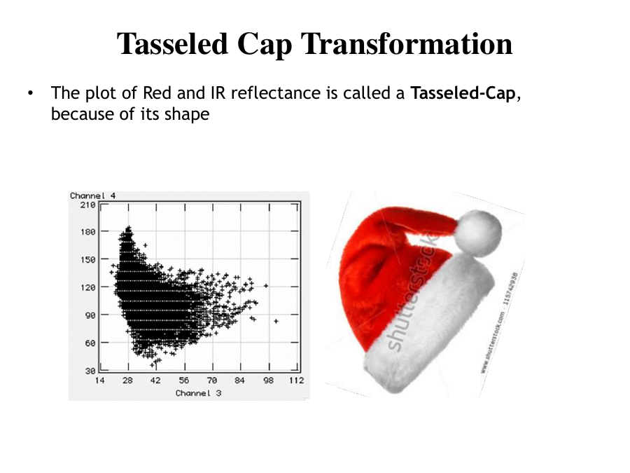
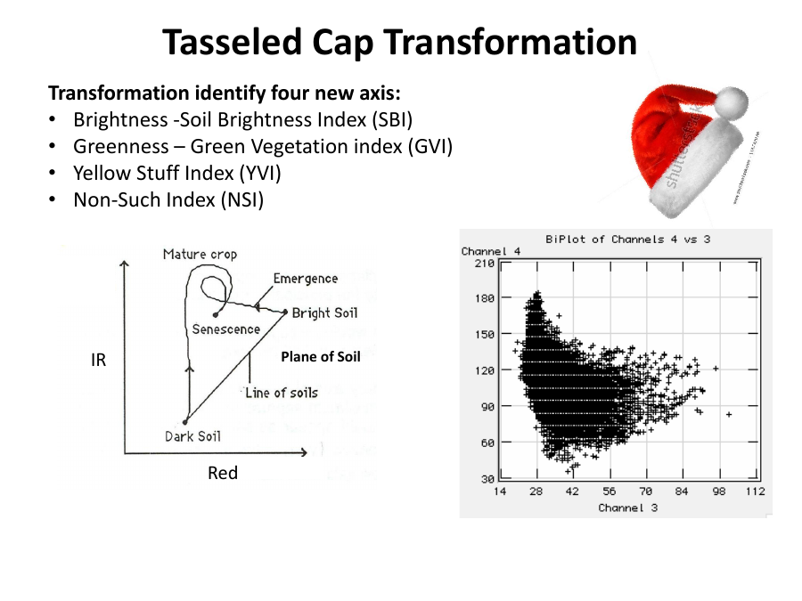
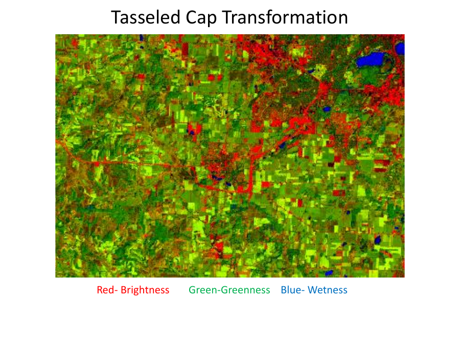

# Lecture 9 — Kauth-Thomas Tasseled Cap Transformation (TCT)

> **Big idea in one line:** TCT rotates the spectral bands into a few new, physically meaningful axes — **Brightness, Greenness, and Wetness** — that track exactly how a crop field looks as it grows from bare soil to mature plants to harvest.

---

## 1. Why we need band transformations

- Sensors collect data in **more bands than any single task needs**, because each task is best served by a **different set of bands**.
- So we need a way to **determine the best set of bands** for a given job.

**Two kinds of objectives:**
1. **Image enhancement** — make scene characteristics more obvious to a **human observer**.
2. **Optimal bands** — for use with a **pattern recognition / classification algorithm**.

---

## 2. What is the Tasseled Cap Transformation?

Developed by **Kauth and Thomas (1976)** (and Crist & Kauth, 1986).

- Originally developed for **Landsat MSS** data to represent the **physical properties of growing crops** in the US Midwest.
- Provides a way to **optimize data viewing for vegetation studies**.
- **Sensor dependent** (coefficients differ per sensor).
- Useful to **enhance human perception** for interpreting pixels.
- ⚠️ **It does NOT enhance separability** (it's for visualization/interpretation, not for making classes more separable).

### Why "Tasseled Cap"?
When you plot **Red vs IR reflectance** for a growing crop over the season, the shape of the data cloud looks like a **tasselled cap** (a cap with a tassel). Hence the name.

- In the Red-IR plot, the **perpendicular distance to the soil line** indicates **plant development**.
- The **farther** the perpendicular distance from the soil line, the **more vegetation** is present.



> **Memory tip:** TCT = "rotate the data so the crop-growth story lines up along clean axes." The cap shape comes from how crops move through the season.

---

## 3. The Four New Axes (the heart of TCT)

TCT identifies **four new axes**, each orthogonal (perpendicular) to the others:

| Axis | Name | Index | Meaning |
|------|------|-------|---------|
| **1** | **Brightness** | SBI (Soil Brightness Index) | Soil reflectance / non-vegetated areas (pre-emergence) |
| **2** | **Greenness** | GVI (Green Vegetation Index) | Vegetation amount (signature moves up as crops grow) |
| **3** | **Yellowness** | YVI (Yellow Stuff Index) | As crops senesce, signature increases in the yellow direction |
| **4** | **Wetness** | NSI (Non-Such Index) | Related to soil moisture |

> **Memory tip — "B-G-Y-W" axes:** **B**rightness, **G**reenness, **Y**ellowness, **W**etness. Or remember the indices **"SBI, GVI, YVI, NSI."**
> - Axis 1 = soil, Axis 2 = green (grows up as plants grow), Axis 3 = yellow (ageing crops), Axis 4 = wet (moisture).



---

## 4. The crop-growth sequence (what the axes capture)

Through a growing season, a field moves through this sequence:

1. **Bare fields / newly planted** → **high brightness, low greenness** (spring).
2. **Plant growth** → **increasing greenness, decreasing brightness** (early summer).
3. **Maturity** → maximum **greenness** (late summer).
4. **Senescence / harvest** → bare field/stubble: **decreasing greenness, increasing brightness** (fall).

> **Memory tip:** The field rides **UP the greenness axis** as crops grow, then comes **back DOWN to brightness** at harvest. That round trip is the "cap."

---

## 5. How TCT is computed

Multiply each pixel's original brightness values by the corresponding **TC coefficients**:
```
TC = WTC · DN
```
- **WTC** = the matrix of tasseled cap coefficients (weights).
- **DN** = the original pixel digital numbers.
- **TCT has a FIXED WTC and is INDEPENDENT of the scene** (unlike PCA, which is scene-specific — compare with Lecture 10).

> **Memory tip:** **TCT = fixed coefficients (same everywhere for a sensor); PCA = scene-specific.** This is a common exam contrast.

---

## 6. Brightness – Greenness – Wetness in detail

### MSS (only Brightness + Greenness)
The original MSS transform extracted only **brightness and greenness**, because MSS focused on the **visible and near-infrared** only:
```
B = 0.332·MSS1 + 0.603·MSS2 + 0.675·MSS3 + 0.262·MSS4
G = −0.283·MSS1 − 0.660·MSS2 + 0.577·MSS3 + 0.388·MSS4
```

### What each component image shows
- **Brightness** — direction of **soil reflectance** variation → **urbanized and bare-soil** areas stand out.
- **Greenness** — direction of **vegetation reflectance** variation → **more biomass = brighter** pixel.
- **Wetness** — info about **soil & plant moisture** → **water bodies very bright**; more moisture = brighter response.

### TM (added Wetness)
Coefficients were recalculated for **Thematic Mapper (TM)** to use its **higher spectral resolution**, adding **Wetness** thanks to the **MIR (middle-infrared) channels** that are sensitive to moisture:
```
B = 0.2909·TM1 + 0.2493·TM2 + 0.4806·TM3 + 0.5568·TM4 + 0.4438·TM5 + 0.1706·TM7
G = −0.2728·TM1 − 0.2174·TM2 − 0.55508·TM3 + 0.7221·TM4 + 0.0733·TM5 − 0.1648·TM7
W = 0.1446·TM1 + 0.1761·TM2 + 0.3322·TM3 + 0.3396·TM4 − 0.6210·TM5 − 0.4186·TM7
```

> **Memory tip:** **MSS = Brightness + Greenness only. TM (with MIR bands) = adds Wetness.** Wetness needs the middle-infrared channels.

A common **false-colour TCT composite** assigns:
- **Red → Brightness**, **Green → Greenness**, **Blue → Wetness**.



---

## ⭐ Quick Revision Cheat-Sheet (Lecture 9)

- **TCT (Kauth-Thomas, 1976):** rotates bands into physically meaningful axes for **vegetation/crop** studies. Sensor-dependent. **Does NOT improve separability.**
- **Name origin:** Red vs IR plot of a growing crop looks like a **tasselled cap**; distance from soil line = plant development.
- **4 axes "B-G-Y-W":** **Brightness (SBI), Greenness (GVI), Yellowness (YVI), Wetness (NSI)** — all orthogonal.
- **Crop sequence:** bare (bright) → growth (greener, less bright) → maturity (max green) → harvest (bright again).
- **Computed as `TC = WTC · DN`; WTC is FIXED and scene-INDEPENDENT** (contrast with PCA).
- **MSS = Brightness + Greenness only; TM adds Wetness** (because of MIR moisture-sensitive bands).
- **Composite:** Red = Brightness, Green = Greenness, Blue = Wetness.
